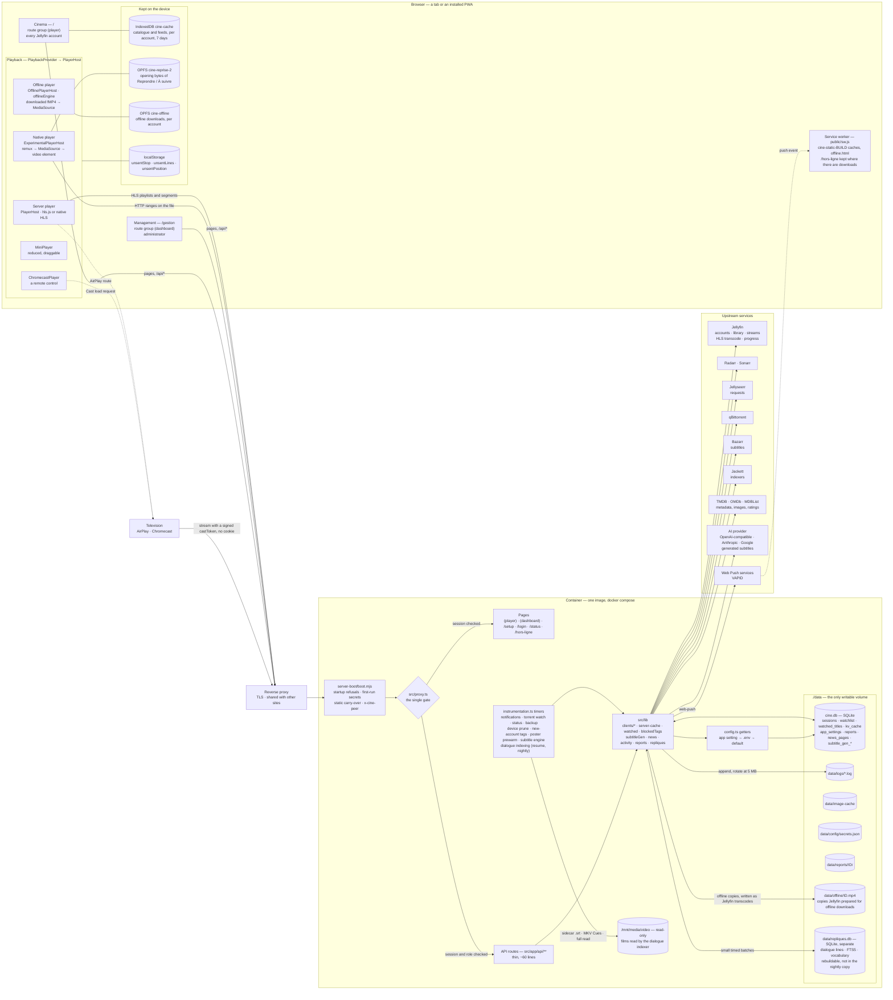
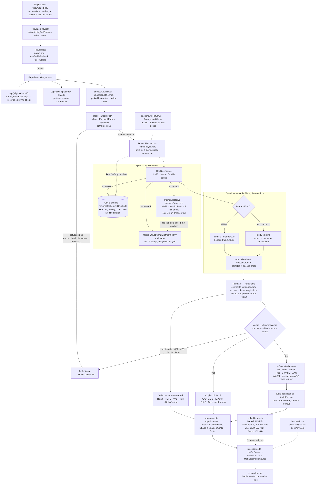
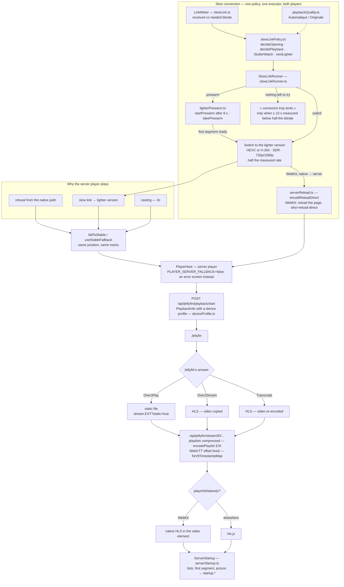
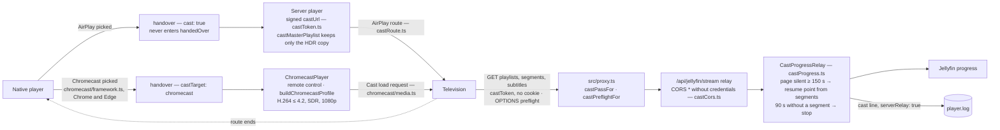
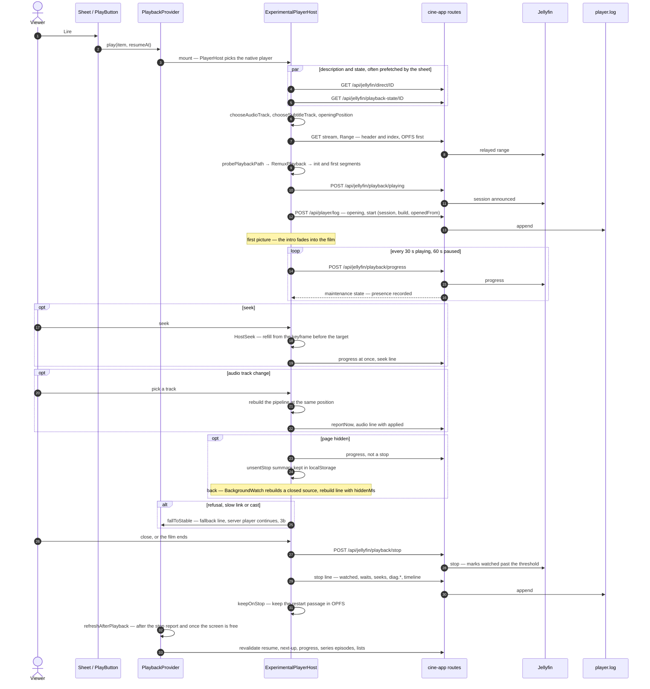
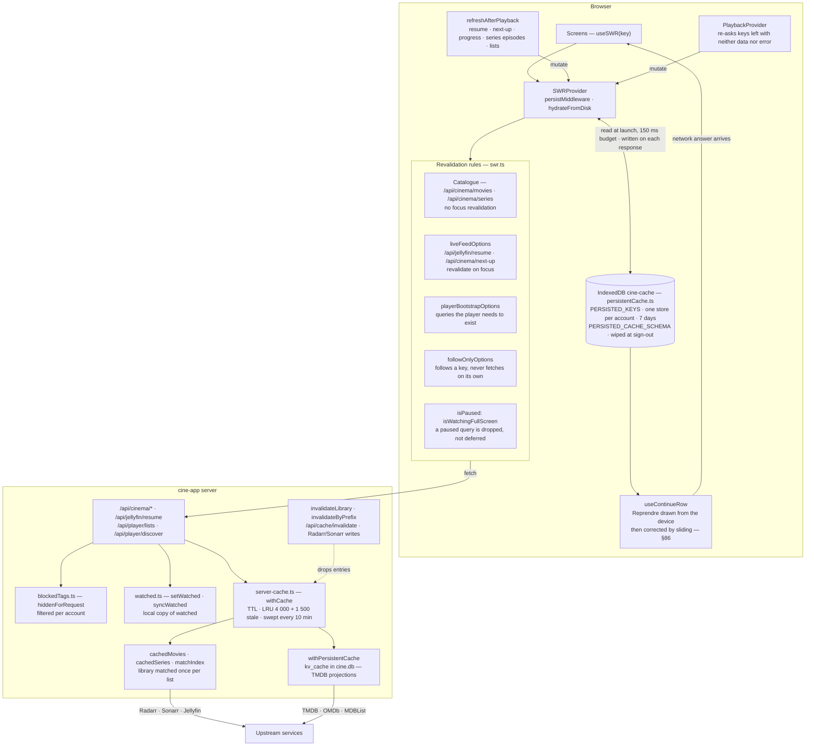
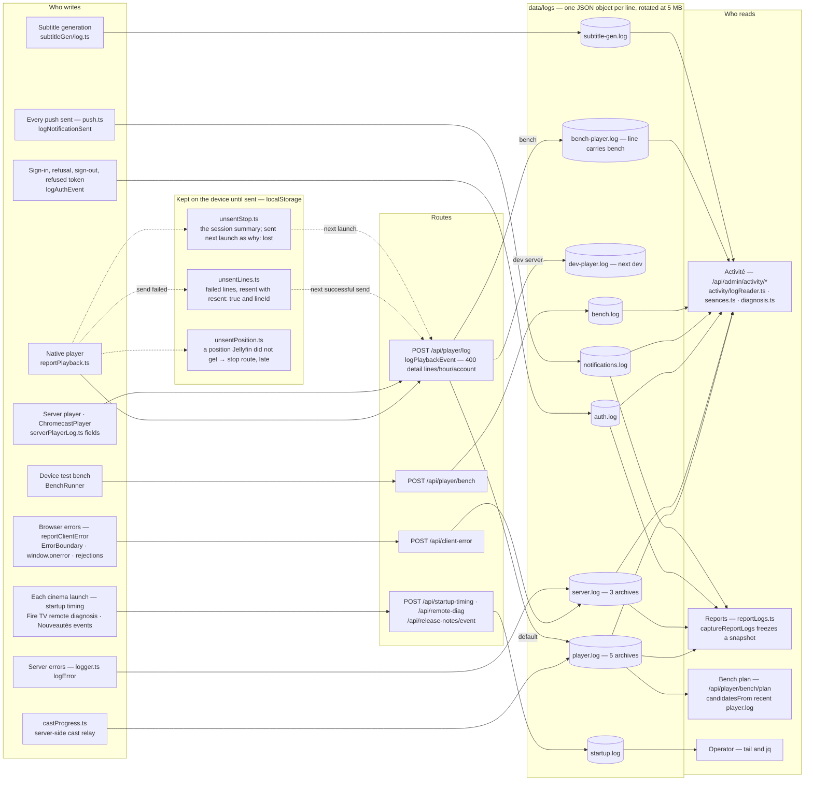
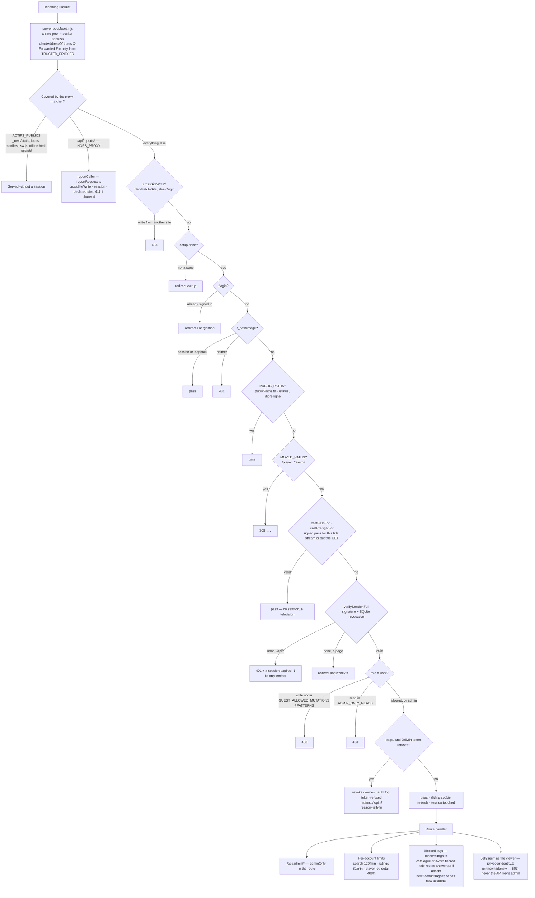

# The native player — technical reference

This document opens with a map of the whole application — both interfaces, the server, the
player, the caches, the logs and the gate — and then becomes the native player's reference.

**Vue en une page, zoomable : [ARCHITECTURE.svg](ARCHITECTURE.svg)** — the eight zones below on one
vector drawing, with a legend; on a phone, open it, then tap *Raw* to zoom freely.

## Application map

The whole application on seven diagrams, from the widest to the finest. Every box names the file,
route or function that carries it, so the map doubles as an index into the code; the sections
below it, and [`DECISIONS.md`](DECISIONS.md), hold the reasons.

1. [The system](#1-the-system) — browser, reverse proxy, container, upstream services
2. [The two interfaces](#2-the-two-interfaces) — Cinema and Management, roles, first launch
3. [The player](#3-the-player)
   - [3a. Choosing a path, and the native pipeline](#3a-choosing-a-path-and-the-native-pipeline)
   - [3b. The server player and the slow connection](#3b-the-server-player-and-the-slow-connection)
   - [3c. Casting to a television](#3c-casting-to-a-television)
4. [The life of one playback](#4-the-life-of-one-playback) — sequence, from *Lire* to the summary
5. [Data flow and caches](#5-data-flow-and-caches) — SWR, the device cache, the server cache
6. [Logs and observability](#6-logs-and-observability) — which line goes where, who reads it
7. [Requests and security](#7-requests-and-security) — `src/proxy.ts`, cast passes, blocked tags

### 1. The system



Everything a viewer sees goes through `src/proxy.ts`; nothing in the browser talks to an upstream
service directly, and only a television fetches without a session cookie. Configuration and
secrets live in `data/` beside the database ([DECISIONS §48](DECISIONS.md)), so a fresh install
needs no `.env`.

**Dialogue search** ([DECISIONS §88](DECISIONS.md), `src/lib/repliques/`) is the one part of the
server that reads media files itself. When an administrator turns it on, a background pass reads
each library film's text subtitles — a sidecar file first, otherwise the MKV's text track through
its Cues (one 4 KiB read per line, `mkvText.ts`, reusing the player's Matroska parser read-only),
otherwise the whole file streamed — and writes them to `data/repliques.db`, a separate SQLite file
with an FTS5 index on the folded text. Every file read passes a gate that stops for a pause and
waits while anyone is watching (Jellyfin sessions, the stream relay, the playback beat). The
cinema search queries it through `/api/repliques`, after and apart from the title search.

**Offline downloads** ([DECISIONS §109](DECISIONS.md), `src/lib/offline/`, beta) do not read media
files: Jellyfin transcodes a lighter version through its API (`/Videos/{id}/stream.mp4`, fragmented
MP4), the server writes it to `data/offline/` as it arrives (`offline_jobs` / `offline_requests`), and
the device fetches it by ranges into OPFS (`cine-offline/<account>/<id>/`) and plays it with a player
of its own. `/hors-ligne` is a public page the service worker keeps per build, so the app opens on the
downloads without a network. Description, in French:
[docs/telechargement-hors-ligne.md](docs/telechargement-hors-ligne.md).

### 2. The two interfaces

```mermaid
flowchart TB
    LOGIN["/login<br/>Jellyfin account — /api/auth/jellyfin<br/>local administrator — /api/auth/login"]
    SETUP["/setup — first-launch assistant<br/>welcome · admin · jellyfin · tmdb · library<br/>extras · deployment · finish"]
    SETUP -->|"setup flag set"| LOGIN
    LOGIN -->|"Jellyfin session · admin or user"| SHELL
    LOGIN -->|"local session, no Jellyfin identity"| OV

    subgraph CINEMA["Cinema — / — PlayerShell; address state in the hash (cinemaRoute.ts)"]
        direction TB
        SHELL["PlayerShell<br/>PlayerRail on a computer · PlayerBottomBar on a phone<br/>PLAYER_NAV: home · search · list · account"]
        subgraph HOME["Home — tab=movies | series"]
            DESK["CinemaClient — computer<br/>CinemaHero follows focus · arrow-key grid"]
            MOB["CinemaMobileClient — phone<br/>CinemaMobileHero · flick rows"]
            ROWS["Rows<br/>CinemaRow · CinemaTop10Row · CinemaDiscoveryRow<br/>CinemaSeriesRow · Reprendre / À suivre"]
            GRID["Full grid — browse=genre or *<br/>CinemaBrowseSheet"]
        end
        subgraph SHEETS["Sheets — useSheetMorph, cinemaClose"]
            MOVIE["Film — film=ID<br/>CinemaMovieDetail · CinemaMobileDetail"]
            SERIES["Series — serie=ID<br/>CinemaSeriesDetail → CinemaEpisodeBrowser"]
            TMDB["Not in the library — discover=ID<br/>PlayerDiscoverSheet → request"]
            PERSON["Person — person=ID<br/>PlayerPersonSheet"]
        end
        SEARCH["Search — search=1<br/>PlayerSearchPanel"]
        LIST["Ma liste — list=1<br/>PlayerListPanel"]
        subgraph ACCOUNT["Account — account=1 — PlayerAccountPanel"]
            PREFS["Preferences<br/>interface language · playback languages"]
            ACC["Account<br/>password · devices and sessions"]
            NOTIF["Notifications<br/>PushToggle · per-account choices"]
            DISP["Display<br/>home layout · guided scroll"]
            HELP["Help<br/>Nouveautés · onboarding · service status<br/>HDR FAQ · storage · report a problem"]
            subgraph ADMIN["Administration — admin only"]
                ACT["Activité — activity=…<br/>overview · compte: · seance: · journaux · signalement: · nouveautes"]
                MAINT["Maintenance<br/>/api/maintenance"]
                LAB["Lab<br/>device test bench · animations=AnimationLab"]
                TOG["Management →"]
            end
        end
        NEWS["Nouveautés — news=…<br/>PlayerNewsPanel · NewsGate window at launch"]
        REPORT["Report — report=…<br/>PlayerReportPanel · ReportWizard"]
    end

    subgraph MGMT["Management — /gestion — layout: Sidebar / MobileNav"]
        direction TB
        BRIDGE["NavBridge<br/>back to the cinema · account preferences"]
        subgraph INFRA["Infrastructure"]
            OV["/gestion — overview"]
            RAD["/radarr · /radarr/ID — films"]
            SON["/sonarr · /sonarr/ID — series"]
            QBP["/qbittorrent — downloads"]
            CAL["/calendar"]
            STA["/stats"]
            IMP["/timeline — imports"]
            LCK["/controle — library check<br/>read-only · §90"]
            subgraph SVC["Services"]
                SV1["/bazarr · /jackett · /jellyfin · /jellyseerr"]
                HEALTH["/health — service checks"]
            end
        end
        subgraph CONF["Configuration"]
            C1["/parametres — connections"]
            C2["/parametres/lecture — playback"]
            C3["/parametres/sous-titres — generated subtitles"]
            C4["/parametres/comptes — new accounts"]
            C5["/parametres/administration — administrator"]
            C6["/parametres/deploiement — deployment"]
        end
    end

    SHELL --> HOME
    SHELL --> SEARCH
    SHELL --> LIST
    SHELL --> ACCOUNT
    ROWS -->|"tap a poster"| SHEETS
    SEARCH --> SHEETS
    LIST --> SHEETS
    MOVIE -->|"cast list"| PERSON
    PERSON --> TMDB
    HELP --> NEWS
    HELP --> REPORT
    TOG -->|"link /gestion"| OV
    BRIDGE -->|"link /"| SHELL
    MOVIE -->|"Lire"| PLAYER["Player — section 3"]
    SERIES -->|"Lire"| PLAYER
    ROWS -->|"resume"| PLAYER
```



Two roles, `admin` and `user`. Hiding the administration group and the management link is
presentation only: a `user` who types `/gestion` gets pages whose reads answer 403
(`ADMIN_ONLY_READS`, diagram 7). Every cinema screen is a field of the address hash, so Back steps
out one screen at a time; desktop and phone are two layouts sharing one function per decision
([DECISIONS §31, §52, §74, §81](DECISIONS.md), [The sheet lifecycle in CLAUDE.md](CLAUDE.md)).

**What the cinema shows, and where its truth comes from** ([DECISIONS §47, §89](DECISIONS.md)):
storage and episode numbering from the disk (Jellyfin), identity from Radarr/Sonarr by folder,
episode names from the episode Sonarr attached to the file — or Jellyfin's, for a series the
administrator trusts (`episode_text_trust`) — and titles Radarr/Sonarr do not track from Jellyfin
alone. Radarr and Sonarr are **optional**: not configured, `cachedMovies` / `cachedSeries` answer an
empty list without any request and everything Jellyfin has becomes "Jellyfin only"; configured but
down, nothing becomes "Jellyfin only" (eight hundred films would change identifier during an
outage). **The library check** (`/controle`, `src/lib/libraryCheck/`, [§90](DECISIONS.md)) lists
where these sources disagree — identity, episode numbering (with TMDB as an independent arbiter),
files Radarr probably misfiled, Jellyfin-only titles, hard-linked double filings — in a background
pass stored in `library_check`; it writes nowhere else, and only suggests gestures.

### 3. The player

#### 3a. Choosing a path, and the native pipeline



No pixel and no copied audio sample passes through JavaScript: the remuxer only rewrites the
packaging. A refusal is always a named string, which the activity page groups by. Details:
[Path selection](#path-selection), [The remux pipeline](#the-remux-pipeline),
[MSE delivery](#mse-delivery), [Audio](#audio), [The lead reserve](#the-lead-reserve-in-memory),
[DECISIONS §3, §4, §28, §62, §66](DECISIONS.md).

#### 3b. The server player and the slow connection



The server player is a safety net, not a second product: it plays what the native path refuses,
what a slow link cannot carry and what goes to a television. Jellyfin decides between DirectPlay,
DirectStream and Transcode; every byte still goes through the cine-app relay. Details:
[User-facing messages](#user-facing-messages), [Slow connection](#slow-connection),
[DECISIONS §4, §23, §76–§79](DECISIONS.md).

#### 3c. Casting to a television



A MediaSource stream cannot leave the tab, so a television always gets the server's stream; the
page becomes a remote control (Chromecast) or hands its element's route over (AirPlay). The server
keeps the resume point when the page goes quiet. Details: [Path selection](#path-selection)
(casting paragraphs), [DECISIONS §64](DECISIONS.md).

### 4. The life of one playback



One session id joins every line of a playback; a rebuild rewrites `start` under the same id. A
page killed by iOS sends its summary at the next launch (`why: "lost"`), and a position Jellyfin
never received leaves through `unsentPosition`. Details: [Playback reporting](#playback-reporting),
[Seek lifecycle](#seek-lifecycle), [The playback log](#the-playback-log),
[DECISIONS §1, §7, §24, §36, §84](DECISIONS.md), and `docs/cycle-de-vie-lecteur.md`.

### 5. Data flow and caches



The cinema opens on what the device kept, then the network corrects it; the catalogue is frozen on
purpose (it changes daily), only the resume and next-up feeds follow focus. While a film fills the
screen SWR is paused, which is why the player's own queries carry `playerBootstrapOptions` and why
closing the player revalidates explicitly. Details: CLAUDE.md "Known pitfalls",
[DECISIONS §7, §27, §29, §51, §55, §86](DECISIONS.md).

### 6. Logs and observability



Player line kinds (`PlayerEventKind`): `opening`, `start`, `fallback`, `network`, `rebuild`,
`error`, `seek`, `stall`, `audio`, `pause`, `cast`, `reserve`, `subtitle-gen`, `fluidite`, `stop`.
Every native and server line carries `session` and `build`; incident lines carry `timeline`, and
`stall`/`stop` carry `diag.*`. Offline downloads write one line per step (requested, started, ready,
failed, fetched, cancelled, removed, expired, deleted) to `server.log` under `scope: "offline"`, beside
`scope: "download"` for the original file; the Activity panel reads them there. Bench and dev lines never reach `player.log`, so they never count as
a viewer's. Details: [Diagnostics](#diagnostics), [The playback log](#the-playback-log),
[Device test bench](#device-test-bench), [DECISIONS §42, §82](DECISIONS.md).

### 7. Requests and security



The interface never enforces a permission: `src/proxy.ts` refuses whatever a `user` should not do,
and a television is the only caller allowed in without a session, for one title and only for the
stream and its subtitles. Details: CLAUDE.md "Architecture", [DECISIONS §16, §34, §54, §56, §57, §64](DECISIONS.md).

---

Reference documentation for the playback engine that reads library files **without asking the
server for anything**: no transcoding, no stream negotiation, no HLS. The browser fetches the
file — Matroska or MP4 — over HTTP byte ranges and everything else happens in the tab.

Source: `src/lib/webcodecs/`, plus the routes and hooks listed in the [file map](#file-map).

It still opens a **Jellyfin session**, for the one thing the server has to know: what is being
watched and how far — see [Playback reporting](#playback-reporting).

## Contents

- [Application map](#application-map)
- [Scope and context](#scope-and-context)
- [Path selection](#path-selection)
- [The remux pipeline](#the-remux-pipeline)
  - [`byteSource` — HTTP range reads](#bytesource--http-range-reads)
  - [`ebml` / `matroska` — header and index](#ebml--matroska--header-and-index)
  - [`mp4Demux` — MP4 input](#mp4demux--mp4-input)
  - [`decodeOrder` — reconstructing decode times](#decodeorder--reconstructing-decode-times)
  - [`mp4Muxer` — writing the container](#mp4muxer--writing-the-container)
  - [`remuxer` — segmentation and delivery](#remuxer--segmentation-and-delivery)
  - [MSE delivery](#mse-delivery)
- [Audio](#audio)
- [Subtitles](#subtitles)
- [Black bars baked into the file](#black-bars-baked-into-the-file)
- [Track selection and account preferences](#track-selection-and-account-preferences)
- [Playback reporting](#playback-reporting)
- [User-facing messages](#user-facing-messages)
- [Diagnostics](#diagnostics)
- [Verification harness](#verification-harness)
- [Refactoring the player](#refactoring-the-player)
- [Known limitations](#known-limitations)
- [File map](#file-map)

---

## Scope and context

The Cinema interface is the application: `/` serves it, management lives at `/gestion`. The two
addresses the player used to have — `/cinema`, then `/player` — answer a permanent redirect to `/`.

**Two players coexist.** The server-side one (Jellyfin/HLS) remains, and takes over when this one
declines: a file it cannot remux, a browser that refuses the codec, or a link too slow for the
file (the lighter version). There is no per-account opt-out to it any more (removed 13/10/2026):
the native player is always tried first. `PlayerHost` owns that switch, and `fallToStable` hands
over rather than closing.

A third player, apart from both, plays **offline downloads** (`OfflinePlayerHost`,
`src/lib/offline/offlineEngine.ts`, DECISIONS §109): the downloaded file is already fragmented MP4,
so its fragments go to MediaSource as they are and only the header is touched (`hev1` → `hvc1` for
Safari). It shares `PlayerControls` and the mini-player with the others and nothing else, so online
playback never depends on it. See [docs/telechargement-hors-ligne.md](docs/telechargement-hors-ligne.md).

The design goal is the cost model. A server transcode is expensive, starts slowly and degrades the
image; here the file leaves the disk as it is. That is why in-app playback (`PLAYER_ENABLED`) is on
by default: the ordinary path costs the server nothing beyond serving bytes.

**The safety net is optional.** `PLAYER_SERVER_FALLBACK=false` removes the server-side player from
the install: `PlayerHost` then mounts this one unconditionally, there is no lighter version for a
slow link (see [User-facing messages](#user-facing-messages)), and `fallToStable` stops handing over — it writes the reason to the log as an `error` and puts it on
screen. Giving up then means a plain playback error rather than a transcode. While the flag's
answer is still in flight it counts as "there is one": the only caller that can give up that early
is the path selector's refusal, and being wrong in that direction plays the film through the
server instead of showing an error, never the reverse.

---

## Path selection

`pathSelector.ts` decides whether the native path can carry the file and **always states its
reasoning**. There is no silent downgrade — a player that drops a level without saying so looks
like a player that works.

| Outcome | Mechanism | When |
|---|---|---|
| **Remux → native `<video>`** | Matroska or MP4 repackaged into fragmented MP4 in the browser, fed to a real `<video>` through MediaSource | The normal path |
| **Refusal → server player** | An error naming the codec or the reason (`Aucun chemin de lecture disponible pour ce fichier. remux : …`), which the host hands to the server player (`fallToStable`) — or shows as a playback error when `PLAYER_SERVER_FALLBACK=false` | The native path cannot carry it |

There used to be a second local path between the two, **WebCodecs → canvas** (software decode frame
by frame, canvas render, hand-held audio clock, HDR→SDR in a shader). It was removed on 2026-09-24:
ten sessions in three weeks, all of them tests, every one ending in the same server fallback a
second later, and every reason that once led there now handled by the native path. What it taught
the project, and where to find it: [`docs/lecteur-canvas.md`](docs/lecteur-canvas.md), tag
`lecteur-canvas-final-2026-09-24`.

**Resuming a few seconds earlier** (`resumeRewind.ts`, native player): opening a title this
device has not played for ten minutes — the next day, or after the TV — starts 5 s before the resume
point, and so does pressing play after a pause of ten minutes or more. Never for a rebuild or a
handover between players, which follow the last picture by seconds, nor within 30 s of either end.
"Played recently" is kept per device in local storage (50 titles); a lost value means a 5 s rewind,
never a missed scene.

**The next episode is prepared during the credits** (`nextEpisodeWarmup.ts`): a minute before the
end, its description, its resume state and its file header and index are fetched and left where
the opening looks for them, so it starts without the round trips to a distant server. No picture is
read, and the source closes without taking the current film's handover slot (`close(false)`).

**Casting goes through the server player** (AirPlay, Chromecast): a MediaSource stream cannot be
sent to a television, so the host hands over with `cast: true` and takes the film back when the
route ends. That handover belongs to the playback that asked for it — the takeover carries its
session (`castingNow`) — and never enters `handedOver`, the list of files the native path could not
carry, which lasts until the app reloads: closing the player mid-cast used to send every later
launch of that title to the server player. In the playlist a television receives, an HDR file keeps
only its copied variant (`castMasterPlaylist`): Jellyfin adds two SDR re-encodes declared at the
same bitrate, and after a seek a television gave up on the slow restart of the copy, switched to a
4K re-encode sharing the same Jellyfin job, and asked for the same segment forever. The cost: a
television without HDR finds no SDR version of such a file. Closing the player mid-cast stops the television too:
removing the element does not end an AirPlay session, and the television used to play on while
the next launch resumed from the moment of the close. Jellyfin stamps every WebVTT segment with
`X-TIMESTAMP-MAP=MPEGTS:900000` — the ten-second offset of MPEG-TS segments — while our segments
are fMP4 with the file's own timestamps (`-copyts -start_at_zero`); the relay rewrites it to
`MPEGTS:0` (`fixVttTimestampMap`), or an Apple TV shows each subtitle ten seconds late. The phone
draws its own subtitles and never showed the offset. **Choosing subtitles from the phone does not
reach the television yet**: the phone's menu drives its own `<track>` elements, the television
reads the stream's subtitle renditions — pick them on the television meanwhile. Playlists (`.m3u8`)
leave the relay compressed (brotli, else gzip, by `Accept-Encoding` — `encodePlaylist`, DECISIONS §76):
Jellyfin repeats the whole request on every segment line, and an episode's playlist was 954 KB in clear.

**A Chromecast is driven, not fed** (DECISIONS §64). On Chrome and Edge (desktop, Android) the
native player offers a Chromecast button, marked beta — every account by default, administrators
only when `CHROMECAST_FOR_EVERYONE` is off. Google's sender kit is loaded on demand only there
(`src/lib/chromecast/framework.ts`). Once a receiver is picked in Chrome's list, the host hands over
with `cast: true, castTarget: "chromecast"`, and `PlayerHost` mounts `ChromecastPlayer` instead of
the server player: a remote control. The receiver fetches the signed `castUrl` itself; the stream is
negotiated with a cautious profile of its own (`buildChromecastProfile`: H.264 ≤ 4.2, 8-bit SDR,
1080p, AAC/AC-3/E-AC3 copied, text subtitles side-loaded as WebVTT, image subtitles burned in) —
the sender cannot tell the receiver's model. The stream and subtitle routes answer CORS (`*`, no
credentials) only to a request carrying a valid cast pass, `OPTIONS` preflight included
(`castCors.ts`); a page with its cookie keeps exactly its former headers. An audio change
renegotiates at the same position; a text subtitle is switched on the receiver without a reload.
The receiver application is Google's Default Media Receiver unless `CAST_RECEIVER_APP_ID` names
one an install registered itself.

**When the page goes quiet, the server keeps the resume point** — Chromecast and AirPlay alike
(`castProgress.ts`). Each HLS segment served to a cast pass carries its position (`runtimeTicks`,
written by Jellyfin); minus 30 s of receiver read-ahead, it is saved for that account
(`saveAsAdmin`) when the page has sent nothing for that title in the last 150 s (a paused page
beats only every 60–70 s), at most every 30 s; after 90 s without a segment, the stop is saved at the
last position and Jellyfin applies its watched threshold. Only for a request **without a session
cookie** — a television: the in-page server player loads the same signed address (`castUrl`) but
carries its cookie, and neither the relay nor CORS applies to it. A relayed entry is forgotten as
soon as the page reports again, so a page back to local playback is never overwritten.

**The native path is nearly free.** Matroska samples are already exactly what MP4 wants — length-prefixed
HEVC/AVC access units, AC-3/AAC frames as they are. Only the packaging differs. No pixel and no
audio sample passes through JavaScript: the browser decodes in hardware, composes the image itself,
drives its own audio clock, and **displays HDR natively**. Building one group of pictures takes
15–56 ms, against ~2 500 ms to download it.

**Every file goes through the same pipeline, MP4 included.** An MP4 used to be handed to
`<video>` untouched ("direct play"), on the reasoning that it is already the packaging the remuxer
produces. A good container does not mean everything in it plays natively: E-AC3/AC-3 in an MP4
played **silently** on Chrome and Firefox — no error, so no fallback —, a file with several audio
and subtitle tracks offered no track menu and ignored the account's language, embedded subtitles
never showed, and an HEVC the browser refused ended on an error screen instead of the server
player. The pipeline does nothing (or almost) when nothing is needed — copied samples, a new
wrapper — and everything it knows how to do when something is: track choice, audio re-encoding,
subtitles, seeking, the kept byte zone, rebuilds. See [`mp4Demux`](#mp4demux--mp4-input).

**The container is detected on the file's own bytes** (`mediaFile.ts`: a `ftyp`, `moov`, `mdat`,
`free`, `skip` or `wide` box at offset 0 means ISO BMFF), never on what the server calls it:
Jellyfin names a container after the ffmpeg demuxer that reads it, so an ordinary MP4 comes back
as `mov,mp4,m4a,3gp,3g2,mj2`.

**Path 3** in practice covers `.avi` files, in MPEG-4 ASP and MP3, which no browser decodes — and
MP4s this player does not read (fragmented), which are refused before any path is tried and go to
the server player.

---

## The remux pipeline

```
byteSource ──▶ ebml/matroska ──▶ sampleReader ──────▶ remuxer ──▶ mseSource ──▶ <video>
 HTTP ranges   │ header, tracks,    raw samples,        fragmented    MediaSource
               │ index              decode order        MP4
               └▶ mp4Demux ───────▶ Mp4SampleReader ─┘
                  moov → same        samples in
                  description        decode-time order
```

`mediaFile.ts` is the only door: `openMediaFile` reads the header of either container into the
same `MatroskaFile` description, and `createSampleReader` returns the matching reader. Every caller
— remuxer, TrueHD decoder, path selection — goes through it, so none of them knows
or cares which container it reads.

### `byteSource` — HTTP range reads

Range reads in **1 MiB chunks**, cached (64 chunks, ~64 MiB). Elements known to be small (Tracks,
Cues) are read in one request and addressed in memory by absolute offset, because parsing a
container field by field otherwise means one read per field — 129 000 of them for a film with
15 000 index points.

**Request shape dominates latency, not work.** Measured on a phone: 4.45 s to first frame, 2.6 s of
which is reading the first group of pictures, for 15–56 ms of remuxing. Four consequences, all of
them structural:

- **Six-chunk readahead**, never one. One chunk is a relay rather than a pipeline: every megabyte
  paid for its own round trip before its first byte. It is never speculative — the fill loop wants
  30 s of lead, about 20 MB. The one exception is the header of an opening at a resume position
  (`holdReadahead`): reading chunk 0 used to fetch chunks 1–6, the start of the film, which a resume
  never reads — 6 MiB per resume, and the only network traffic of a resume served from the device.
  The readahead comes back with the first read at the resume position.
- **Chunks of one read are requested together**, so a read straddling four chunks costs one round
  trip rather than four.
- **No round trip before the first range when the size is known.** The file description the host
  fetches (`sizeBytes`, from Jellyfin's media source) is passed down to `HttpByteSource.open`, which
  then skips its `HEAD` and starts both ends at once; with no size, the `HEAD` (then a
  `bytes=0-0` probe) comes back. A known size is checked against the first `Content-Range` that
  arrives — before the parser has read a byte — and replaced by it if they differ (a file replaced
  while its description sat in the session cache), with a trace line; cached chunks the new size
  makes wrong are dropped.
- **Both ends of the file are requested at open**, in parallel: the header at the start, the index
  wherever the Cues were written (the very end, for a streaming-oriented file). The parse result is
  **cached under the file name and its version** (`mediaHeaderKey`: the stream URL plus Jellyfin's
  MediaSource `ETag`), so reopening the same file — or rebuilding after the platform dropped the
  source — does not pay for it again, while a file replaced at the same path (same URL) is read
  afresh. Without a version, the URL alone, and a size corrected by the server forgets the entry.
- **`warm(offset)` on seek.** The index knows which cluster a seek lands in several milliseconds
  before the parser asks for its first byte. Without warming, every seek began with a single
  request on an idle link; on a dense 4K file, 4 MB must arrive before the first frame, for ~12 ms
  of remux work. Index back-off benefits from the same mechanism, since it targets a colder region
  still.

- **A seek abandons the reads it no longer needs.** Each chunk has its own abort controller.
  `MseSource.seek` calls `Remuxer.prepareSeek` at request time, before the seek is served; that
  aborts every in-flight chunk outside the target chunk and its readahead (`ByteSource.abandon`), then
  warms the target. On a distant server a seek used to wait up to 2 s for a read of the position just
  left, while that position's readahead held the link. Whoever was awaiting an aborted read gets
  `ReadAbandoned` and stands down without repair: the fill loop does not count a refused segment or
  start a recovery, and the audio transcoder does not rebuild its encoder. `seekTo` then resets
  everything, as after any seek.

- **Readahead is cut to two chunks until a seek has its first picture** (`seekSettled`, 8 s at most).
  Measured with `Server-Timing` and the per-seek network trace, from a distant server at 75 Mb/s: the
  server spent under 20 ms per range, and 11 to 21 MB crossed the link before the first picture of a
  seek that needed 4 to 6. The six readahead chunks were sharing the link with the one the parser
  was waiting for.
- **Every seek traces its network cost** at its first append: requests, bytes, throughput, first-byte
  delays, the slowest request, the server's own time (`Server-Timing: app;dur, jf;dur`, added by
  the stream relay), and the protocol of each request counted (`protocole h2`, or
  `protocoles h2 ×5, http/1.1 ×1`) — read from the latest Resource Timing entry for the stream URL
  (`nextHopProtocol`), since every range shares that URL. The browser's buffer stops at a few hundred
  entries; past it, the value read is that of the earliest requests, which for one origin is the
  same answer. Absent when the browser does not say; never thrown.

**Before the stream is even opened**, the player needs two JSON answers: the file description
(`/api/jellyfin/direct/…`) and the viewer's state (`/api/jellyfin/playback-state/…`, resume position
and track preferences). A detail sheet asks for both when it opens, for the title its main button
would play and nothing else (`usePlaybackPrefetch`): the description goes into SWR under the key the
host reads, so a request still in flight is taken over rather than repeated; the viewer's state is
kept for 30 s, used once, and forgotten whenever a player closes — a resume position must not be
carried across a viewing. See `DECISIONS.md`, « Ce que Lire trouve déjà prêt ».

Retries: 4 attempts per chunk, 200 / 600 / 1 500 ms apart, each with a 25 s deadline
(`REQUEST_TIMEOUT_MS`: a socket left hanging by a Wi-Fi → mobile switch never errors on its own). An
abandoned read is never retried. Three further rules:

- **One minute offline per chunk, not per attempt** (`OFFLINE_PATIENCE_MS`, 13/10/2026). While the
  browser says it is offline, a retry waits for `online` instead of spending attempts; when that
  minute runs out still offline, the chunk gives up at once and the « connection lost » screen
  appears. The patience used to apply before each of the three retries: three minutes of frozen
  picture on a device really offline.
- **A silent request is asked again after 5 s** (`SEEK_FIRST_BYTE_MS`), once per chunk: on the first
  attempt while a seek waits for its picture, and for 15 s after the page returns to the foreground
  (`WAKE_FIRST_BYTE_WINDOW_MS`, 13/10/2026), requests already in flight included. The connection
  from before a screen lock is often dead, and a request posted on it waited the full 25 s while the
  lead ran out — a phone locked two minutes during a pause stalled 5 s after its return. Playback
  continues on its lead meanwhile; on a link that is really slow, this changes nothing. Such a
  re-request is the ordinary relaunch of a seek or a wake-up, not a failed attempt: it never says
  « Connexion perdue ou instable… ».
- **A body shorter than its `Content-Range` is a failure** (13/10/2026). A cut response that ended
  cleanly used to be handed to the read that awaited it, fewer bytes than asked, which the demuxer
  read as the end of the file. It is now retried like any network failure (the lead reserve already
  refused such a range). Compared with *this* response's range, not the size at open: an end chunk
  cut short by a corrected size is legitimately shorter.

The body is still read in one piece and counted once arrived — the slow-link measure (below) counts
finished chunks; a streaming reader (`readCounted`, `slowLink.ts`) is kept, tested and not wired, since
it changed how every opening receives its bytes for a precision the finished chunks already give.

### `ebml` / `matroska` — header and index

Header, tracks and index only. **Clusters are never walked**: on a 40 GB file that would mean
reading the whole thing, when the index already says where each keyframe lives.

**An index point carries one set of positions per indexed track.** Taking the first one yields the
place where *audio* can resume, almost never a keyframe — so the track's own position must be
selected explicitly.

A file with no Cues can be played but not seeked, and says so.

### `mp4Demux` — MP4 input

An MP4 (ISO BMFF: `.mp4`, `.m4v`, `.mov`) is described in **exactly the shape of a parsed
Matroska** — same `MatroskaTrack`s, same codec ids, same configuration records, an index of access
points — so nothing downstream branches on the container. Checked against ffmpeg on synthetic
fixtures: the codec records of an MP4 and of its `ffmpeg -c copy` Matroska twin come out
identical, and every sample's presentation time, size, file offset and sync flag matches
`ffprobe -show_packets`.

- **`moov` is read whole, `mdat` never.** The top-level boxes are walked by their headers only
  (16 bytes each), so the index is found at the front or behind a multi-gigabyte `mdat` at the
  end. `moov` is one read: 2–14 MB on a feature film (it lists every sample of every track), the
  same bytes a `<video>` given the URL would read before its first frame.
- **Sample entries → Matroska codec ids**: `avc1`/`avc3` → `V_MPEG4/ISO/AVC` (`avcC`),
  `hvc1`/`hev1`/`dvh1`/`dvhe` → `V_MPEGH/ISO/HEVC` (`hvcC`; `dvcC`/`dvvC` → `dolbyVision`),
  `av01` → `V_AV1`, `mp4a` → `A_AAC` (the AudioSpecificConfig out of `esds`) or `A_MPEG/L3`,
  `ac-3`/`ec-3` → `A_AC3`/`A_EAC3` (no codec private, as in Matroska: the remuxer describes them
  from a frame), `Opus` → `A_OPUS` (`dOps` rewritten as the Ogg `OpusHead` Matroska keeps), `fLaC`
  → `A_FLAC` (`fLaC` + the `dfLa` blocks), `mlpa` → `A_TRUEHD`, `tx3g` → `S_TEXT/UTF8`. Anything
  else keeps its four-character code (`V_MP4/encv`, `A_MP4/alac`…) so the refusal names it.
- **Channel counts come from the codec records**, not the sample entry: ETSI TS 102 366 fixes
  `channelcount` at 2 in `ac-3`/`ec-3` entries, so a 5.1 is read from `dac3`/`dec3`; AAC from its
  AudioSpecificConfig.
- **Language**: `mdhd`, and `und` is `null`. Not Matroska's "absent means English" rule — here the
  field is always written, and `und` means unknown; ffmpeg (hence the server) reads it the same way.
- **Default and enabled.** MP4 has no default flag; the `tkhd` "enabled" flag stands in for it (ffmpeg
  only enables the default track of each type). It is **not** used as `isEnabled`, which would drop
  every non-default subtitle track from the menu.
- **One video track**: the one with the most samples. A single-picture track (a cover stored as a
  track, a JPEG/PNG sample entry), a chapter text track (`tref/chap`, QuickTime `text`), a data or
  timecode track become `other` and are never read.
- **Timestamps** per track timescale: decode times from `stts`, composition offsets from `ctts`
  (signed in both versions), and the edit list applied as ffmpeg and mediabunny apply it — empty
  edits shift the start, the first media edit's `media_time` is subtracted. Presentation times
  therefore match what ffprobe reports, and the audio mediabunny decodes for re-encoding lands on
  the same instants as the samples copied beside it (verified to the microsecond on library files).
  Only the first media edit is followed; a longer list is traced.
- **The sample index** (`stsz`/`stz2`, `stco`/`co64`, `stsc`, `stss`, `stts`, `ctts`) is expanded into
  typed arrays — about 25 bytes per sample, some 20 MB for a three-hour film with three quarters
  of a million samples across its tracks.
- **Access points** are the video track's sync samples. A point's position is the smallest file
  offset among the samples (all tracks) decoded from its keyframe on — reading from there yields the
  keyframe *and* the sound around it, which is what a Matroska cluster position means, and what the
  kept byte zone (`keptRangeAt`) and seek warming (`warm`) use.
- **`Mp4SampleReader` yields samples in decode-time order across tracks**, not file order. A
  Matroska stores clusters by time; an MP4 stores chunks however its muxer chose, and nothing forces
  sound to sit near the picture — some files put all the video, then all the audio. Read in byte
  order, such a file would deliver minutes of picture with no sound, and MediaSource plays only the
  intersection of its buffers. On a well-interleaved file the two orders are the same up to small
  back-and-forth inside one cached megabyte.
- **mov_text samples** lose their two-byte length prefix and trailing style boxes; an empty sample
  (the gap between two lines) is empty text, ignored like an empty Matroska block.
- **Fragmented MP4** (`moof`/`mvex`, or sample tables with no samples) is refused with a named
  error before any path is tried, and goes to the server player.

### `decodeOrder` — reconstructing decode times

HEVC and AVC **reorder**: a B-frame is decoded after the frames it references but shown between
them. Matroska stores only *presentation* time; MP4 requires both.

The reconstruction rests on one property: samples are stored in decode order, and **the set of
decode times of a group equals the set of its presentation times, sorted**. Sorting a group's
presentation times and dealing them out in decode order therefore recovers the timeline exactly,
for any reorder depth, without knowing anything about the codec.

**This holds only for a group closed by keyframes**, where reordering cannot cross. `I P B b b`
with presentations `0 4 2 1 3` yields `0 1 2 3 4`; the first three alone sort to `0 2 4` and shift
the P-frame by one frame. Fragment splitting therefore happens **after** this computation, never
before.

### `mp4Muxer` — writing the container

`ftyp`/`moov` for the initialization segment, `moof`+`mdat` per fragment. Two encoding rules that
are easy to get wrong and silent when wrong:

- A `trun` stores **no decode time beyond the first** — the rest are the sum of the durations. The
  duration written is therefore **the gap to the next decode time**, not the frame duration.
  Identical at constant frame rate, invisible until a 23.976 fps file.
- The bottom-right corner of the unity matrix is fixed-point **2.30**, not 16.16: 1.0 is
  `0x40000000`.

Timescale is 1 000 000 (microseconds).

### `remuxer` — segmentation and delivery

Reads samples, computes the timeline per group, splits into fragments, produces segments and
subtitles.

| Unit | Rule |
|---|---|
| **Segment** | Cut on a random access point, at least 2 s after the previous one |
| **Fragment** | Bounded at **1.2 MB / 60 samples** (CMAF chunks) |
| **Subtitles** | Lines of **every** text track collected in one pass |

**Media is delivered as it is read, not when the group is complete.** A frame read later can only
displace a frame already held within the **reorder depth** — a handful of frames; beyond that,
what precedes is settled. The depth is measured on the stream's first group and reused for all
subsequent ones, including after every seek; before there is enough to measure, a generous estimate
(64 frames) stands in. In practice a seek delivers 2.1 MB and then ~1 MB per 2.4 s of media,
instead of 6.5 MB in one block.

Collecting **all** text tracks in a single pass costs nothing — they cross the reader anyway — and
makes a language change a filter rather than a re-read.

#### Random access points are verified, not trusted

Matroska marks a block as a keyframe when it references no other block. An encoder can emit an
intra frame that satisfies this while **frames decoded after it reference frames from before**. On
a real file, 14 of 193 announced keyframes are `TRAIL_R` rather than access points. Starting there
produces a decode that cannot complete: ffmpeg reports `Could not find ref with POC -35` and
continues without those frames; Safari answers `media failed to decode` and closes the
MediaSource.

The remuxer therefore reads the first slice NAL unit (skipping the prefix SEI) and accepts only
`BLA`, `IDR` or `CRA` — `isRandomAccessPoint` in `codecConfig.ts`. When the point it finds is past
the target, it **backs up in the index** (12 s at a time, 3 times at most) rather than landing
late. Cost: one seek in eighty on the affected file re-reads a few seconds of frames nobody sees.

### MSE delivery

Four modules, split along the nature of the evidence each one holds:

| File | Subject |
|---|---|
| `mseSupport.ts` | What the browser **accepts** — asked, never assumed |
| `bufferQueue.ts` | **One operation at a time** per buffer |
| `playbackGuard.ts` | **The element's clock**: pause, resume, landing, resumed start |
| `mseSource.ts` | **The bytes**: buffers, filling, seeks, recovery |

The guard never speaks of bytes; it decides *when* the playhead should move, and the source remains
the only thing that moves media. The source hands it a narrow view of itself (`GuardHost`): three
reads and two verbs.

**Buffering.**

- MediaSource allows only one operation at a time per buffer; everything goes through
  `BufferQueue`. Unserialised call sites produce a fatal `InvalidStateError`.
  An operation still `updating` after 4 s is **waited for, never skipped**: the queue stays held,
  is looked at again every 4 s (or 250 ms after a timer that fired more than a second late — a
  blocked main thread, whose `updateend` is right behind it), and only after 30 s is it `abort()`ed,
  its own `updateend` awaited, then rejected. Until 2026-10-15 the 4 s timeout rejected and let the
  next append start on a busy buffer — a certain `InvalidStateError`, and three of them handed the
  film to the server player; 4.6 s of main-thread work during an append was enough (night pass,
  LECTEUR-1).
- The fill loop targets **30 s of lead**, with an **8 s floor** fetched unconditionally. Obeying
  `ManagedMediaSource.streaming` without that floor leaves the buffer empty forever once the system
  says stop.
- When the browser refuses an append because the buffer is full, what is **behind** the playhead is
  evicted. At the very start of a film there is nothing behind it, so the **target drops** instead
  (75 % of what actually fits, floor 8 s) rather than dropping segments silently.

**Positioning.** The guard owns every decision about where the playhead sits:

- **Opening away from zero**: the remuxer is sent to the right place immediately, but the head
  **waits for media to arrive underneath it**. A `currentTime` set while only the init segments have
  been appended is a request WebKit accepts and never honours. A seek *during* playback has never
  had this defect — the media and the decoder already exist. A requested seek cancels the deferred
  open rather than adding to it.
- **Landing**: a seek that produces media past its target places the head **on that media** rather
  than on emptiness — as a media element does. **Opening a film is one of these**: a file with
  B-frames presents its first frame 210 ms after zero, so starting at 0 s starts on nothing.
- **Landing inside the media, not on its edge.** Sitting exactly at a range's first instant leaves
  the seek unresolved on iOS: the element declares itself playing, the head is on media, and the
  clock never moves. One frame inside is imperceptible and unambiguous.
- **Resumed start**: a pause arriving *before the first frame* of a requested playback is the
  element giving up, not the viewer pausing. When media finally arrives, the head is placed on it
  and playback re-requested, twice at most. A viewer's pause is respected.
- **Pause/resume**: the position is re-asserted **at the moment of the pause**, which flushes the
  audio queue while nothing is visible — iOS otherwise holds ~0.5 s of audio ahead of the hardware
  and dumps it on resume. Once only; re-asserting every 80 ms produces a skipping record.

**Recovery.**

- **Watchdog (250 ms)**: a head with nothing under it and nothing arriving is repositioned. An
  empty buffer is not a lost player — the element's ranges are the **intersection** of both
  buffers, so emptying audio empties them all.
- **Frozen clock (1.5 s)**: playing, head on media, seconds of lead, and the clock not moving. The
  inverse shape of every other stall, handled the same way — re-request the position, slightly
  further on. Three nudges of 0.08 s; past those, a real recovery (below), once per 1.5 s. The
  recovery's own 0.08 s step is not playback: counted as such, it reset the nudges after every
  recovery, and a frozen picture took four minutes to reach the stable player (24/09).
- **The recovery ladder** (`recover` → `escalate` → `handOver`, `mseSource.ts`). Both kinds of
  stall climb the same rungs, and no rung is ever a dead end:
  1. seek to the head again, buffers cleared and re-read — **three times** at one spot within 5 s;
  2. **the next indexed keyframe** past the head (`Remuxer.keyframeAfter`, `cueTimeAfter`), 0.1 s
     inside its group — the same group re-read fails the same way, the next one has not been
     touched. Three attempts there too;
  3. **hand over to the host**: `onError(…, "playback")` with `lost` now true, so the host's
     ordinary source-loss rebuild runs — its budget, its step past a place that failed twice, and
     the stable player once that budget is spent. The watchdog stands down.

  Each rung is climbed once until the clock has **really played for 3 s** (forward ticks under
  0.6 s, no seek). Eight attempts without playback climb it anyway, however they are spaced.
  Two latches this replaced (22/09/2026, a −10 s skip that froze a film for nineteen seconds):
  the 5 s window was refreshed by *abandoned* calls too — the watchdog calls every 250 ms, so it
  never expired and every call after the third gave up; and the frozen clock was left alone for
  good after its third nudge.
- **Network failure with lead** (`keepThroughNetworkFailure`): a read that fails for the network,
  retries included, used to go through a recovery — both buffers cleared. With **5 s or more** of
  lead, the buffers are kept and the read is retried after 1, 2, 4 then 8 s, from where it stopped
  — and nothing is read in between, since only the retry repositions the file reader;
  just before the first re-read segment is appended, only what it will replace (its group, from its
  first picture) is removed, so the buffer never holds the same pictures twice — and never anything
  under the head: a group starting less than 1 s ahead of it falls back to the ordinary recovery
  instead (long GOPs, a late retry). Below 5 s of lead,
  after four tries, or if a seek intervened, the ordinary recovery runs as before (24/09) — **until the
  pipeline has played**. Since 2026-10-15 (DECISIONS §97), once it has (`playing` seen), a network
  failure never goes through the refused-append ladder: the buffers are kept whatever the lead, and the
  read is retried without a count (1, 2, 4, 8 s, then every 8 s; at once on `online`; the watchdog does
  not recover meanwhile). The bound is time: when the head has run out of media (lead < 0.5 s or
  `readyState` < 3), the element is not paused, the page is visible, and the source has delivered no
  chunk for **48 s** under a demand (`HttpByteSource.networkSilentMs`: from the first unanswered
  request, kept across failed reads, reset by any chunk that arrives, by `online` and by a return to
  the foreground), `onError(…, "network")` — the host's "connection lost" screen and `network` line,
  then its own retry when the network returns. A slow link delivers chunks and is never silent that
  long (a request under ~40 KB/s was already cut by the 25 s timeout). Network back before the bound:
  a read still waiting resumes at once (≈0.4 s, unchanged); after failed reads, the next retry re-reads
  from where it stopped. Before the first picture, the opening keeps its old path (35 s, §77/§78).
- **Source loss**: iOS reclaims media resources in the background and closes the MediaSource. This
  is a pipeline to rebuild at the current position, not a failure to report — up to three times.
- **The rebuild budget decays.** Three source losses an hour apart are not the failure the limit
  exists to stop: past three minutes without incident the counter resets. Otherwise a two-hour film
  exhausts its budget by accident and yields to the stable player mid-session.

### Unreadable stretches in a file (2026-10-14)

A damaged release can carry blocks of zeros in its clusters. The demuxer used to stay silent: an
unreadable header inside a cluster skipped to the next cluster (the half-zeroed picture before it still
reached the browser), and an overwritten *cluster* header ended reading as if the file were over —
`endOfStream`, no error, no fallback, a frozen picture. The server player's ffmpeg crosses such a
stretch.

- **Detection is in the parser**, on the remuxer's main reader only (`SampleReader` option
  `unreadable: "throw"`): an element header whose first id or size byte has no marker bit (0x00), read
  with a complete window, or a whole block whose track number is in that state — where the file says
  film remains (a declared-size cluster; at cluster level, a cue point at or beyond; without cues, a
  declared-size segment). Short reads, children overrunning their parent, trailing bytes after the last
  cluster and zeros inside a picture's payload are not zones. Every other reader is unchanged.
- **Named refusal**: `UnreadableZone`, message « zone illisible dans le fichier vers 234,9 s (octet
  169510505) ». `MseSource` never retries it and never declares the end: it stops reading, plays what it
  holds, tells the host (`onUnreadableZone`), and hands over once the playhead reaches the end of what is
  safe (`onError(…, "playback", { unreadableZone })`, never `lost`). A seek into the zone hands over at
  once; a seek elsewhere leaves it.
- **Prepared handover**: meanwhile the server player is prewarmed at that position with the slow-link
  prewarm (`startPrewarm`, `step: null` — the ordinary negotiation) and takes it over
  (`takeOrdinaryPrewarm`), so the switch costs no negotiation and no ffmpeg start. On WebKit with native
  HLS the handover is immediate instead. `switchGapMs` on the server player's `stop` measures the gap.
- **File integrity** (library check): a background pass reads every library Matroska with the same
  reader and lists the damaged files, polite with the disks (one sequential read at a time, paused during
  playback, never alongside the quote indexing). See DECISIONS.md §93.

---

## Audio

`audioTranscode.ts`, with the decision made in `remuxer.ts`.

### Delivery

| Case | Treatment |
|---|---|
| The browser accepts the codec in MediaSource | **Copied as-is**, bit-exact |
| It refuses, but the track can be decoded | **Decoded and re-encoded** |
| Neither | Explicit refusal |

Software decoders: `@mediabunny/dts` and `@mediabunny/ac3` (libavcodec in WASM, ~1.5 MB and
~1.1 MB, lazily loaded).

They run in a worker the extension builds from an inline script (`blob:` URL, hence `worker-src
blob:` in the CSP). The three packages move together, at exact versions, and an upgrade is proven
by `mediabunny-regress-bench.spec.ts` — identical hashes before and after for the tracks found,
the demuxed packets, the decoded planes and the remuxed audio segments (1.58.1 → 1.61.4 on
2026-10-14: 58 tracks of 21 files, every line identical; the WASM decoders are byte-identical; the worker script the Next build emits
is byte-identical to the published one, and decodes the same PCM in Chromium, Firefox and WebKit
under the production CSP as in Node). Since 1.61.4 a worker
that fails to start or dies **rejects** every pending and later command: our chain turns that into
a named refusal of the native path, and the film goes to the server player
(`mediabunny-worker-failure.test.ts`). Before, the command never answered: the opening waited out
the encoder's priming timeout and blamed the encoder, and a worker lost mid-film left the sound
reading forever. mediabunny still leaves one rejection unhandled after such a failure (the decoder's
close, chained on the rejected call queue), which reaches `server.log` as a client error.

### The replacement codec is chosen, not assumed

Both halves must hold: the browser must be able to **produce** the codec *and* **take it back** in
MediaSource. AAC first, Opus second.

- **Firefox does not encode AAC at all**, but encodes Opus in stereo *and* 5.1 and accepts it in
  MediaSource. Without the Opus fallback it loses the native path, and the film goes to the
  server player.
- **iOS does not accept Opus** in MediaSource, but encodes AAC in 5.1.

**An Opus track is copied where the browser takes Opus** (since 2026-10-11, DECISIONS §66): Chrome,
Edge, Firefox and Android answer yes to `audio/mp4; codecs="opus"`, and the track goes out as an `Opus`
sample entry whose `dOps` is the file's own `OpusHead` (channel count, pre-skip, gain, mapping family
and table), at 48 kHz — no second lossy generation, and a 3.0 Opus plays on the device instead of the
server player. Never on WebKit, even if it answered yes: nothing has measured an Apple device on a
copied Opus, so an iPhone keeps its old path (mono and stereo decoded and re-encoded to AAC,
multichannel to the server). Block timestamps are copied as they are; Matroska's `CodecDelay` (the
pre-skip, 312 samples = 6.5 ms here) is not subtracted, and the browser discards the pre-skip the
`dOps` declares — at most 6.5 ms either way, far inside lip-sync tolerance.

### Channel order: who converts, measured (2026-09-21)

Every decoder here hands back the **standard (WAVE) order** — L R C LFE Ls Rs (Lrs Rrs): mediabunny's
AC-3/E-AC3/DTS (measured against ffmpeg, 19/09), libFLAC (the format defines it), FFmpeg's TrueHD
(layout masks 0x60f / 0x63f; mono and stereo, decoded only since FFmpeg 7.1.5, come out as C / L R — levels per rank checked against `astats` on synthetic streams, 14/10). `fold` reads that order. What differs is the **encoder**:

| Encoder | Takes | Verified by |
|---|---|---|
| AAC, Chrome / Edge (desktop) | standard order, converts itself | a viewer's ears on Chrome/Windows (19/09) |
| AAC, Apple — Safari, every iOS browser, **and Chrome on macOS** | **AAC order** (C L R Ls Rs LFE): AudioToolbox is handed a channel *count*, no layout — by WebKit's `AudioEncoderCocoa`, and by Chromium's `AudioToolboxAudioEncoder` ("We don't setup the AudioConverter channel layout here") | ears on iPhone: "Titanic" 5.1 (07/09), Braveheart 7.1 (21/09); Chrome/macOS read in its source |
| AAC, Chrome on Android | standard order, probably: MediaCodec without a channel mask; Android's software AAC encoder is set to WAVE order | read, not measured |
| AAC, Apple, 8 channels | never asked: folded to 5.1 first (`appleAacCap`) — AAC has no true back-surround 7.1 | — |
| Opus, Firefox | standard order, converts itself (libopus) | tagged tones per channel encoded in Firefox, decoded by ffmpeg (21/09) |
| Opus, Chrome / Safari | stereo only | refused beyond two channels |
| Opus **copied** (Chrome, Edge, Firefox) | nothing to order: the browser's own Opus decoder reads the file's channel mapping | 3.0 JoJo S05 decoded by ffmpeg from the copied fMP4: identical to the source, sample for sample (11/10) |

The table lives in `APPLE_AAC_ORDER` / `orderFor` (`audioTranscode.ts`), keyed on
`appleAudioToolbox()` — the *system*, not the browser: it is the platform encoder that decides, and
Chrome on a Mac uses the same one as Safari.

**Not measured, and where to look first if a viewer reports voices on one side:**
- AAC from **Chrome on Android** (42 plays here): read in Chromium and Android, not heard.
- Multichannel **Opus decoded by Apple** — why only mono and stereo Opus are transcoded on Safari.

Library census (30 110 audio tracks, 21/09): 99.5 % mono, stereo, 5.1 or 7.1. The rest — Opus 3.0
(76, series), AC-3 3.0 (8), DTS 6.1 (5), E-AC3 5.0 (2), AC-3 4.1 (2) — go through `fold`'s rule
for layouts it cannot name: keep L R C, drop the rest, rather than guess. The rule holds even when
the count does not change, and an encoder is never asked for five or seven channels: they go out as
six or eight (`knownLayoutAtLeast`), L R C in place and the rest silent — Firefox's Opus encoder
accepts five channels and read a 4.1 as a 5.0, the LFE in the left surround (24/09).

How it was measured, to do it again: encode one sine per channel at distinct frequencies with the
browser's own `AudioEncoder`, wrap the packets in a container ffmpeg reads, decode with ffmpeg, and
read the dominant frequency of each output channel. A browser's own decoder cannot settle it — it
may mirror its encoder's convention and hide it.

> Expected side effect: once the LFE is correctly labelled, the standard stereo fold **excludes**
> it. Before the fix it was taken for a surround channel and mixed in, so the sound is quieter
> afterwards. That is the correct behaviour, not a regression.

### Audio delivery: per track, and every track change rebuilds

**Default since 2026-09-21 (`perTrack` in `remuxer.ts`).** Each track is delivered in its best
form — a Dolby track the browser takes is copied untouched, TrueHD, DTS and anything else it
refuses is re-encoded.

**AAC whose layout is a PCE** (`channelConfiguration` 0) goes through `aacPlan`
(`aacConfig.ts`, DECISIONS §62): rewritten to the standard configuration and copied losslessly when
the PCE's elements match one in order; copied as-is where a real MediaSource append proved the
browser takes a PCE (`aacPceProbe.ts` — Chromium refuses, Firefox accepts); otherwise decoded and
put in standard order — every channel when the decoder's output order for that PCE shape was
measured, L R C when it was not. `isTypeSupported('mp4a.40.2')` says nothing about a PCE: Chromium
answers yes and then refuses the init segment. Outside Chromium a PCE is copied first (the
pre-2026-10-10 behaviour); if the browser refuses the copy — Safari on iPhone does for Ruby, during
path selection — the player rebuilds once and decodes it with **FFmpeg's native AAC decoder compiled
to WebAssembly** (`src/lib/webcodecs/aac/aac-wasm.mjs`, 913 KB / 385 KB gzipped, rebuilt
byte-for-byte by `tools/aac-wasm/build.sh` — SHA-256
`6c6d93e7507d08362a600b4a05b091c1658c403a27eb794ea4e3d742bf0cbdbc`), never with the browser's
AudioDecoder: Safari's (CoreAudio) fails on Ruby's PCE. Chromium keeps its own AudioDecoder and
falls back to the WebAssembly one only if it refuses the track. `aac-wasm-bench.spec.ts` compares
the module's output with `ffmpeg -af astats` channel by channel (Ruby: ≤ 0.03 dB on six channels).

**Pinned FFmpeg: 7.1.5 since 2026-10-14** (7.1.2 before), for both modules — the TrueHD one
(`truehd-wasm.mjs`, 465 KB / 193 KB gzipped, SHA-256
`b8d19dcd1aa7f221bf05fc7d29eb94b9c62e794d394e78d84aadd6271753fb71`) and the AAC one. Archive checked
against the FFmpeg release signing key and pinned by SHA-256 in both `build.sh`; both scripts first
rebuilt the 7.1.2 files byte for byte, then 7.1.5 twice with the same result. Read in the source diff
(not the Changelog), what changes for us: mlpdec's substream masks no longer depend on a layout the
caller set (7.1.3) — our module sets none, so under 7.1.2 a one-substream **mono or stereo TrueHD
decoded to nothing** (every unit refused, no sound, no error); and on the AAC side only error paths
(USAC use-after-free, a frame without a sample rate refused). Not in 7.1.x, deliberately: the PCE
height extension and 960-sample HE-AAC of 8.x. Proof, `ffmpeg-wasm-regress-bench.spec.ts` (SHA-256 of
the delivered floats, from 0 s, after two seeks and on a fresh decoder mid-film, 60 s each): all 65
TrueHD tracks of the library (62 Atmos 4-substream 7.1, 3 two-substream 5.1) and 45 AAC tracks
(13 with a PCE, LC/HE, mono to 7.1, 44.1 and 48 kHz) are **identical to the byte**, 440 windows of
440; `aac-regress-bench` identical on WebKit and Chromium. The library holds no mono or stereo TrueHD;
`webcodecs-truehd.test.ts` decodes synthetic ones (`fixtures/truehd/generate.sh`, FFmpeg 9.0's
encoder) to `astats`' levels, and fails on the 7.1.2 module. Against native FFmpeg 9.0 on the same
10 s, still within 0.01 dB on every channel (Braveheart at 0 and 600 s, Dog 51, Gattaca's 5.1).

**"Enhance dialogue"** (beta, every account — DECISIONS §68) shapes the voices inside this re-encode:
`DialogueEnhancer` (`dialogueEnhance.ts`) runs between `fold` and the encoder's channel order, on the
channels the chain delivers. It splits voice (the centre of a 3.0/5.1/7.1, the mid of a stereo) from
background: the voice is equalised and only ever raised (a leveller driven by the voice alone), the
background is attenuated, ducked while a speech detector on the voice channel hears speech, and
compressed on its own, so an explosion never lowers the voice; two −1 dBFS limiters, voice and
background. Version 1 used one linked compressor over every channel and lowered the voice with the
explosions. With it on
(`RemuxOptions.dialogue`), a copied track whose decoder here yields standard order is re-encoded so
the samples pass through it. That covers Dolby, DTS, TrueHD and FLAC; AAC up to standard 5.1, decoded
everywhere by the WebAssembly FFmpeg decoder, whose order is measured; and Opus up to 3.0, plus 5.1
on Firefox. Chromium 153's WebCodecs decoder returns Opus 5.1 out of order (L Rs C R Ls LFE), as
measured by `tools/channel-order-bench`, real Chromium and Firefox through Playwright. Off, no processor
exists and `audioDelivery` answers as before, byte for byte (`aac-regress-bench`). Web Audio was
tried first and fails on iPhone: WebKit does not route a ManagedMediaSource element through
`createMediaElementSource` (levels stay at −∞).

**Changing track has one path: the player is rebuilt** at the same position, opening directly on
the new track (`RemuxPlayback.requestAudioTrack`, `openingAudio`, `ExperimentalPlayerHost`) — same
format or not, on every engine, since 2026-09-22. It is the machinery that already brings the
player back after a lost source; the frame on screen is held, a film paused stays paused, and a
track change does not spend the rebuild budget reserved for failures. A position asked for by a
seek still loading is the one reopened.

Until then a same-format change stayed **in the buffer**: the audio buffer emptied and refilled
while the picture played, behind an exclusive section and a picture hold. Measured on Safari,
Chrome and Firefox, it was the slower of the two (0.4 to 3.1 s median, with multi-second tails,
against 0.05 to 0.35 s for a rebuild — it waited for the fragment being built, where a rebuild
drops it), and on WebKit it could leave a lasting audio offset that only a seek cleared: the
refill carried up to one keyframe interval of past audio, and Safari's audio renderer only
re-synced to the picture if the hold won a race of a few tens of milliseconds. It was removed, with
its buffer surgery and its capability probe.

**The one refusal**: a file with no index, past its first second. A rebuild reopens by the index,
and without one it would restart the film from zero — so, like a seek on that file, the change is
refused with a warning (`noIndexAudio`) and the previous track keeps playing. At the very start,
reading from the beginning *is* the right answer, and the change rebuilds.

The `audio` lines of the playback log carry `via`: `reconstruction`, or `refus` for that refusal
(older lines say `tampon` for the in-buffer change).

Why per track: once TrueHD became decodable, 19 films mixing TrueHD and Dolby had their Dolby VF
re-encoded — a second lossy generation, and work for the phone — and a re-encoded language change
cost 2 to 15 s on iPhone, where a recovery rebuild took 0.3 to 0.5 s.

Rebuilding tears a *healthy* MediaSource down mid-playback. The 2026-09-03 attempt below, "rebuild
the MediaSource", failed because it swapped a MediaSource under a running pipeline; this tears the
whole pipeline down and builds a new one on the element, and holds on device. Passing
`perTrack: false` (`RemuxOptions`, given to `Remuxer.open` and to the plan functions — no longer a
module-level setting) restores the per-file unification below; track changes rebuild there too.

What the first device test (2026-09-21, Braveheart VF ↔ VO) taught, and what now holds it:

- **Apple's AAC encoder must not be reused through `reset()`.** Every fresh encoder primed; every
  `InternalAudioEncoderCocoa encoding failed` followed a `reset()` + `configure()` — which is what
  a seek did, and a rebuild does twice. A seek now builds a **fresh** encoder with the exact
  configuration (`renew` in `audioTranscode.ts`), and only the current encoder is listened to.
- **An encoder that fails in use lowers the rate for the session**, never below the last rung of
  the ladder (without an imposed rate Safari answers with HE-AAC, another object type).
- **The encoder's rebuild budget decays** like the player's: three rebuilds, forgotten after thirty
  clean segments (`GOOD_SEGMENTS_TO_FORGIVE`) — otherwise a long film spent its budget on
  hiccups twenty minutes apart and went to the server player at the fourth.
- **A replacement encoder must describe the buffer as the one it replaces**: `retryTranscoder`
  refuses one whose actual codec, rate or channel count differs from the buffer's, rather than
  changing a live buffer's configuration.
- **The end of the file is declared with a transcoder too**: once the last picture is out, the
  rest of the re-encoded sound is asked for once, then `nextSegment()` answers `null` and the
  stream is ended. Until 22/09/2026 it never did, and every re-encoded film looped in its credits.
- **A switch that cannot open reverts to the previous track** instead of falling to the server
  player (`revertFailedSwitch`).
- **The rebuild keeps the picture**: the frame on screen is copied into a canvas above the
  element and fades out once the new pipeline has its own; and the new `HttpByteSource` inherits
  the size and the chunks of the one just closed for the same URL (no HEAD, no re-download —
  `handover`, five seconds at most).
- **The bytes around the playhead stay in memory** (`keep` in `byteSource.ts`, `keptRangeAt`): the
  cache evicted oldest-first while the player reads up to thirty seconds ahead, so the region a
  track change re-reads — sound is interleaved with the picture — was long gone and came back over
  the network (9 s on a slow link, 21/09). The player now names that region every two seconds of
  playback and on every seek; eviction passes over it (24 MiB at most; the cache grew from 48 to
  64 MiB so it does not eat into the read-ahead), and it survives a rebuild with the handover.
- **A pause stays a pause**: `startPaused` reaches `PlaybackGuard.opened`, which otherwise took a
  player opened standing still for a failed start and started it.

### One codec per file (the fallback)

**Mid-buffer codec transitions do not exist here.** If a file's tracks cannot all be delivered
as-is, **they are all re-encoded** — decided at open, and frozen for the life of the MediaSource.

All three ways of changing a live buffer's codec were tested on device:

| Approach | Measured result |
|---|---|
| `changeType` | Safari accepts, then `media failed to decode`, sometimes 6 s later. Closes the MediaSource. |
| Rebuild the MediaSource | Detaches the element; Safari does not come back. |
| `removeSourceBuffer` + `addSourceBuffer` | The API works, the result is inert: segments accepted, ranges growing, head advancing, **no sound**. The first seek closes the source. |

The third one's code, its probe and the `TRUST_BUFFER_REBUILD` switch that disbelieved it were
removed on 2026-09-22 with the in-buffer track change: every track change now rebuilds the whole
player, so no live buffer ever changes codec.

**Accepted cost**: on a mixed-codec file, an AC-3 track that could have passed through intact is
re-encoded. It buys a language change that cannot break playback.

> `decoderConfig.description` is *specified* as the bare AudioSpecificConfig, and Chrome returns it
> that way — **Safari returns the whole `esds` contents**. Wrapping it a second time yields
> `mp4a.40.0` (the first five bits read are the `0x03` tag byte) and closes the MediaSource. The
> descriptor tree is therefore unwrapped, and what actually came out is read rather than what was
> asked for.

---

## Black bars baked into the file

A 2.39:1 film is often delivered in a 16:9 frame, its bars part of every image (1920×1080 holding
1920×872 of picture). The element fits the *frame* to the screen (`object-contain`), so on a
screen wider than 16:9 — a phone in landscape — the film is boxed in black on all four sides.
Measured on a sample of 222 titles coded 16:9: 90 carry bars at the top and bottom, 7 on the sides.

**The measure is server-side and decodes no video** (`pictureFrame.ts`). It reads Jellyfin's
trickplay thumbnails — one image every ten seconds over the whole file, already extracted for the
scrubbing preview — decodes the JPEG sheets with `sharp` into greyscale, and finds in each
thumbnail where the content starts (a row or column is picture once its mean luminance exceeds
24/255, `cropdetect`'s 0.1). A few sheets per film: about 0.2 s, cached on disk for six months
under a key that includes the thumbnail count, so a replaced file is measured again. No
trickplay, or fewer than 30 informative thumbnails, means no answer and no enlargement.
`PLAYER_AUTO_FRAME=false` turns the whole thing off.

**It can only err on the safe side.** The result is the *union* of every thumbnail's content —
the largest picture seen over the film. A dark scene narrows its own measure and never the union;
for real picture to be taken for a bar, that edge would have to be black from one end of the film
to the other. A film whose ratio changes (IMAX sequences) gives the whole frame, hence no
enlargement. The first 3 % and last 8 % are skipped (studio logos, credits), the two outermost
pixels of each thumbnail are not trusted (JPEG blocks bleed across neighbouring thumbnails in a
sheet), the result is widened by a pixel on every side, and a bar under 1 % is ignored.
Checked against `ffmpeg cropdetect` at twelve points on the same 222 titles: no title where the
thumbnails claim more bar than ffmpeg, one where they see less.

**The enlargement is client-side** (`frameFit.ts`): the scale that brings the *picture*, not the
frame, to the first screen edge it meets — the smaller of the two ratios, so the other dimension
keeps everything — and an offset that centres the picture when its bars are unequal. On a touch
screen (rounded corners) the picture stops 2 % short of the edge; the Dynamic Island is left to
float over it, as in every iOS video app. It is a CSS
transform on a wrapper around the surfaces, inside a clipping box, recomputed on every resize; the
surfaces keep their own opacity transitions. The request leaves at open, alongside everything
else, and nothing waits for it: from the cache it lands before the first picture, measured for the
first time it arrives a moment later and the picture glides into place. Not in the mini-player,
which fills its window already. The server-side player is not affected.

---

## Subtitles

**Size and position** (DECISIONS.md §72, `subtitleStyle.ts`). The text size is the smaller of two
affine measures — one from the height, one from the width — times the chosen factor: at the default
(« Normale », 1) 37 px on 1920×1080, 28 px on 1366×768, 27.5 px on an iPad in landscape, 17.5 px on
a phone in landscape, 14 px in portrait. The scale is centred on that model: 0.75 / 0.875 / 1 / 1.2 /
1.45. Preferences are stored with `v: 2`; an unmarked value (the scale before 12/10/2026, whose base
was 4/3 larger, or the old `cine:subtitle-size` key) is translated once by `migrateV1Size` to the size
that renders closest, then rewritten. The native player's layer is a size container and measures
against itself (`cqh`/`cqw`); `::cue` uses the window (`vh`/`vw`). The bottom line rests at 6.5 % of
the height (12 px minimum) plus the safe area, and rises just above the controls while they are
shown — their real height, reported by `PlayerControls` through `onChromeEdges` — by a transform
alone. Native `<track>` cues keep the browser's own placement.

**Two subtitles at once** (DECISIONS.md §87, `dualSubtitles.ts`, `SubtitleLayer`). A second subtitle
can be drawn just above the main one, at 80 % of its size in a softer tint, with its own track, clock
and offset; it may be a generated track (native player). The main line never moves: both sit in one
row anchored by its bottom, the main line last, and an empty line of the main's height keeps its
place while only the second speaks. On a portrait phone both shrink by a tenth and keep to two lines
each. The server player keeps the browser drawing a single subtitle; with two, both `<track>`s go to
`hidden` and the page draws them (`useServerDualSubtitles`). The choice is remembered per device as
two languages (`cine:dual-subtitles`) and reapplied on the next title when both exist. Televisions
(AirPlay, Chromecast) receive the main subtitle only.

**Overlapping lines** are shown together, in the order they appeared, two at most
(`simultaneousText`, DECISIONS.md n°19); they stay at the top only if every one asks for it.

**Internal text tracks** are collected in one pass by the remuxer (see above) and filtered by
language at display time. `subtitleMarkup.ts` strips markup, for internal tracks and external files
alike.

**ASS/SSA are rendered without their styling**: dialogue only — formatting, positioning and embedded
fonts are discarded. A deliberate trade: offering them plain beats denying subtitles to 218 files
because of their formatting.

**Bitmap subtitles** (PGS, VobSub) are not rendered, and are not offered in the menu rather than
appearing there inert. The affected files all have a `.srt` alongside, which is what gets offered.

### External `.srt` files

Nothing in a Matroska file names the `.srt` files in its folder; the server, which sees the folder,
is the only one that knows they exist. Measured on a 672-film library: 272 carry at least one
external text subtitle, and 95 have no text subtitle in the container at all — 88 of those are
covered by a file alongside.

- `/api/jellyfin/direct/[itemId]` lists them (`IsExternal`, text codecs only).
- They are numbered **negatively** (`-1 - index`), so they can never be confused with a track read
  from the file.
- They are fetched **when selected**, as WebVTT — Jellyfin converts, whatever the on-disk format.
- They are held **above the pipelines**, like the chosen language, so they survive a rebuild after a
  network cut.
- Lookup is **binary and non-destructive**: seeking backwards finds its line again instead of
  showing nothing until the next one.

Two details of real server responses the parser must handle: a **BOM** before the `WEBVTT` header,
and **position settings** at the end of a cue timing line (`region:subtitle line:90%`) which are not
part of the text.

### Generated subtitles

A full text subtitle of the title can be translated into another language, on demand and during
playback, by an online AI (DECISIONS.md §69). Server side: `src/lib/subtitleGen/`.

- **Source.** Text tracks only, internal or external, read through Jellyfin's
  `/Videos/{id}/{msid}/Subtitles/{index}/Stream.vtt` (an internal Matroska track takes ~14 s to
  extract the first time). A track counts as full by its number of cues against the runtime, not by
  its forced flag.
- **Requests.** Every request of a job starts with the same bytes: instructions, the glossary once
  it exists, and the whole source text as `id|text` lines (an inner line break written ` / `). Only
  the previous ~20 translations and the ids to translate vary. Batches answer in plain `id|text`
  lines, not JSON: on real batches the JSON form shifted translations by one cue under perfect ids
  (2 of 6 batches), the line form never did, and it costs about a third fewer tokens. Any reply line
  not starting with `<id>|` is ignored (the model sometimes adds a remark); the glossary stays a
  single structured-JSON call. The first small batch runs while the glossary is being prepared; the
  following ones wait for it.
- **Streaming.** With Anthropic each complete line is written as soon as it arrives, marked
  provisional, so the player shows it before the batch ends; the whole batch is then validated (ids,
  counts, line limits, source language, and a length-based drift detector). A rejected batch clears
  its provisional lines and the retry rewrites them under a higher revision, which the player
  replaces by cue index. OpenAI and Gemini use the same line format without streaming.
- **Case.** A source cue written in capitals (over 80 % of at least four letters) gets its
  translation upper-cased by code, with the target language's rules; other cues are left as the model
  wrote them. Anthropic gets an explicit cache breakpoint on the last prefix block; OpenAI and
  Gemini cache identical prefixes on their own. Requests of one job are sequential; at most three
  run at once across jobs. One exception: the **seek batch**. When a viewer's position jumps into a
  zone whose cue at position − 10 s is neither done nor in flight, and has stayed there for 1 s
  (each new jump restarts the wait, so repeated +10 s presses or scrubbing trigger one batch at the
  final position), 8 cues are requested at once beside the job's running batch, with the same
  prefix (already cached). At most one per job; a later jump replaces one waiting for its turn. It
  may take the total to four requests, never more, and otherwise goes first in line. Before it, a
  jump into an untranslated zone took 6.1 s to be covered in production.
- **Priority.** Viewers who polled in the last 30 s come first, from their position minus 10 s,
  until they have five minutes translated ahead; then ahead of them, then the beginning.
- **Delivery.** The player polls `/api/subtitle-gen/jobs/<id>/poll` about every 2 s with the last
  revision it holds and its position, and receives the new cues. When every cue is done, the `.srt`
  is written to `data/subtitles/<itemId>/` and uploaded to Jellyfin (`POST /Videos/{id}/Subtitles`),
  which places it next to the video. Once Jellyfin lists it, `/api/jellyfin/direct/[itemId]` flags it
  `generated: true`; if the upload fails for good, the copy in `data/` is listed instead.
- **Cost and limits.** Tokens are billed by category (input, cache write, cache read, output) from a
  per-model price table; a monthly budget and 50 new generations per account per day bound the spend.
- **Log.** `data/logs/subtitle-gen.log`: `start`, `source`, `first` (click-to-first-line and
  request-to-first-line delays), `seek` (`fastLane`, `jumps`), `seekFirst` (`seekToFirstMs`, from
  the last jump to the first cue written in its zone), `batch` (periodic
  summary), `retry` (with the cause of a rejected batch, e.g. `drift`), `pause`, `refusal`, `kept`,
  `done` (tokens, output tokens per cue, cache read rate, cost, duration),
  `present`, `cleanup`. Never the key, never subtitle text.

### Generated subtitles (native player)

« Générer des sous-titres » (DECISIONS.md §70, `src/lib/subtitleGen/`) asks the server to transcribe
and translate a title, and shows the result while it is being made:

- A generation in progress is a **temporary menu entry** numbered below −1 000 000, labelled through
  `trackLabel.ts` (« Français — génération… », progress shown apart). Never passed to the pipeline.
- Only the **active** entry is polled (`POST …/poll`, every 2 s, 10 s when paused or finished but
  not yet presented), **always with the intended position** — it is what tells the server where to
  translate first — and not while the page is hidden. Lines are held **above the pipelines**, sorted,
  and looked up by the same function as external files (`cueTextAt`).
- Where nothing is translated yet — judged by the transcription's line ranks, so a silence between
  two consecutive lines is not a gap — a **status line is drawn as a subtitle** (preparing, resuming
  after a seek, paused with its reason). A real line always wins.
- Once Jellyfin presents the finished file (`presented`), the external list is re-read with a bare
  `fetch` and the player switches to the `generated: true` entry — first on the lines already in
  memory, then on the file. Refusals (429/402/422, network) are passing messages; none stops playback.

The server player, AirPlay and Chromecast only ever see the finished file, through the ordinary
external list.

---

## Track selection and account preferences

Jellyfin stores, per account, an audio language, a subtitle language and a mode (`Default`,
`Always`, `OnlyForced`, `Smart`, `None`). Honouring them is **not** a string comparison:

- The container writes `fre`, the account writes `fra` — the bibliographic and terminological
  halves of ISO 639-2. **Twenty languages** have this double spelling.
- Track names are free text: `FR VFF : AC3 5.1`, `VFQ`, `French (France)`, `Espagnol [VO]`.

Rules:

- Languages are normalised to a comparable form before matching.
- **The code wins over the name**; the name is read only in the absence of a code (3 audio tracks
  out of 1425 here).
- An account with **no subtitle language** gets only what the file's flags designate — a forced
  track *in the audio's language*, else a default one, else none — except in `Always` mode. Reading the empty language as
  "any language" switched on the first full track, whatever its language (24/09).
- A track is **never** selected on the grounds that it is the only one left. Without the requested
  language, nothing is touched.
- **Audio descriptions and commentaries are excluded** — `French (France) AD` is a real-world
  track name.
- `VO` does not mean English. It means the track is not dubbed, which says nothing about its
  language, as `Espagnol [VO]` shows.

**The viewer's choice always wins over the account's**, including after a rebuild.

**Where preferences come from**: `/api/jellyfin/playback-state/[itemId]`, re-read at every open —
not from the file description, which is memoised to reopen a film instantly. That is correct for a
file that never changes and wrong for preferences that do.

The read is a bare `fetch` rather than a cached key, because it gates the effect that builds the
whole pipeline: it must change **exactly once**, from "not yet known" to "known". A cached key would
yield the memoised value and then the fresh one — two changes, therefore a film restarting
mid-flight. It carries an 8 s guard delay, so an unanswered request cannot leave a spinner running
forever.

---

## Playback reporting

Nothing about the file goes through Jellyfin, but progress does — otherwise resume points would stop
being correct for this player alone.

- **Start is announced** (`/api/jellyfin/playback/playing`). The stable player does not need it:
  negotiating its stream says as much. This one negotiates nothing, and without the announcement it
  reported progress for a session the server had never heard of.
- **A heartbeat every thirty seconds while playing without events, every minute while paused**
  (2026-10-13, DECISIONS §84; ten seconds before — ~320 posts an hour of film). Everything that
  changes the session goes at once: a pause, a resume or a seek (the pause state and the position
  are read every second, without the network), a track change (`reportNow`), hiding the page,
  closing, the next episode (a new session) and the network coming back (`online`). At the
  position the player itself provides — never `video.currentTime`, which drops to zero during a
  track reload and would overwrite the resume point with 0. The heartbeat's response carries the
  maintenance state (`noteMaintenanceState`) and the route records the caller's presence
  (`recordPlaybackBeat`): while a beat succeeded in the last 90 s (`progressBeat.ts`), the
  maintenance poll and `PresencePinger`'s minute are silent during a film, and resume on their own
  if it stops.
- **The end is reported** on unmount, on `beforeunload` **and on `pagehide`** — iOS never sends the
  first. Going to the background records a **progress** report, not a stop: putting an app away is
  not closing a film.
- **Pause is reported honestly.** A film paused for an hour is not an hour of viewing.
- **Each player reports under its own name.** Jellyfin names a client from each request's
  authorization header, so one account can show which of the two is running: `CineApp` for the one
  that hands the file to Jellyfin, `CineEngine By CineApp` for the one that reads it here. The name
  comes from the browser, so it is **compared against those two**, never forwarded as-is.

Intro skipping and next-episode come from Jellyfin's **media segments** (`/MediaSegments/{id}`,
Jellyfin 12), with the old Intro Skipper endpoint (`/Episode/{id}/Timestamps`) as a fallback — on
Jellyfin 12 it answers 404 for every episode. `timestampsFromSegments` keeps the earliest `Intro`
and the earliest `Outro` starting after the first minute, and ignores segments shorter than 5 s:
some analyses produce a 3-second "intro" or an "outro" at 3 s next to the real one. Both players
use it.

The next-episode card appears at the credits, or **in the last second** when no credits are known,
so an episode never freezes on its final frame with nothing offered. Its countdown only runs while
playing (or at the very end): pausing during the credits no longer starts the next episode behind
the viewer's back. Specials (season 0) are chained among themselves, never after a series' finale.

A film's end is reported to Jellyfin **when it ends**, not when the player closes — that stop is
what marks it watched, and a page killed on the end screen used to never send it. *Watch again*
re-declares the session. A close only applies to the playback that asked for it (`openId` on the
session): a film opened during the previous one's 200 ms fade is no longer closed by it.

---

## User-facing messages

The rule: **the banner is for the viewer, the log is for us.** A message belongs on screen only if
it describes something the viewer *sees* or can *act on*. Anything that repaired itself goes to the
trace. Every message clears after **6 seconds** — they all describe a moment, not a state.

Shown:

| Message | Raised when |
|---|---|
| `This audio track could not be opened: …` | Track change refused; **the previous one keeps playing** |
| `External subtitles unavailable.` | The requested `.srt` did not come back from the server |
| `This file has no seek index: seeking is not possible.` | Matroska without Cues |
| `This file has no seek index: the audio track cannot be changed during playback.` | Track change past the first second of a file without Cues — both ways of changing track reposition through the index (`RemuxPlayback.switchNeedsIndex`); the previous track keeps playing |
| `Part of this file could not be decoded: playback resumes just after.` | Second source loss at the same place — a piece of film was skipped |

**No network at the opening is a network cut, not a refusal** (08/10/2026). The file's description
(`/api/jellyfin/direct/…`) that could not be fetched because the connection was down used to hand the
file to the server player — which needed the same network and loaded nothing. A `fetch` rejection is
now marked `network` (`asNetworkFailure`, `directInfo.ts`): the player shows the « connection lost »
screen with its automatic retry, and the retry asks for the description again under a new key
(`infoAttempt`) without touching the opening position (`PlayerLifecycle.retryOpening`). A server
answer, even an error, still goes through the usual refusal path.

**A slow connection is measured, pre-warmed and switched automatically — never confused with a cut**
(12/10/2026, DECISIONS.md §77 and §78). No figure is ever shown to the viewer — they go to the log and the
technical panel. One pure state machine (`src/lib/slowLinkPolicy.ts`: `decideOpening`, `decidePlayback`)
decides for both players; one executor (`src/lib/slowLinkRunner.ts`, DECISIONS.md §79) holds the pre-warm,
the final screen and the seek watch for both; the hosts only measure, display and switch (the existing
rebuild — `fallToStable` natively, a renegotiation on the server player).

| When | Condition (measured) | Effect |
|---|---|---|
| Opening | ≥ 5 s of reception, < 50 % of the stream's need | « Connexion lente… » under the loading line |
| Opening | same, from 8 s | the lighter version is **pre-warmed** in the background (negotiation + first segment) |
| Opening | < 25 % with proofs (10 s, 256 KiB) from 10 s, or 25–50 % at 20 s, still no picture | **switch** to the lighter version, reusing the pre-warmed transcode; brief notice « Passage en vidéo allégée en raison d'une connexion lente. » |
| Seek | no picture 10 s after a seek made while playing (never one made while paused; the timer runs only while a seek waits) | the opening rules, timed from the seek |
| Playback | the 2nd network wait > 1 s | pre-warm at the current position, never a switch; dropped (Jellyfin transcode stopped) if no switch follows within 60 s (`EARLY_PREWARM_MS`) |
| Playback | a network wait > 5 s, or the 3rd > 1 s within 3 min, measured link under the need | switch, at the position of that moment, reusing the pre-warm (made then if none is ready) |
| Give-up (35 s native, 20 s server watchdog) | slowness proven, no switch possible (« Originale », not allowed, floor reached) | screen « Lecture impossible : la connexion est trop lente. » — Réessayer · Fermer |
| Retries in progress | a range attempt failed and another follows (`networkTrouble.ts`), or offline | « Connexion perdue ou instable… »; never a pre-warm or a switch; all attempts failed → the « connexion perdue » screen (Réessayer, Fermer) |

**hls.js (server player outside WebKit), since 1.7.3 (14/10/2026).** A segment request that gets no answer at
all (status 0: the connection is cut) is first retried by hls.js itself — 1, 2, 4, 8, 8, 8 s — before any fatal
error; 1.5.17 declared it fatal at once. And when `navigator.onLine` is false, hls.js 1.7 waits for the network
**without end** (`retryDate = Infinity`, « Waiting for connection (offline) »), never raising a fatal: our six
relaunches never started, and the final screen never came (measured 15/10/2026 in Chrome, offline through
Playwright: still frozen under « hors ligne » after 5 min 30). The player marks such a non-fatal error as a cut
(`reconnecting`, the same « Connexion perdue ou instable… »), so those seconds are never judged as slowness,
and since 15/10/2026 bounds the cut itself (`NETWORK_OUTAGE_GIVE_UP_MS`, 48 s from the first sign — the first
request without an answer or the first network fatal —, cleared by the next buffered fragment): at the
deadline hls.js is stopped and detached and « La lecture a été interrompue… » is shown, ~48 s as with 1.5.17
(a deliberate choice). A shorter cut still resumes on its own; « Réessayer » restarts at the position the picture
froze at (`lastKnownTime`). hls.js's own load policies are left as they are: lowering `fragLoadPolicy.errorRetry`
does not end the offline wait (taken whenever `maxNumRetry` > 0 on a single-variant stream), and zero would also
drop hls.js's silent retries of a passing HTTP error. Our six relaunches (45 s) keep the hand where hls.js does
declare the fatal (online, server unreachable). Media recovery: hls.js 1.7 resets the MediaSource itself on
`MEDIA_SOURCE_REQUIRES_RESET`; when it then declares the error fatal (no SDR variant to fall back to), the
player only restarts loading — one recovery per incident — and every restart is given the position the
element was at (`startLoad(position)`, `hlsRecovery.ts`), never `config.startPosition`, which is the
original resume point of a pre-warmed session (§78). See DECISIONS §67.

A slowness measured while playback works (picture present, no visible stall) triggers nothing; an opening
pre-warm is cancelled when the native picture arrives — its list and segment requests aborted — and the
Jellyfin transcode stopped (`DELETE /Videos/ActiveEncodings`, through the stop route marked `prewarm`, which
only stops a session the start route registered as a pre-warm for that account, `prewarmSessions.ts`). Measures taken while the page
is hidden are never judged: an opening restarts its measurement on return.

**The lighter version** is a Jellyfin transcode at half the measured throughput, 1.5 Mbit/s at least,
always under the file's need, lowered again on each further failure
(`max(1.5, min(previous / 2, measured / 2))`) down to the floor. HEVC (Main 8-bit, `hvc1`) when the device
decodes 10-bit HEVC, otherwise H.264; SDR (tone-mapped); 720p up to 2.5 Mbit/s in HEVC (under 6 in
H.264), 1080p above, never more (`lighterMaxWidth`, a `Width` condition of the device profile). The
pre-warm (`lighterPrewarm.ts`) negotiates without announcing (`prewarm: true`) and fetches the master, the
variant and **the** segment holding the position; the server player takes that answer as-is
(`takePrewarm`: same `PlaySessionId`, same URLs) and starts hls.js there (`startPosition`) — verified on the
production server: one ffmpeg for both, replayed segments in under 10 ms. Safari's native HLS asks for
segment 0 first, which restarts ffmpeg once (~1.85 s, measured on the server; not verified on a device).

It needs the server player (`PLAYER_SERVER_FALLBACK`) and the account's Jellyfin policy allowing video
transcoding (`EnableVideoPlaybackTranscoding`, read with at most 300 ms of wait on the opening, then the
last known answer); the « Qualité » setting of the ⋮ menu (Automatique / Originale, per account and
device, `playbackQuality.ts`) turns it off. Never for a cast (AirPlay) negotiation, never for the device
bench. The film keeps playing lighter to its end; a playback started within 2 minutes of a lighter
session starts lighter too (`carriedLighter`, the **only** memory of the lighter version: page and
`sessionStorage`, tied to the account, Automatique only), unless the link's capacity reached 110 % of the
original file's need for 10 s meanwhile (`LinkRecovery`); choosing Originale erases it. Audio track,
subtitle and position cross over; the step itself travels on the native player's handover. The Quality
setting chosen in one tab applies to the other open tabs (the `storage` event clears the value each
tab kept).

**A pre-warm belongs to whoever takes it, and serves only what it was made for** (13/10/2026). Taken by
the server player (`takePrewarm`), it is that player's alone: ready when its segment arrives even if it
was taken while still in progress, closed by `discardTakenPrewarm` if discarded — never left open at
Jellyfin. It is reused only if it fits (`prewarmFits`): same step **and same audio track**, which is
written into the transcode's address. A seek left without a picture reuses only a pre-warm made at its
own position (within 1 s); otherwise it is closed and made again there — on the server player, the
position of a seek is the element's target, since the known position does not move until a picture
arrives. A pre-warm that will no longer serve is also closed when the server player's watchdog gives
up, and as soon as a decision returns `none` under « Originale ».

**On WebKit, a lighter switch reloads the page at once** (`serverReload.ts`, 12/10/2026). Safari cannot
open a second native HLS session in a page that already served a player (the same reason as the reload
in `changeAudio`): every lighter switch on an iPhone tried native HLS in the page, failed with code 4 in
under two seconds, climbed three rungs of the audio ladder, then reached the last-resort reload, which
worked — about ten seconds lost each time. `shouldReloadDirect` (in `PlayerHost`'s `handOver`) now
reloads straight away when the handover carries a lighter step, on WebKit with native HLS
(`playsHlsNatively`); ordinary handovers keep their in-page path, which works there. The reload intent
(`sessionStorage`) carries position, audio track, `attempt: 1` and `carry`: the step, the subtitle,
the log session it continues, the reason for the handover and the moment of the decision. A pre-warm
that is ready crosses the reload (`carryPrewarmAcrossReload`, 60 s at most, same `PlaySessionId`,
same URLs); one that is not is stopped. Never for a cast, the bench, a playback opened directly on
the server player, or hls.js; once per session. When the browser refuses to start the reloaded page
without a gesture (`NotAllowedError`), it says « Version allégée prête. Touchez Lecture pour
reprendre. » under a clean paused state. The same carry lets
`audio-reload` and `retry-reload` keep the step: a lighter session stays lighter after a track change,
even once the two-minute memory has expired (`reloadedLighter`); a step only inherited stays inherited
and re-arms nothing. Log: `start` `why: "reload-direct"`, `reloadGapMs` (decision → first picture) on
the summary.

**The technical panel says what is delivered.** For any playback the server transcodes, a « Diffusé »
section (`describeJellyfinPlayback`, `playbackPanel.ts`): codec and range announced by the master
playlist (hls.js: its levels, read from the raw attributes since its `videoRange` defaults to SDR;
Safari: read by the route from the master it already fetches, `masterVariantFacts`, no extra request),
the decoded size (`videoWidth × videoHeight`, followed on `resize`), and the bitrate Jellyfin targets
(`VideoBitrate` + `AudioBitrate` of its address). Nothing is guessed: unknown means no line. « Fichier »
becomes « Fichier d'origine » with the source's range; the title reads « Version allégée » with the
cause and the bitrate, and a note gives the position of the switch or says the step was inherited from
the previous playback. The cause and the position travel across a reload in the intent. The server
stream's need (`streamNeedBps`) is that targeted bitrate when Jellyfin transcodes — Jellyfin's
`MediaStreams` describe the source, so a lighter session used to be judged against the original
bitrate, and its next step decided against the wrong figure.

A position Jellyfin did not receive (a failed heartbeat or stop) is kept on the device
(`unsentPosition.ts`, one key per account and title — a shared device's other account no longer erases
it) and sent when a report gets through again or at the next launch, through the stop
route marked `late`, which only ever advances a position (`recoverLostPosition`).

**Link simulator** (admin, Account → Administration → Lab → « Tests divers », lot S « Connexion simulée »): pick a film, play it in the real player
under a hand-set throughput (0.2–50 Mbit/s), total cut or 5 s cut, with a live thread of what the player
did. Throttling happens in the browser only (`linkSimulator.ts`: `HttpByteSource`, the lead reserve and
an hls.js loader, all sharing one simulated link — throttled request by request, the native player's
parallel reads added up to several times the chosen rate), armed by that page in the current tab; elsewhere `simulatorActive()` is false and none of its branches
run.

Sent to the trace instead, because the viewer saw nothing and has nothing to do: refused segment
retried, refused seek retried, recovery abandoned after N attempts (the remuxer's index back-off
routinely reaches the position just afterwards) and the ladder's next rung, pipeline rebuilt, sound
restored by the software decoder.

---

## Diagnostics

There is no console on a phone, which is the constraint the whole diagnostic surface is designed
around.

- **`trace.ts`** — a timestamped account of opening a file: stream opened, header and tracks, path
  chosen and paths refused, decoder and encoder, MediaSource, init segments, first segments and what
  the buffer did with them, every seek **and who asked for it**, every recovery **and what it saw**,
  element failure and source closure at the instant they happen.

  The log is **sliding**, not truncated: the first 120 steps are kept for good — opening is what
  explains how the film was playing — and the last 280 follow the present, with a line between them
  saying how many were dropped. Truncating means a long film stops recording, so the interesting
  failure is the one guaranteed to be missing.

- **`ExperimentalPlayerReport.tsx`** — the trace, the pipeline state, the device's measured
  capabilities and the file as the server sees it, as one copyable block. On the error screen, under
  the spinner after 20 s, and in the technical panel. **The stream URL is excluded**: it carries a
  token.

- **`capabilities.ts`** — what the device accepts, *asked* rather than assumed: DTS in MediaSource,
  AAC and Opus encoding at 2 and 6 channels, AAC/Opus in MediaSource, `AudioData`.

> `video.error` (code and message) and `MediaSource.readyState` carry the reason for a failure. A
> `SourceBuffer`'s `error` event carries nothing.

### The playback log

Falling back to the stable player is **automatic and silent** — right for the viewer, wrong for
whoever maintains the server: on an eighteen-account instance, a path that fails quietly fails
unwitnessed.

`data/logs/player.log`, one JSON object per line:

| Event | Written when |
|---|---|
| `start` | A path was chosen — which, why, in how many ms, at what second |
| `fallback` | The stable player takes over, with the reason and the abandoned path |
| `network` | The network dropped mid-playback, with the position |
| `rebuild` | Source lost and rebuilt, with the attempt number and whether a passage was skipped |
| `error` | An error shown to the viewer |
| `seek` | A seek from the controls: from, to, already buffered or not, how long, and `steps` — the trace since the request |
| `stall` | The element says it is playing and the clock has covered under a second in 5 s — once per stall, at most one a minute. Position, `readyState`/`networkState`/`seeking`, source state, video and audio ranges near the head, lead, whether a read is running, `recoveryStreak`/`frozenNudges`/`recoveries`, ms since the last append, `streaming` (ManagedMediaSource only), the network as seen at that instant (`onLine` when the browser says, `netTrouble` — ranges retrying or offline —, and `relaunch`, the network hold and failures counted before the screen, DECISIONS §97), `diag.*` for the 30 s before it (see *Supply diagnosis* below), and `steps`: the last 20 s of trace. Emitted by `MseSource.watchForStall` on the watchdog tick |
| `audio` | A track change: both tracks described, copied or re-encoded, `applied`, how long, and `steps` |
| `cast` | Server player only: a television has actually taken the route |
| `opening` | Native player, once per opened session: what the source did from the press until six seconds after the film moved (`firstMoveMs`, `steps`) — a short second load right after the opening left nothing anywhere else |
| `pause` | The sleep timer stopped the film (`why: "veille"`) |
| `subtitle-gen` | Native player, « Générer des sous-titres » (§70). `event`: `demande` (with `at`), `activation`, `première-ligne` (`ms` since the click), `saut-non-traduit` (`waitMs` from a seek into an untranslated zone to its first line), `pause` (`reason`), `reprise`, `fin`, `bascule` (`via` `jellyfin` or `repli`), `erreur` (`code`), `échec` |
| `reserve` | The lead reserve in memory (`MemoryReserve`, below). Since 2026-10-13 (DECISIONS §84) only `event` `erreur` (a refused range) and `arrêt` when the reserve stops on its own (session gone). Older logs also hold `départ` (now `reserveAllowedMB` / `reserveSpeedMbps` on `start`), `point` and the ordinary `arrêt` (now `stop`'s `diag.reserve*`, see *Supply diagnosis*) |
| `fluidite` | Not the player: the Lab's grid smoothness measure (`scrollProbe.ts`) — 20 s of frames recorded on the device from the first scroll of the full grid, one line, then disarmed. It led to the grid being built of whole-row chunks (DECISIONS §85) |
| `stop` | The session's summary. `why` (`close`, `next`, `page`, `unmount`, or `lost` — see below), `watched` seconds (the clock stops on the element's `waiting` and restarts on `playing`, in both players — §97), `ended`, `rebuild`; `waits` / `waitedMs` / `longestWaitMs` — stops of 250 ms or more mid-playback, excluding opening and seeks (`stall` only fires at 5 s); `seeks` / `seekWaitMs`; `audioSwitches`; `backgrounds` / `backgroundMs` / `backgroundRebuilds` — times the page went to the background, for how long, and how many returns found the source closed by the platform and rebuilt (each also written as a `rebuild` line, reason "source fermée en arrière-plan", with `hiddenMs`); `recoveries`, `frozenNudges`, `escalations` when any; `audioSync` and `frames` (presented / dropped); `diag.*`, the session's supply diagnosis with every wait classified. The server player writes `why` and `at` |

Each line carries the time, **the account taken from the session** (never from the request body:
the one field that says who this is must not be the one anybody can invent), the file, its
container, video codec, resolution, bit depth and range, plus the browser — and, on the native
player, a **`session`** id. A rebuild rewrites `start` (with `rebuild` > 0), so lines are joined by
`session`, never by account and time: two devices on one account used to be read as one viewer.

**A stop that could not be sent.** A page iOS kills in the background never receives `pagehide`:
before this, about one session in fourteen had no `stop`. While a session lives, its summary is
kept in `localStorage` (`src/lib/unsentStop.ts`) — written exactly whenever the page is hidden and at
`pagehide`; otherwise checked every 30 s and rewritten (percentiles from a 200-value sample) only when
something changed — an event, or two more minutes watched — with a 15-byte sign of life
(`touchUnsentStop`) in between (2026-10-13: it was ~2 KB and a sort of up to 2 000 values every
30 s) — and removed once the real `stop` leaves. A summary with no sign of life for two minutes is sent on the
next launch (and every minute after) as `why: "lost"` with `lateByMs`, and removed only once the
server accepts it — the app also opens on the login screen, where it would be refused. A tab woken
after being declared lost still sends its real `stop`: keep the last line per `session`. The
`stop` itself leaves through `navigator.sendBeacon`, which the browser keeps queued after the page —
except offline, where a beacon is accepted and then lost while the kept copy is erased at the same
instant: it then goes through `fetch`, and a failure puts it in the queue of unsent lines
(`unsentLines.ts`) like any other line (13/10/2026). That queue is sent after the next successful
send, at launch, every minute, and — since 2026-10-15 — on the window's `online` event, with a second
pass 5 s later (DECISIONS §97): a cut mid-film is what fills it.

**What a slow link and the server player add to the lines** — no extra line, fields on the existing
ones: `slowLink`, a bounded thread of events, in French, with their time and measure
(`<event> +12.3 s (recv/need)`: hint, pre-warm, switch, screen, « instable »), and `slowChoice`, on `opening`, `fallback`, `error`, `stop`
and the server's `start`; `lighterMbps` / `lighterTier` / `lighterCarried` / `lighterReloaded` /
`lighterCleared`, `switch.*` (cause, position before and after), `prewarm.*` (rate, step, state,
codecs, resolution, delay, `carried` across a reload), `switchGapMs`, `reloadGapMs` and `quality`. A
give-up the measured link explains carries `reason: "connexion trop lente"` with `recvMbps`, `needMbps`,
`measuredS`, `bytes`; the Activity page files every reason starting with those words under slow
connections, never against the file. Every server-player `start` says why it negotiated (`why`:
`open`, `handover`, `audio`, `audio-reload`, `retry`, `cast-relaunch`, `ladder`, `retry-reload`,
`reload-direct`, `lighter`), and its `start`, `error` and `stop` carry `startup.*` (lists, first segment,
picture, ms from the request; `startup.stage` on a failure — the picture is the stream's first one, taken before the
resume seek; a resumed session's `stop` adds `diag.resumeAt`, `diag.resumeSeekMs`, `diag.resumePictureMs`, and
`diag.resumeKickMs`/`diag.resumeKickSegment` when hls.js was started on the resume segment). `stall`, `error`, `fallback`, `rebuild`,
`network` and `stop` carry `timeline`: the last two minutes sampled every 5 s in memory
(`pos,s,Mb/s,ahead,reserveMB,state;…`, `playbackTimeline.ts`).

Three guardrails, since a browser decides what gets written: fields are **bounded** (40 at most,
plus 40 `diag.*`; 500 characters each — 4 000 for `steps` —, objects flattened one level and no deeper), the file **rotates** at 5 MB keeping five generations (`player.log.1` newest … `.5`), and a
failed write **never brings down a playback**.

#### Supply diagnosis (`diag.*`)

Added on 2026-09-28 for a phone that waited fifty times an episode on a 27.5 Mb/s 4K file while a
Mac behind the same router had no wait at all: nothing in the log could say whether the phone's
Wi-Fi, the work only it paid (E-AC3 decoded and re-encoded to AAC), or its decoder held the chain.
`playbackDiagnosis.ts` keeps timestamped intervals from every stage — each request (sent → last
byte, first-byte delay, `Server-Timing`), each read that had to wait for bytes (the remuxer
starved), each segment built, the re-encoded sound of each segment, each append until
`updateend`, and Chromium's long tasks — plus a 500 ms sampler for event-loop lag and presented
frames, `navigator.connection` (`type` is `wifi`/`cellular` on Android Chrome; `downlink` saturates
at 10, and is only reported: since 15/10/2026 nothing caps a stream on it — DECISIONS §78) and the battery. A session is delimited by the host (`diagBegin`/`diagEnd`, by session id);
rebuilds stay inside it.

| Field | Meaning |
|---|---|
| `recvMbps` / `linkMbps` / `linkBusyPct` | Bytes received over the window, over the time a request was in flight, and that time's share. Low `recvMbps` with a busy link is the network; low with an idle link means the chain was not asking |
| `needMbps` | The file's mean bitrate — what the chain must sustain |
| `readWaitMs` (`readWaitS`) | Time the remuxer waited for bytes |
| `buildMs`, `audioMs`, `appendMs`, `longTaskMs`, `lagMaxMs` | Segments built (reads included), sound re-encoded, appends, main-thread long tasks, worst timer lag |
| `fbMaxMs` / `fbMedMs` / `fbP90Ms`, `slowestMs`, `serverMaxMs`, `reqFailed` | Request health |
| `fps`, `dropped` | Frames presented per second and dropped, over the window (`stall` only) |
| `conn`, `connSeen`, `connChanges`, `effectiveType`, `downlinkMbps`, `downlinkMinMbps`, `rttMs` | What the browser says of the network |
| `verdict` (`stall`), `waitsNet` / `waitsCpu` / `waitsDecoder` / `waitsOther` and their `…Ms` (`stop`) | A hint, not a proof: *décodeur* when a second or more was buffered under the head, *réseau* when reads waited half the window or more, *calcul* when building outside reads, appends and long tasks took half, *autre* otherwise. A wait is judged on the 10 s before it and itself, since the buffer emptied before it began; waits of a second or more are also written to the trace with their numbers |

### The lead reserve, in memory

`src/lib/webcodecs/memoryReserve.ts` (28/09/2026). WebKit caps a SourceBuffer at 105 MB on iPhone —
~31 s of 4K. While a film plays, the reserve uses spare throughput to download further ahead and
keeps it **in memory**, in a map inside `HttpByteSource` kept apart from its 64 MiB cache so the
cache's evictions cannot chase it (`offerReserve`); `fetchChunk` moves a reserved chunk into the cache
when the player reads it, and the player's own readahead skips what the reserve holds.

It yields to the player in every case: nothing before `START_AFTER_WATCHED_SECONDS` (60 s) actually
watched in the session — a quarter of sessions are shorter —, nothing until the browser buffer has
`MIN_LEAD_SECONDS` (10 s), nothing while a read waits (`readsWaiting`) or during a seek
(`seekFocused`) — **nor for `SEEK_SETTLE_MS` (10 s) after the last one**, each seek restarting the
count, so a run of quick ±10 s seeks does not launch a burst between each (a seek too short for a tick
to see `seeking` is recognised by the position jumping). A seek, or a read still waiting on the
second tick, aborts the reserve's ranges in flight. Each range has a deadline
(`REQUEST_TIMEOUT_MS`, 60 s — a connection that died silently used to hold one of the two slots for
the whole session), and failures back off from 5 s doubling to 60 s rather than stopping the reserve
for the session. It starts beyond the player's readahead, never asks for a chunk the player already
has in flight, and the player's readahead skips what the reserve has in flight (`reserveInflight`); ranges of `RANGE_CHUNKS` (8 MiB),
`PARALLEL` (2) at most, paced at `reserveSpeedBps` (50 Mb/s); never more than `MAX_AHEAD_SECONDS`
(five minutes) ahead; what the head passes is dropped. It fills **in bursts**: up to capacity, then
nothing until it has fallen to `REFILL_BELOW` (half) — a radio stays awake seconds after each
transfer, so wake-ups, not bytes, cost energy (`diag.reserveBursts` on `stop`). It writes no running
line to the log any more (2026-10-13): `point` lines were 84 % of all player-log posts at one every
30 s, still 34 an hour of film after being cut to phase changes (08/10/2026), and nothing read them.
The session's summary — summed over every pipeline of the session — is on `stop` under `diag.*`:
`reserveNetMB` fetched, `reserveBursts`, `reserveEmptied` / `reserveEmptiedMB` given back in the
background, `reserveMaxAheadMB` / `reserveMaxAheadS`, `reserveS` running, `reserveFetchMbps`,
`reserveRuns` (more than one pipeline), `reserveIdle` (why it was not fetching at the end); its limits
are on `start` (`reserveAllowedMB`, `reserveSpeedMbps`); the two-minute `timeline` carries it sample by
sample on every incident line; the local trace keeps its 30 s summary. Its size is
`reserveBudgetBytes`: 150 MB on iPhone and iPad — Safari does not expose device memory and kills a page
that takes too much, the threshold unpublished — and by `navigator.deviceMemory` elsewhere (100 MB at
≤ 2 GB, 200 at 4, 500 at 8, 300 unknown). Chunks are copied, not viewed: a `subarray` would keep its
whole 8 MiB range alive while one chunk sits in the cache. **Hidden page, emptied reserve**: iOS kills
memory-heavy pages first in the background — emptied on `visibilitychange` itself, since iOS suspends
the timers of a hidden page and the next tick might never come. Near the end of the file the window
runs to the last byte (the index only gives the *start* of the last group). **A rebuild keeps it**:
stopping with its pipeline leaves its chunks in the source, which hands them over with its cache
(`handover`, 5 s), and the next reserve adopts them — a track change no longer re-downloads up to
150 MB. It is not stopped at the end of the film, so « Revoir » still has one. Its fetches are not
counted in the player's own network measurements (`diagRequest`), and `diag.*` gets its totals every
tick rather than every 30 s.

A version of the reserve written to OPFS (`DiskReserve`) lived for a few hours that day: nearly every
byte watched passed once through flash — the size of what is watched, ~12 GB per hour of 4K — and it
was removed for the devices' sake. The device keeps only what a start needs (`budget.ts`); the
background pass trims anything else. That version also found that Safari writes a `subarray` view as
its whole underlying buffer: `exactBytes` copies any partial view before an OPFS write, and a chunk
read back at the wrong length is deleted.

Lines carrying `bench` (a device test bench session) are written to `data/logs/bench-player.log`
instead — same format, two generations — so a bench never rotates real viewers' history away.

```bash
tail -f data/logs/player.log | jq .
jq -c 'select(.kind == "fallback")' data/logs/player.log   # fallbacks only
jq -r '.kind' data/logs/player.log | sort | uniq -c        # the distribution
# one summary per session: last stop line per session id
jq -s 'map(select(.kind == "stop" and .session)) | group_by(.session) | map(last)' data/logs/player.log
```

---

## Verification harness

`bench.spec.ts` at the repository root — excluded from `npm test`, run deliberately:

```bash
docker run --rm -v "$PWD":/app -v /tmp/bench:/bench -v /mnt/media/video:/media:ro -w /app \
  -e BENCH_FILE="/media/tv/…/file.mkv" -e BENCH_FROM=1951 -e BENCH_COUNT=6 \
  -e BENCH_OUT=/bench/out -e BENCH_EXPECT_START=1943.3 \
  node:24-alpine sh -c "npx vitest run bench.spec.ts"
```

Then, on a machine with ffmpeg: decode `<out>.video.mp4` requiring zero errors, and compare **the
sequence of gaps between presentation timestamps** against ffprobe's reading of the source.

**Gaps, not timestamps.** A term-by-term comparison absorbs the presentation offset (5 frames at
40 ms = the 200 ms of delay) and proudly reports "constant offset: 0 ms" while measuring nothing.

`raps.spec.ts` measures the proportion of false keyframes in a file and what refusing them costs.

`cout.spec.ts` answers the other question — not *is it right* but *where does the time go*:

```bash
docker run --rm -v "$PWD":/app -v /mnt/media/video:/media:ro -w /app \
  -e COUT_FILE="/media/movies/…/file.mkv" node:24-alpine npx vitest run cout.spec.ts
```

It reports reads, bytes and milliseconds for four moments: reading the header, opening the
remuxer, producing the first segment, and seeking. Measured on a real library on 2026-09-20:

| | header | before the first frame | seek |
|---|---|---|---|
| 4K, 8.3 GB, 13 tracks | 77 ms / 0.2 MB | **4.2 MB** | 4.4 MB |
| HD, 2.3 GB, 7 tracks | 79 ms / 0.2 MB | **2.0 MB** | 1.4 MB |

That 2.1× ratio is the one `data/logs/player.log` reports for real openings on real devices (4K
1250–1600 ms, HD 565–690 ms), which is the whole point: **launching is bound by bytes, not by
CPU** — remuxing costs 2 to 20 ms per segment, and everything above totals about 110 ms. And
those bytes are the file's own interleaving: producing 29 KB of video means traversing 2.8 MB,
because thirteen tracks are braided together in the same clusters. No change on this side removes
them; only remuxing the files themselves would, and those belong to Radarr.

Synthetic tests pass on files real ones fail; this harness exists because that gap is where the
original defects lived.

---

## Refactoring the player

`src/__tests__/empreinte/` is a behaviour fingerprint of the player: both hosts with their real
controls, and `MseSource`, driven through scripted scenarios (opening, seeks, pause, track changes,
subtitles, background, network loss, slow link, handover, cast, next episode, close, error
screens). Each scenario writes one ordered thread — every log line with all its fields, every
request, every storage write, every order given to the element and to what lies under the host,
the local trace, and a summary of the controls' DOM — compared against a committed text file.
Timers, clock and random draws are faked, so the thread is deterministic.

The rule: **a pure move must not change any fingerprint**; a deliberate behaviour change updates
the fingerprints in its own commit, with the reason. The folder's `README.md` lists what is
recorded and how to run it.

---

## Seek lifecycle

A seek's state lives in one object, `SeekLifecycle` (`src/lib/webcodecs/seekLifecycle.ts`), owned by
`MseSource`: *requested* (a burst keeps only the last), *serving* (the target the source is serving,
used to recognise its own `seeking` events), *in flight* (from `seeking` until the playhead reaches
the target), *arrived*. Its two rules are written once in `seekArrival.ts` and shared by the source,
the host and the bench: arrived means within 1.5 s of the target (`seekArrived`), and a file with no
index can only be reached near its start (`reachable`).

- **A deliberate step around the target moves the target with it** (`moved`): landing on the first
  media, a frozen-clock nudge, a re-asserted pause position. None of these is a departure.
- **One detector for a playhead out of place** (`watchForHeadAway`). During a seek, the playhead
  moving away from its target sends it back to the *target*. After arrival, a clock running three
  seconds with no media under the playhead resumes from where it is. Both go through the recovery
  ladder. When the ladder is exhausted, `handOver` keeps the position the host rebuilds from, which
  is the target and not wherever the playhead ran to.
- **Any deliberate move tells the pause guard**, including a step within what is already buffered.
  A forward seek made while paused was pulled back to the pause position on resume.
- **The host forgets the target it asked for** once the source says the seek is over
  (`seekPending`), even if the playhead landed elsewhere. A seek replaced by the next one is logged
  as `superseded`, and as `arrived` if it was at its target.
- **No clock hold during a seek.** A WebKit-only `playbackRate = 0` hold was tried and removed on the
  same day. Across two iPhone benches, Safari still moved a playhead back to its old position with
  the clock held, and the out-of-place detector caught it both times. The hold also silenced the
  frozen-clock and stall watches. Safari fires no `requestVideoFrameCallback` at rate 0, so the
  release cannot wait for the first picture either.
- **One landing for opening and for seeking** (`landingFor`). The playhead stays on the target if
  media covers it. Otherwise it goes one frame inside the first media that starts after the target
  (`LANDING_INSET`), up to 15 s later. Opening used to land exactly on the media's first instant,
  which WebKit leaves unresolved, and reached only 1 s ahead, so a sparse index could only be
  joined through a recovery that re-read the file.

## Device test bench

The benches above prove what the remuxer *produces*; they cannot say what a given browser does with
it. The device bench does: an administrator starts it from the cinema's Account panel, on the phone
or computer to be tested, and it plays real films through the real player while measuring.

- **Driven, not simulated.** When a session carries `bench` (`PlaybackSession.bench`), the native
  player registers a bridge (`src/lib/playerBench/bridge.ts`). Seeks go through the same
  `noteSeekRequest` + `currentTime` pair as the controls, track changes through the same
  `changeAudioTrack` as the menu. Bench sessions report nothing to Jellyfin (a bench seeks to the
  end of films, which would mark them watched), and every player line they cause carries
  `bench: <run id>` and goes to `data/logs/bench-player.log`, not `player.log` — the server
  player's lines included, when a film is handed to it during a bench.
- **A film handed to the server player is not judged.** Whether it was handed over before the
  bench reached it (a cast, an earlier refusal) or during its opening (Dolby Vision without an
  HDR10 base layer on a browser with no Dolby Vision decoder), it is marked `skip` — "nothing to
  measure here" — rather than waited on for 45 s and failed. A film where nothing was measured is
  `skip`, never `ok`.
- **Which films.** `/api/player/bench/plan` reads `player.log` and all its archives — real viewers
  only, lines carrying `bench` ignored even in archives written before the split: the files that stalled, erred, fell
  back or seeked slowly first, then enough to cover Dolby Vision, HDR10, SDR, MP4, 4K and an episode.
  No title is written in the code.
- **What is measured** (`measure.ts`, pure and tested): the film clock against wall time and against
  presented frames (`getVideoPlaybackQuality`), sampled every 250 ms. That reads a frozen clock, a
  clock running with no picture, an unrequested jump, and a clock running fast.
- **Scenarios** (`runner.ts`): opening; playback; seeks (far forward, −10 s, +30 s, seeded random
  positions, far back, near the end, back again); a burst of five seeks in 0.6 s; pause and resume;
  a seek while paused; each other audio track; a seek immediately followed by a track change; a
  track change while paused; subtitles; 30 s of continuous playback. The quick depth keeps a subset.
- **Questions.** Optional yes/no prompts for what cannot be measured: sync, picture after a seek,
  language after a switch, subtitle timing, picture quality.
- **Results.** One line per film in `data/logs/bench.log` (admin-only routes), each failure with the
  player's own trace; the Account panel lists recent runs.

## Known limitations

| Limitation | Detail |
|---|---|
| **No adaptive bitrate on the native path** | The file is read as it is. A link too slow for it is handed to the server player's lighter version (a Jellyfin transcode, see [User-facing messages](#user-facing-messages)), never switched back to the original during that film; Safari's native HLS on the server player measures nothing |
| **TrueHD is decoded here** | Since 2026-09-21: FFmpeg's decoder compiled to WebAssembly (`tools/truehd-wasm`; FFmpeg 7.1.5 since 2026-10-14, see "Audio delivery"), run on the main thread in quarter-second batches with a yield between them (Turbopack does not compile a TypeScript worker), fed one Matroska block per call (FFmpeg's parser loses sync mid-stream), re-encoded like DTS. 52 tracks in the library then — 50 TrueHD Atmos 7.1, 2 TrueHD 5.1 (65 on 2026-10-14: 62 and 3) — 35 films whose VO or VF exists only in TrueHD. Validated against `ffmpeg astats` to 0.01 dB on every channel (`truehd-bench.spec.ts`); at most 88 ms of silence after a seek. Atmos objects are not rendered: the 7.1 presentation is, as on the server player |
| **False keyframes cost one seek in eighty** | On the affected file only; a few seconds of frames nobody sees are re-read |
| **ASS/SSA without styling** | Dialogue only — see [Subtitles](#subtitles) |
| **Fragmented MP4 refused** | `moof`/`mvex` files carry no sample tables; the header read refuses them by name and the server player takes over (offline downloads are fragmented MP4 and have their own reader, `src/lib/offline/fmp4.ts`). Only the first media edit of an edit list is followed |
| **An MP4's index is read whole** | `moov` lists every sample, 2–14 MB on a feature film, fetched before the first frame — what a `<video>` given the URL reads too. Matroska's header and index are 0.2 MB |
| **Bitmap subtitles not rendered** | PGS and VobSub, covered by external `.srt` in every affected file here |
| **FLAC is carried where it is taken, decoded here where it is not** | Chrome and Firefox accept FLAC in a MediaSource and get it untouched. Safari refuses it, and since 2026-09-21 it is decoded by libFLAC compiled to WebAssembly (`@wasm-audio-decoders/flac`, `flacDecoder.ts`) and re-encoded like DTS. Verified against `ffmpeg astats` on 24-bit stereo, 16-bit mono and 24-bit 5.1 library tracks: every channel within 0.05 dB, dialogue in the centre |
| **A pathological file is the normal case** | Six-audio-track files mixing FLAC / AC-3 / DTS / TrueHD at 1, 6 and 8 channels, 24-bit FLAC, mono defaults, Dolby Vision 4K. Test player changes against a file like that before believing them |

---

## File map

Everything is in `src/lib/webcodecs/` unless stated otherwise.

### The remux path

| File | Role |
|---|---|
| `byteSource.ts` | HTTP range reads, cache, in-memory windows |
| `ebml.ts`, `matroskaIds.ts` | The EBML format, headers and identifiers |
| `matroska.ts` | Header, tracks, index; cluster lookup by time |
| `sampleReader.ts` | Raw samples, in decode order |
| `mp4Demux.ts` | MP4 input: `moov` → the same description, and `Mp4SampleReader` |
| `mediaFile.ts` | The one door: container detection, header, sample reader |
| `decodeOrder.ts` | Decode-time and duration reconstruction |
| `mp4Boxes.ts`, `mp4Muxer.ts`, `mp4SampleEntries.ts` | Writing the fMP4 |
| `codecConfig.ts` | Codec strings, and what a keyframe actually is |
| `remuxer.ts` | The core: segments, fragments, subtitles, audio tracks |
| `remuxPlayback.ts` | Assembly: a file in, a playing `<video>` out |

### Delivery to the element

| File | Role |
|---|---|
| `mseSupport.ts` | What the browser accepts, and the buffer-replacement probe |
| `bufferQueue.ts` | One operation at a time per buffer |
| `playbackGuard.ts` | The element's clock: pause, resume, landing, resumed start |
| `mseSource.ts` | MediaSource, buffers, filling, seeks, recovery |
| `bufferBudget.ts` | The fill target in bytes, per engine (WebKit's per-buffer cap) |
| `seekLifecycle.ts`, `seekArrival.ts` | A seek's state, and the two rules of arrival — see [Seek lifecycle](#seek-lifecycle) |
| `memoryReserve.ts` | The lead reserve in memory — see [The lead reserve](#the-lead-reserve-in-memory) |
| `pathSelector.ts` | Which path, and why |

### Audio, subtitles, capabilities

| File | Role |
|---|---|
| `audioTranscode.ts`, `softwareAudio.ts` | Audio decoding and re-encoding |
| `externalSubtitles.ts` | The `.srt` files alongside: fetching, lookup by time |
| `subtitleMarkup.ts` | Markup stripping, for internal tracks **and** files; text of a subtitle block (`subtitleText`) |
| `playerTrack.ts` | A track as the interface sees it (`PlayerTrack`), read from the container |
| `capabilities.ts` | What the device accepts, measured |
| `browserEngine.ts` | The user-agent questions the engine asks (Chromium, Gecko, Apple system, Opus copy), each with its exact text; `isWebKitEngine` stays in `src/lib/webkitEngine.ts` |

### Server side and reporting

| File | Role |
|---|---|
| `src/app/api/jellyfin/playback-state/[itemId]` | Position and preferences: what changes between two playbacks |
| `src/lib/usePlaybackSession.ts` | What the server learns: start, heartbeat, end |
| `src/lib/playbackClients.ts` | The two names the app plays under |
| `src/lib/playerLog.ts` | The playback log: writing, bounds, rotation |
| `src/lib/reportPlayback.ts` | What the browser sends to it |
| `src/lib/unsentStop.ts`, `src/lib/unsentLines.ts`, `src/lib/unsentPosition.ts` | What could not leave: a session's summary, other log lines, a position Jellyfin did not receive |
| `src/lib/progressBeat.ts` | Whether the playback heartbeat just got through — read by presence and the maintenance poll (DECISIONS §84) |
| `playbackDiagnosis.ts`, `src/lib/playbackTimeline.ts` | `diag.*` on `stall`/`stop`; the two-minute `timeline` on incident lines |
| `trace.ts` | The timestamped account |
| `src/lib/pictureFrame.ts`, `src/app/api/player/frame/[itemId]` | Where the picture sits in the frame, measured from trickplay thumbnails |
| `src/lib/frameFit.ts` | The enlargement to the nearest screen edge, and its hook |
| `src/lib/chromecast/` | Chromecast: who can send (`eligible`), Google's kit and the shared state (`framework`), the load request (`media`), the receiver application (`receiverAppId`), the hooks (`useChromecast`) |
| `src/components/player/ChromecastPlayer.tsx` | The remote control a Chromecast handover mounts |
| `src/lib/castCors.ts`, `src/lib/castProgress.ts` | CORS for a cast pass; the resume point kept by the server when the page goes quiet |
| `src/lib/playbackPanel.ts` | The technical panel's description, « Diffusé » included |
| `src/lib/scrollProbe.ts` | The Lab's grid smoothness measure (`fluidite` line) |

### Offline downloads

All in `src/lib/offline/` unless stated otherwise. DECISIONS §109; description in
[docs/telechargement-hors-ligne.md](docs/telechargement-hors-ligne.md).

| File | Role |
|---|---|
| `jobs.ts`, `quality.ts`, `events.ts` | Server: preparations through Jellyfin, retention and room, the two qualities, the `scope: "offline"` log lines |
| `src/app/api/offline/**`, `src/app/api/admin/offline/**` | Request, state, file by ranges, fragment index, details, subtitles; the administrator's list and deletion |
| `downloads.ts`, `deviceStore.ts` | Device: the download loop (three at a time, pause, retry) and OPFS through a synchronous-access worker |
| `episodeDownloads.ts`, `downloadGroups.ts` | Season downloads, next episode on its own, watched episodes removed; grouping for the downloads page |
| `artwork.ts`, `subtitles.ts`, `trickplay.ts` | What is kept with the file: sheet and markers, text subtitles, scrubbing previews |
| `offlineEngine.ts`, `fmp4.ts`, `src/components/offline/OfflinePlayerHost.tsx` | The offline player: fragment reader and MediaSource feed |
| `resumeRules.ts` | Jellyfin's resume thresholds, applied on the device without a network |
| `offlineEntry.ts`, `src/app/hors-ligne/`, `public/sw.js` | The entry without a network: the account remembered, the page kept by the service worker |
| `src/components/offline/OfflineDownloadsView.tsx`, `OfflineTitleSheet.tsx` | The downloads page (cinema panel and `/hors-ligne`) and the offline title sheet |

### Slow connection

All in `src/lib/`. DECISIONS §77–§79.

| File | Role |
|---|---|
| `slowLink.ts` | The measured verdict (`slowLinkVerdict`), the opening's link reading, the stream's need (`streamNeedBps`; `transcodeTargetBps` drops a target that is only our own cap copied back by Jellyfin), `readCounted` (kept, not wired) |
| `slowLinkPolicy.ts` | The one state machine: `openingAdvice`, `decideOpening`, `decidePlayback`, `StutterWatch`, `nextLighter`, `lighterMaxWidth`, `LinkRecovery`, `SlowLog` |
| `slowLinkRunner.ts` | The one executor for both players: the pre-warm held, the final screen, the seek watch |
| `lighterPrewarm.ts` | Pre-warming the lighter version, taking it over (`takePrewarm`, `prewarmFits`), carrying it across a reload |
| `src/app/api/jellyfin/playback/start`, `…/stop`, `prewarmSessions.ts` | Negotiation marked `prewarm`; stopping only a session registered as one for that account |
| `serverReload.ts` | The WebKit reloads that reopen the server player, and what their intent carries (`shouldReloadDirect`, `reloadedLighter`) |
| `networkTrouble.ts` | « Connexion perdue ou instable… »: a range being retried, told to the host |
| `transcodePolicy.ts` | Whether the account's Jellyfin policy allows video transcoding |
| `playbackQuality.ts` | The Quality setting (Automatique / Originale) and the two-minute memory (`carriedLighter`) |
| `linkSimulator.ts`, `slowLinkMonitor.ts` | The Lab's link simulator and its live thread; inert elsewhere |
| `networkBitrate.ts` | The ordinary `MaxStreamingBitrate`: from the browser's link *class* only (`2g` → 1.5, `3g` → 6.4 Mb/s, else unconstrained) — `downlink` is never read as a measurement |

**Only a real stall acts** (DECISIONS §78, 15/10/2026): an opening or a seek without a picture past its delay, or a `waiting` in mid-playback. The measured rate and the stream's need only say whether that stall is the network's, and pick the tier; on their own they trigger nothing.

Removed: `SlowLinkPopup.tsx` (12/10/2026 — nothing is offered any more, the switch is automatic) and
`useLegacyPlayer.ts` (13/10/2026 — no per-account choice of the server player).
