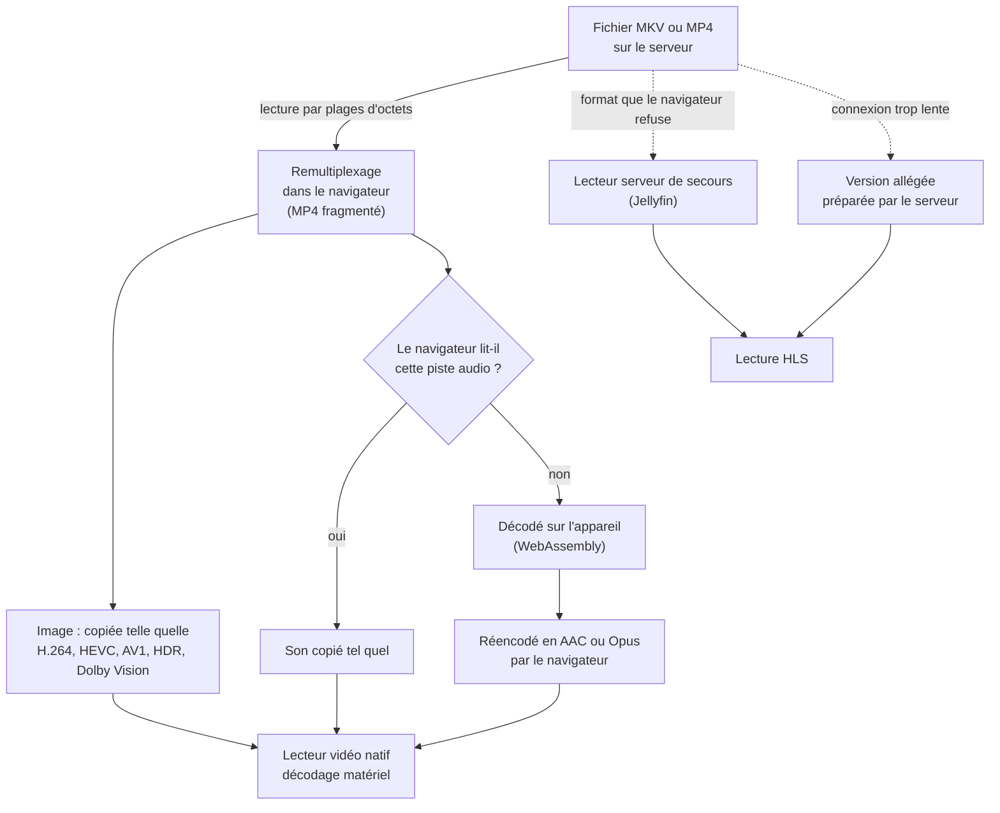
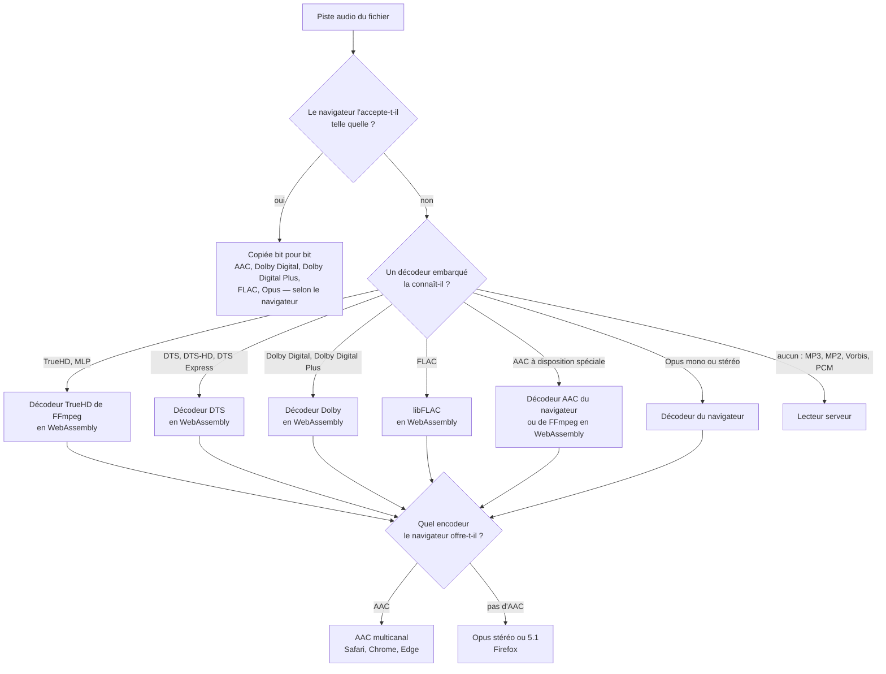
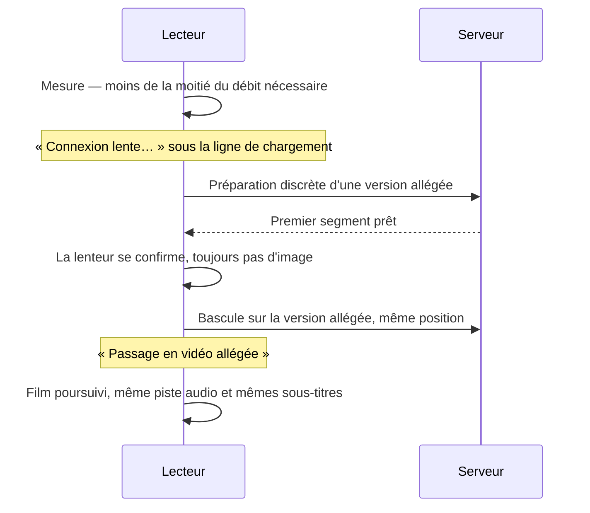

# Le lecteur Ciné App

**Un vrai lecteur de cinéma dans le navigateur : il prend le fichier MKV ou MP4 tel qu'il est sur le
disque, le remet en forme sur l'appareil et le confie à la puce vidéo — 4K, HDR, Dolby Vision et son
multicanal compris, sans que le serveur réencode quoi que ce soit.**

| | |
|---|---|
| 🎬 **0 transcodage serveur** | dans le cas courant : le serveur envoie des octets, l'appareil fait le reste |
| 🔊 **10 familles audio** | lues sur l'appareil, copiées telles quelles ou décodées sur place — AAC, Dolby Digital, Dolby Digital Plus, Dolby TrueHD, MLP, DTS, DTS-HD, DTS Express, FLAC, Opus |
| 📱 **4K HDR10 et Dolby Vision** | sur iPhone, iPad et Mac, en natif, sans conversion de l'image |
| 🧪 **7 156 tests automatisés** | dans le dépôt, plus des bancs de mesure qui passent de vrais films au crible |

Environ **39 000 lignes de TypeScript** pour le lecteur seul (dont 17 000 pour le moteur de
remultiplexage et d'audio), et **cinq décodeurs audio** compilés en WebAssembly, chargés seulement
quand un film en a besoin.

---

## Pourquoi c'est différent

Un lecteur de médiathèque classique, devant un fichier que l'appareil ne lit pas tel quel, demande
au serveur de **tout réencoder** pendant la lecture : image et son. C'est coûteux, lent à démarrer,
et l'image y perd souvent son HDR.

Ciné App fait l'inverse : l'image n'est **jamais** réencodée. Le fichier est seulement réemballé dans
le format que le navigateur attend, et seul le son est converti, **sur l'appareil**, quand le
navigateur ne sait pas le lire.

| | Réencodage par le serveur | Lecteur Ciné App |
|---|---|---|
| **Image** | Réencodée, souvent sans HDR | Celle du fichier, bit pour bit — HDR10 et Dolby Vision compris |
| **Son** | Réencodé, souvent ramené en stéréo | Copié tel quel si l'appareil le lit ; sinon décodé et réencodé sur l'appareil, en multicanal |
| **Charge du serveur** | Forte, à chaque lecture | Quasi nulle : il sert des plages d'octets |
| **Lectures simultanées** | Limitées par le processeur du serveur | Limitées par le réseau |
| **Changement de langue** | Nouveau flux à préparer | Reconstruction locale, à la même position |

---

## Le chemin d'un film

Le remultiplexage ne touche à aucun pixel : il réécrit l'emballage. Préparer un groupe d'images prend
**15 à 56 ms**, quand le télécharger en prend environ **2 500** — c'est le réseau qui fixe le
rythme, jamais le calcul. Au démarrage, un film 4K a besoin d'environ **4 Mo** avant sa première
image, un film HD d'environ **2 Mo**.

---

## Quel chemin pour ma piste audio ?

Avant chaque film, le lecteur **pose la question au navigateur** — jamais à une liste figée : « ce
format, tu le prends ? », « cet encodeur, tu l'as ? ». La réponse décide du chemin.

Les décodeurs ne sont téléchargés que si le film en a besoin (de 0,5 à 1,5 Mo chacun), puis gardés
en cache.

**Les canaux restent à leur place.** Chaque système range ses canaux dans un ordre différent :
l'encodeur AAC d'Apple attend le centre en premier, celui de Chrome sous Windows l'ordre standard.
Le lecteur remet les canaux dans l'ordre que *ce* système attend — dialogues au centre, effets à
l'arrière. Cet ordre a été mesuré navigateur par navigateur, pas déduit d'une spécification.

**La meilleure piste s'ouvre d'office** : la langue du compte d'abord, puis le plus de canaux
*réellement restitués*, puis une piste copiée plutôt qu'une piste convertie. Sur iPhone, un Dolby
Digital 5.1 copié passe donc devant un TrueHD 7.1 qui devrait être décodé pour sortir en 5.1 de
toute façon.

---

## Ce que le lecteur sait lire

### Vidéo

| Format | Sur l'appareil | Détail |
|---|---|---|
| **H.264 / AVC** | ✅ | Décodage matériel, partout |
| **H.265 / HEVC** 8 et 10 bits | ✅ | Là où l'appareil le décode : Apple, la plupart des PC et des Android récents |
| **AV1** 8 et 10 bits | ✅ | Sur les puces qui le décodent |
| **VP9, VP8** | ↪️ | Confiés au lecteur serveur |
| **MPEG-4 ASP** (anciens `.avi`), MPEG-2 | ↪️ | Aucun navigateur ne les décode : lecteur serveur |

| Conteneur | |
|---|---|
| **MKV** | ✅ |
| **MP4 / MOV** | ✅ — par la même chaîne que le MKV, pour avoir menus de pistes et sous-titres |
| **MP4 fragmenté** | ↪️ lecteur serveur |
| **AVI** | ↪️ lecteur serveur |

Le format est reconnu sur les octets du fichier, pas sur son nom ni sur ce que le serveur en dit.

### Audio

| Format | Copié tel quel par | Ailleurs | Ce que reçoit l'appareil |
|---|---|---|---|
| **AAC** | ✅ tous les navigateurs | ⚠️ disposition de canaux spéciale : réécrite sans perte, sinon décodée | AAC, jusqu'au 7.1 |
| **Dolby Digital** (AC-3) | ✅ Safari, et tout navigateur qui l'accepte | 🔁 décodé puis réencodé | AC-3 d'origine, ou AAC / Opus |
| **Dolby Digital Plus** (E-AC-3), Atmos compris | ✅ Safari — l'Atmos est transmis intact | 🔁 décodé puis réencodé | E-AC-3 d'origine, ou AAC / Opus |
| **Dolby TrueHD**, Atmos compris | ❌ aucun navigateur | 🔁 décodé (FFmpeg en WebAssembly) | AAC / Opus, 7.1 de base |
| **MLP** | ❌ aucun navigateur | 🔁 décodé (FFmpeg en WebAssembly) | AAC / Opus |
| **DTS**, **DTS-HD** MA / HR, **DTS Express** | ❌ aucun navigateur | 🔁 décodé | AAC / Opus |
| **FLAC** 16 et 24 bits | ✅ Chrome, Edge, Firefox | 🔁 décodé sur Safari (libFLAC) | FLAC d'origine, ou AAC |
| **Opus** | ✅ Chrome, Edge, Firefox | 🔁 mono et stéréo décodés sur Safari ; ↪️ multicanal au serveur | Opus d'origine, ou AAC |
| **MP3, MP2, Vorbis, PCM** | — | ↪️ lecteur serveur | — |

| Canaux | |
|---|---|
| Mono, stéréo, 5.1, 7.1 | ✅ restitués à leur place |
| 7.1 sur appareil Apple | ⚠️ replié en 5.1 : l'encodeur AAC d'Apple s'arrête à six canaux |
| Dispositions rares (5.0, 4.1, 6.1…) | ⚠️ gauche, droite et centre gardés à coup sûr ; le reste n'est pas deviné |

Les décodeurs embarqués ont été comparés à `ffmpeg` canal par canal sur de vrais fichiers : à
**0,01 dB** près pour le TrueHD, à **0,05 dB** pour le FLAC.

**Améliorer les dialogues** (bêta) : deux forces, réglées dans le lecteur. Les voix sont séparées du
fond, égalisées et remontées, le fond s'efface pendant la parole — sans changer le nombre de canaux.

### HDR

| Format | Sur écran HDR | Sur écran standard |
|---|---|---|
| **HDR10** | ✅ natif | ✅ converti par le système ; sous Chrome Windows, un plafond de lumière corrige l'image trop sombre |
| **HDR10+** | ✅ affiché en HDR10 ; les métadonnées du fichier sont transmises | ✅ comme le HDR10 |
| **Dolby Vision profil 8** (base HDR10) | ✅ Dolby Vision natif si l'appareil l'accepte, sinon HDR10 | ✅ via la couche HDR10 |
| **Dolby Vision profil 5** (sans base HDR10) | ✅ si l'appareil l'accepte | ↪️ lecteur serveur |

Les informations de couleur du fichier (primaires, courbe, écran de mastering, lumière maximale) sont
recopiées telles quelles : rien n'est inventé.

### Sous-titres

| Format | |
|---|---|
| **SRT** et texte MP4, dans le fichier | ✅ taille et position réglables |
| **ASS / SSA** | ⚠️ le texte, sans la mise en forme |
| **Fichiers texte à côté du film** (`.srt`, `.ass`…) | ✅ proposés avec ceux du fichier |
| **Sous-titres forcés** | ✅ reconnus par leur drapeau, ou par leur seul titre |
| **PGS, VobSub** (sous-titres en image) | ❌ non proposés dans le lecteur de l'appareil — en diffusion Chromecast, ils sont incrustés par le serveur |
| **Sous-titres générés** | ✅ voir plus bas |

**Bandes noires recadrées.** Beaucoup de films 2.39:1 sont livrés dans une image 16:9, bandes noires
comprises. Sur un écran plus large, le film se retrouve encadré de noir des quatre côtés. Le serveur
mesure la vraie image sur les vignettes de prévisualisation (sans décoder la vidéo), et le lecteur
agrandit le film jusqu'au bord de l'écran. La mesure ne peut se tromper que dans le sens prudent.

**Des noms de pistes lisibles**, dans les quatre langues de l'interface :
`Anglais — Dolby TrueHD — 7.1`, `Français (Canadien) — 5.1`, `Français — Forcés`. Les codecs
ordinaires ne sont pas nommés, pour que le libellé tienne à l'écran.

---

## Par appareil

Le lecteur fonctionne dans le navigateur : rien à installer. Sur téléphone, il s'ajoute à l'écran
d'accueil comme une application.

| Appareil | Image | Son copié | Son converti | Diffusion |
|---|---|---|---|---|
| **iPhone, iPad** (Safari et tout navigateur iOS) | HEVC 10 bits, HDR10, Dolby Vision | AAC, Dolby Digital, Dolby Digital Plus (Atmos) | TrueHD, DTS, FLAC, Opus stéréo → AAC jusqu'au 5.1 | AirPlay |
| **Mac — Safari** | HEVC, HDR10, Dolby Vision selon l'écran | comme l'iPhone | comme l'iPhone | AirPlay |
| **Mac — Chrome, Edge** | HEVC, AV1 selon la puce | AAC, FLAC, Opus | Dolby, DTS, TrueHD → AAC jusqu'au 5.1 | Chromecast (bêta) |
| **PC — Chrome, Edge** | HEVC selon la carte graphique, AV1, HDR10 | AAC, FLAC, Opus | Dolby, DTS, TrueHD → AAC | Chromecast (bêta) |
| **Firefox** (Windows, Mac, Linux) | H.264, AV1 ; HEVC selon la version | AAC, FLAC, Opus | le reste → Opus, jusqu'au 5.1 | — |
| **Android — Chrome** | HEVC, AV1 selon le modèle | AAC, FLAC, Opus | Dolby, DTS, TrueHD → AAC | Chromecast (bêta) |
| **Fire TV** (Silk) | selon les réponses de Silk | selon les réponses de Silk | secours serveur sinon | — (interface pilotée à la télécommande) |

Ce tableau décrit le cas général : sur chaque appareil, c'est la réponse du navigateur qui décide,
et un panneau technique du lecteur affiche ces réponses telles quelles.

**Mémoire tampon taillée pour chaque moteur.** Safari limite chaque tampon vidéo en octets — environ
105 Mo sur iPhone et iPad, 304 Mo sur Mac —, soit une trentaine de secondes de 4K sur iPad. Le
lecteur calcule son remplissage en octets réellement envoyés plutôt qu'en secondes, et fait lui-même
le ménage derrière la tête de lecture.

---

## Quand ça se complique

### Connexion lente

Le lecteur mesure ce qu'il reçoit, le compare au débit du film, et ne conclut qu'avec des preuves.

- **Version allégée** : HEVC si l'appareil le décode, sinon H.264 ; SDR ; 720p ou 1080p ; débit fixé
  à la moitié du débit mesuré, et abaissé encore si nécessaire.
- **Préparée d'avance** : quand la bascule arrive, le premier segment est déjà là.
- Une préparation devenue inutile (l'image est arrivée) est annulée, et le serveur arrête son travail.
- Réglage **Qualité** dans le menu ⋮ : *Automatique* (par défaut) ou *Originale*.
- Si rien ne peut sauver la lecture : un écran le dit, avec les mesures à l'appui — jamais une
  coupure prise pour de la lenteur.

### Coupure réseau

Le lecteur réessaie, affiche « Connexion perdue ou instable… », puis reprend **au même endroit, dans
la même langue, avec les mêmes sous-titres**. Une position que le serveur n'a pas reçue est gardée sur
l'appareil et envoyée à la reconnexion.

### iPhone mis en veille

Au retour, le lecteur vérifie ce que le système a gardé ; si la source a été fermée en arrière-plan,
il la reconstruit à la même position. Si iOS a fermé la page, la position gardée sur l'appareil
repart vers le serveur au lancement suivant.

### Fichier refusé

Le relais se fait sans fermer le film, avec la même piste et la même position. Le refus est toujours
**nommé** dans le journal : un lecteur qui se rabat sans dire pourquoi ressemble à un lecteur qui
marche.

---

## Diffusion et confort

| Fonction | |
|---|---|
| **AirPlay** | Depuis un iPhone, un iPad ou un Mac. La télévision lit le flux du serveur ; une image HDR reste HDR. Le sous-titre affiché sur le téléphone est incrusté dans l'image de la télévision (le démarrage prend alors une quinzaine de secondes de plus, et le lecteur le dit). Fermer le lecteur arrête aussi la télévision |
| **Chromecast** (bêta) | Depuis Chrome et Edge (ordinateur, Android). La page devient une télécommande : langue, sous-titres texte, position |
| **Reprise suivie à la télévision** | Pendant une diffusion, le serveur note la position d'après ce que la télévision demande, même si le téléphone se tait |
| **Reprise instantanée** | Les premiers mégaoctets des films de « Reprendre » et « À suivre » sont gardés sur l'appareil (au plus 64 Mo par titre). Le film démarre sans attendre le réseau |
| **Épisode suivant préparé** | Pendant le générique, l'en-tête du prochain épisode est déjà chargé |
| **Écran de l'épisode suivant** | Au générique, la vidéo se réduit et l'épisode suivant s'affiche (miniature, résumé, durée) avec un décompte de 10 s. « Regarder le générique » rend l'image entière, un bouton discret reste pour passer à la suite, et l'écran revient à la fin du générique |
| **Avance en mémoire** | Après une minute de film, le lecteur prend de l'avance par rafales — jusqu'à cinq minutes de film, 150 Mo au plus sur iPhone —, puis laisse la radio se reposer. En mémoire vive seulement : rien n'use le stockage de l'appareil |
| **Changement de langue en cours de film** | Le lecteur se reconstruit à la même position, pause conservée |
| **Préférences du compte** | Langue audio et de sous-titres, reprise là où le film s'était arrêté, quel que soit l'appareil |
| **Téléchargement hors ligne** (bêta) | Un film, un épisode ou une saison, préparé par le serveur en version légère (720p ou 1080p, une piste son) et gardé sur l'appareil avec ses sous-titres texte et ses aperçus. Lu sans réseau par un lecteur à part ; la position revient au serveur au retour du réseau. Détails : [docs/telechargement-hors-ligne.md](docs/telechargement-hors-ligne.md) |

### Sous-titres générés (optionnel)

Quand un titre a des sous-titres texte complets dans une langue, on peut en demander une autre. Un
service de traduction en ligne choisi par l'administrateur (Anthropic, OpenAI ou Google) les traduit
**pendant le film, en commençant là où l'on regarde**. Un saut dans le film fait passer la nouvelle
zone en priorité. Le fichier terminé est confié au serveur, et tous les appareils le voient ensuite.
Désactivé sans clé d'accès ; un budget mensuel et une limite quotidienne par compte bornent le coût.

---

## Sous le capot

| | |
|---|---|
| **Tests** | 7 156 tests automatisés dans 750 fichiers, lancés avant chaque déploiement et à chaque publication |
| **Bancs sur vrais fichiers** | quatorze bancs, hors de la suite : octets produits relus par `ffmpeg`, coût de chaque étape, niveau de chaque canal comparé à `ffmpeg`, recensement des formats d'une bibliothèque entière |
| **Banc d'appareil** | lancé depuis le cinéma, il lit de vrais films sur l'appareil à tester : ouverture, sauts, rafales de sauts, pause, changement de piste, sous-titres — et mesure l'horloge du film contre les images affichées |
| **Journal de lecture** | chaque appareil dit ce qu'il a fait : chemin pris, relais, attentes et leur cause (réseau, calcul ou décodeur), débit reçu, deux dernières minutes de lecture |
| **Fichiers difficiles** | testés d'abord sur des fichiers à six pistes audio mêlant FLAC, Dolby, DTS et TrueHD, en mono, 5.1 et 7.1, Dolby Vision 4K : c'est le cas normal, pas l'exception |

Le détail technique — remultiplexage, reconstruction des instants de décodage, vérification des
images clés, livraison audio, ordre des canaux — est dans [`DOC-TECH.md`](DOC-TECH.md).

---

## Limites

- **Pas de qualité adaptative continue** : sur une connexion trop lente, le passage à la version
  allégée coûte quelques secondes d'interruption. Sur iPhone et iPad, Safari impose de recharger la
  page pour ce passage, puis un toucher sur Lecture.
- **TrueHD Atmos** : le 7.1 de base est restitué, pas les effets en hauteur.
- **Sous-titres en image** (PGS, VobSub) : non affichés par le lecteur de l'appareil.
- **ASS / SSA** : texte seul, sans mise en forme.
- **Anciens formats** (`.avi` en MPEG-4 ASP, VP9, MP3…) : lus par le lecteur serveur, qui
  réencode.
- **Changer de sous-titres pendant un AirPlay** : le sous-titre est incrusté au lancement de la
  diffusion ; pour en changer, on revient sur le téléphone et on relance la diffusion.
