<div align="center">


# Laterna

**Your Jellyfin server, as a cinema.**<br>
A self-hosted cinema for the whole household:
rows of posters to watch from, a player that reads your files as they are, and a console to run the
server — in one container.

[](LICENSE)
[](https://github.com/LK59/laterna/pkgs/container/laterna)
[](https://github.com/LK59/laterna/actions/workflows/docker.yml)
[](https://github.com/LK59/laterna/pkgs/container/laterna)

[Website](https://laterna.fr) · [Quick start](#install) · [Features](docs/FEATURES.md) · [Docs](#documentation)

</div>

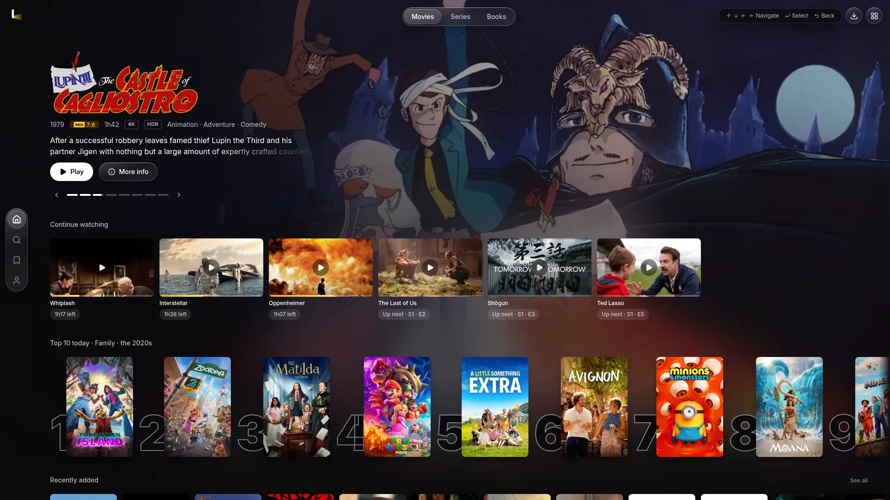

> **[Quick start →](QUICKSTART.md)** One compose file, one command, then a setup assistant in the
> browser. Only **Jellyfin** and a free **TMDB** key are required; Radarr, Sonarr, Jellyseerr,
> qBittorrent, Bazarr, Jackett, actor recognition and AI features are all optional, and can be added
> at any time. Laterna never writes to your media files: it reads your library through Jellyfin, and
> watched state and positions go back through Jellyfin's API like any other client.

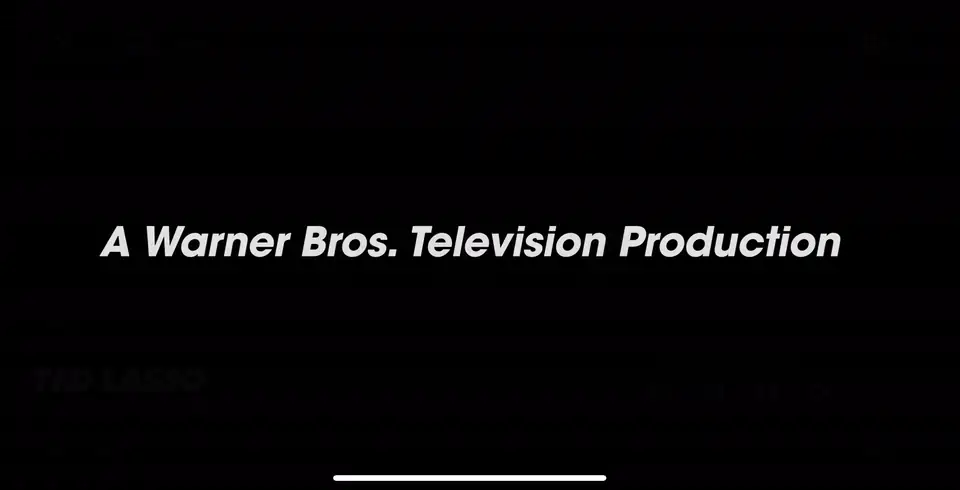

<p align="center"><em>The player on an iPhone: who is on screen, episodes, subtitles, audio tracks, clearer dialogue.</em></p>

Laterna is the interface your household uses instead of Jellyfin's web client: a home screen of
posters, one search for the library, TMDB and people, personal lists, requests for what is missing,
and playback in the page. Its player engine, **Lumen**, reads the file exactly as it sits on disk,
repackages it in the browser tab and hands it to the device's video chip. The administrator gets a
second interface over Radarr, Sonarr, qBittorrent, Jellyseerr, Bazarr and Jackett, wearing the same
design.

## Why Laterna

- **Your files, played as they are.** A 4K Dolby Vision HEVC film with E-AC3 Atmos plays on an
  iPhone with nothing running on the server. MKV and MP4 are repackaged into fragmented MP4 in the
  tab; the picture is never re-encoded, HDR10 and Dolby Vision included. Sound the device cannot
  play — TrueHD 7.1, DTS and DTS-HD, FLAC — is decoded in the browser with FFmpeg's own decoders
  compiled to WebAssembly, then re-encoded there, every channel in its place. Jellyfin's transcoder
  takes over only for a file the browser cannot carry or a link too slow for it, and that fallback
  can be switched off.
- **One container for the cinema and the console.** Everyone signs in at `/`; the administrator also
  gets `/gestion` — downloads, service status, storage, Radarr and Sonarr libraries, calendar,
  statistics, and every setting made in the browser. One Docker container, one volume, no `.env`
  required.
- **An app on the phone, offline included.** Laterna installs to the home screen on iPhone, iPad and
  Android, with notifications (Apple Web Push included). A film, an episode or a whole season can be
  downloaded to watch without a network; positions reach Jellyfin when the network comes back.
  Chromecast and AirPlay send it to the television.
- **Requests built in.** A title that is not in the library opens the same page with a **Request**
  button, filed through Jellyseerr under each person's own account. For a series, you pick the
  seasons.
- **Jellyfin stays the source of truth.** Accounts, watched state, favourites, resume positions,
  audio and subtitle preferences and parental controls (blocked tags) are Jellyfin's. A film finished
  on the TV reads as watched here, and a preference set here applies in the Jellyfin apps too.
- **Optional, and yours.** *Actors on screen* (X-Ray) is a companion container that recognises the
  cast scene by scene on your own server, with no online AI. AI features — translated subtitles,
  search by description, « Previously » on a series, questions about a title — use your own
  Anthropic, OpenAI or Google key, under one monthly ceiling. All of it is off by default.

## A look around

<table>
  <tr>
    <td width="50%">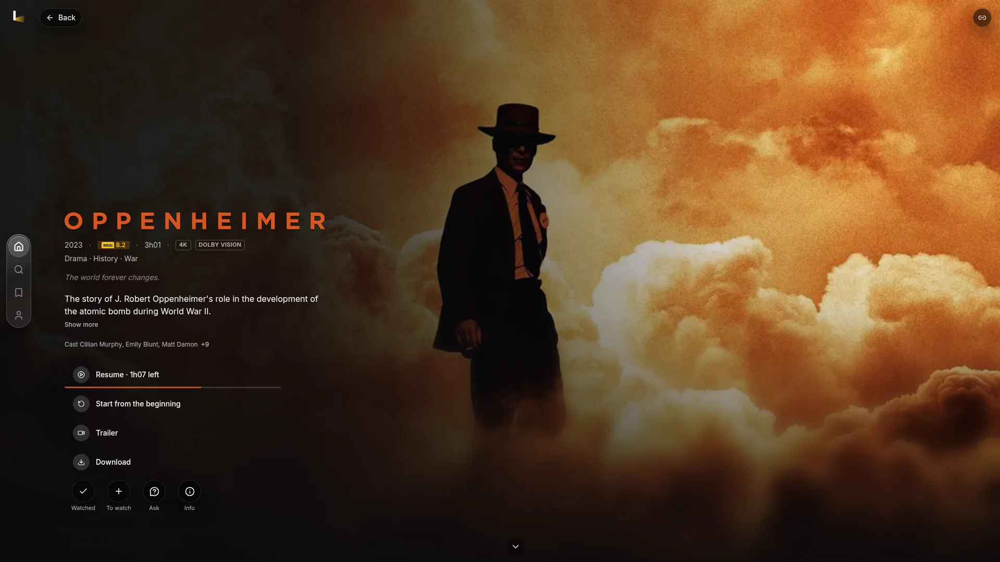</td>
    <td width="50%">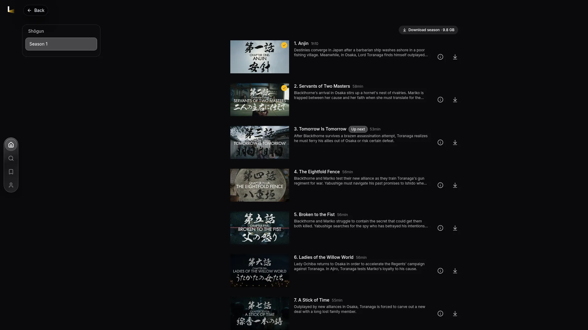</td>
  </tr>
  <tr>
    <td align="center">A film's page: ratings, format, synopsis, cast, resume</td>
    <td align="center">A series: episodes, what is watched, up next, a season to download</td>
  </tr>
  <tr>
    <td>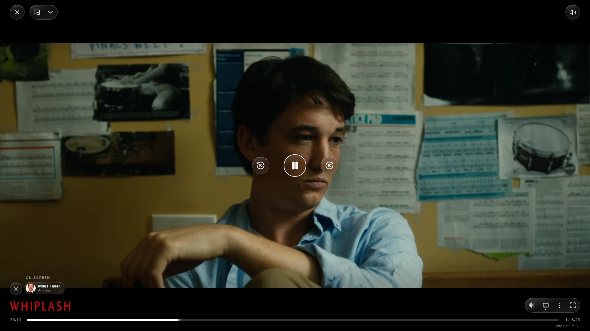</td>
    <td>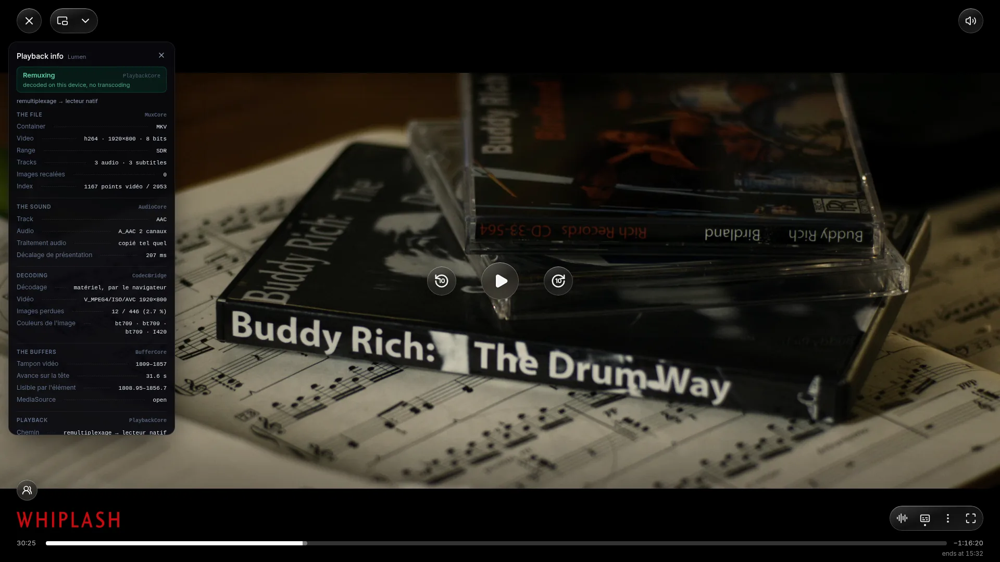</td>
  </tr>
  <tr>
    <td align="center">The player, with <em>On screen</em>: who is in the scene (optional X-Ray)</td>
    <td align="center">Playback info: repackaged, decoded by the device, no transcoding</td>
  </tr>
  <tr>
    <td colspan="2">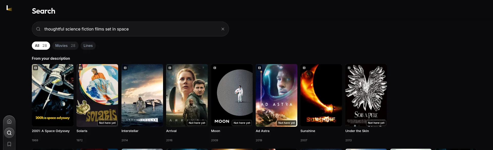</td>
  </tr>
  <tr>
    <td colspan="2" align="center">One search for the library, TMDB and people — or a sentence, with the optional AI search</td>
  </tr>
</table>

<p align="center">
  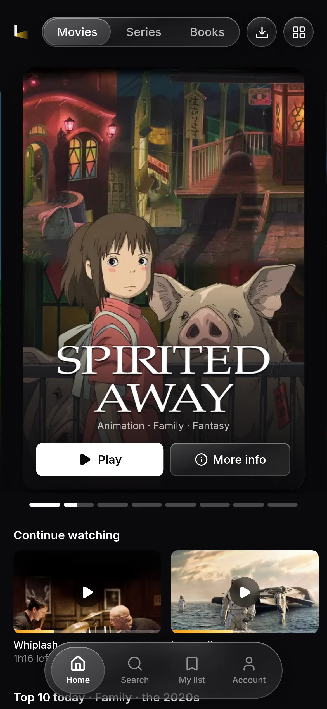
  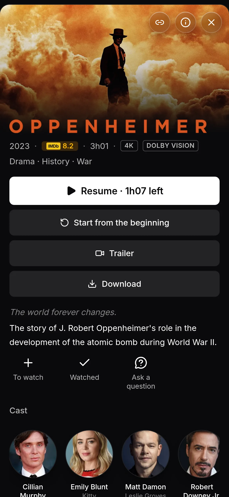
</p>
<p align="center">
  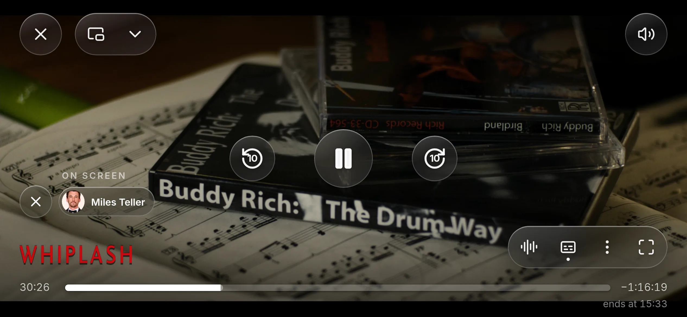
</p>
<p align="center"><em>On a phone: its own layout, a bottom bar, sheets you swipe away.</em></p>

<table>
  <tr>
    <td width="50%">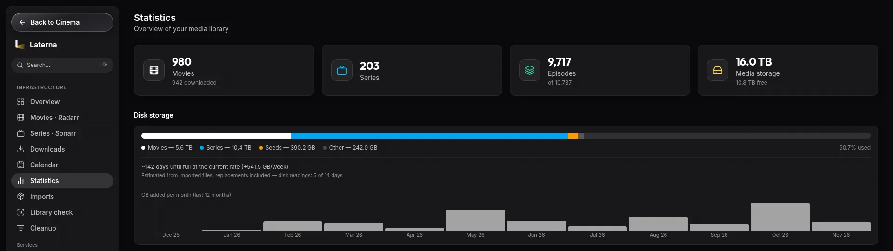</td>
    <td width="50%">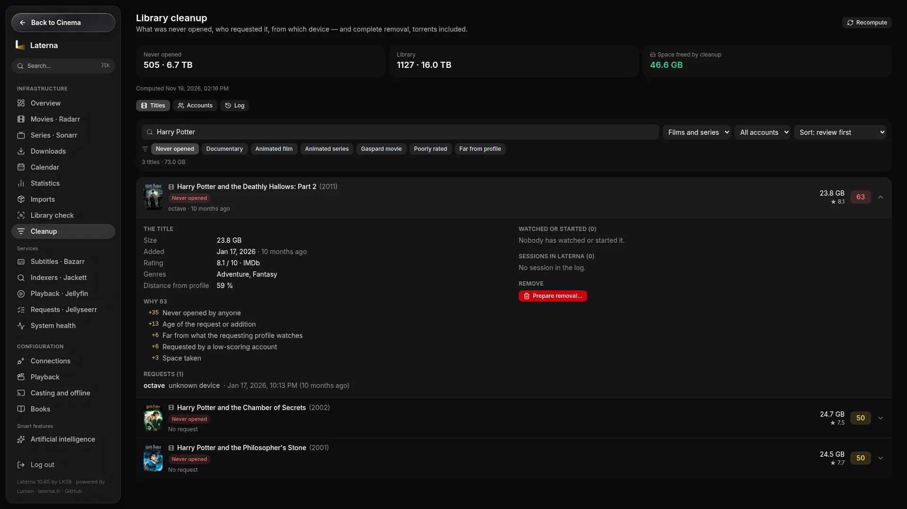</td>
  </tr>
  <tr>
    <td align="center">Management: the library, storage and how fast it fills</td>
    <td align="center">Cleanup: what nobody has opened, who asked for it, and removing it in one go</td>
  </tr>
</table>

The full tour, screen by screen: **[docs/FEATURES.md](docs/FEATURES.md)**.

## How it compares

Laterna does not replace Jellyfin: it needs it, and builds on its accounts, library and play state.

| | Laterna | Jellyfin web client | Jellyseerr |
|---|---|---|---|
| **What it is** | A front end for watching, plus an admin console | Jellyfin's own web interface | A request and discovery app |
| **Plays films in the browser** | Yes | Yes | No |
| **MKV in a browser that cannot open it** | Repackaged in the tab | Remuxed by the server | — |
| **TrueHD, DTS, FLAC the browser cannot play** | Decoded on the device | Transcoded by the server | — |
| **Request a missing title** | Yes, through Jellyseerr | No | Yes |
| **Discovery rows (TMDB trending, recommendations)** | Yes | No | Yes |
| **Radarr, Sonarr, qBittorrent in the interface** | Libraries, downloads, release search, calendar | No | Sends requests to Radarr and Sonarr |
| **Offline viewing** | Downloads kept in the browser or the installed app | Downloads the file (some native apps can play offline) | — |
| **On the television** | Chromecast (beta), AirPlay, or the TV's browser with a remote | Native apps for most TV platforms, Chromecast | — |
| **Music, live TV, photos** | No — films and series, optionally books | Yes | No |
| **Library scanning, metadata, user accounts** | Jellyfin's | Yes — it is the server | Jellyfin's accounts |

## Install

Paste this `docker-compose.yml` into an empty folder — or into Portainer, Dockge, Komodo or any
« add stack » screen — then start it. It works as is; the commented lines are the options most
installs end up using.

```yaml
# Laterna — works as is. Every option: https://github.com/LK59/laterna/blob/main/DEPLOYMENT.md
services:
  laterna:
    image: ghcr.io/lk59/laterna:latest
    container_name: laterna
    restart: unless-stopped
    ports:
      - "127.0.0.1:3000:3000"     # this server only; a reverse proxy serves the rest
    # networks: [proxy]           # the Docker network of your proxy (and Jellyfin): see the end
    volumes:
      - laterna-data:/app/data    # database, settings, generated secrets, logs
      # - /path/to/media:/mnt/media/video:ro   # optional, read-only: storage statistics
    environment:
      - TZ=Etc/UTC                # your time zone, e.g. Europe/Paris
      # - COOKIE_SECURE=true                    # behind HTTPS
      # - TRUSTED_PROXIES=nginx-proxy-manager   # your proxy's container name
    healthcheck:
      test: ["CMD", "wget", "-q", "-O", "/dev/null", "http://127.0.0.1:3000/api/ping"]
      interval: 30s
      start_period: 60s

volumes:
  laterna-data:
    name: laterna-data

# networks:
#   proxy:
#     external: true              # an existing network: `docker network ls`
```

```bash
docker compose up -d
docker compose logs laterna | grep "setup code"
```

In Portainer or Dockge, read the setup code in the container's log view, or run
`docker logs laterna 2>&1 | grep "setup code"`.

> **Installed before 10.65.2?** Your names are `cine-app` and `cine-app-data`: keep them — renaming
> the volume would start from an empty database. Only the `image:` line may change to
> `ghcr.io/lk59/laterna:latest` (same image).

> **Every deployment option** is in the **[deployment guide](DEPLOYMENT.md)**: reverse proxy
> (Nginx Proxy Manager, Caddy, Traefik), data in a folder, media, `.env`, updates and backups — and
> **[actors on screen](DEPLOYMENT.md#optional-actors-on-screen-laterna-xray)**, the optional
> `laterna-xray` service that recognises the cast scene by scene.

<details>
<summary>Or in one go, over SSH on the server</summary>

```bash
mkdir laterna && cd laterna
curl -fsSL -o docker-compose.yml https://raw.githubusercontent.com/LK59/laterna/main/docker-compose.example.yml
docker compose up -d
```

This fetches [`docker-compose.example.yml`](docker-compose.example.yml), the full version of
this file, with a comment on every line.
</details>

Then open `http://localhost:3000` on the server (or through an SSH tunnel): the example publishes
port 3000 on the server's loopback only. The setup assistant asks for the one-time setup code
printed in `docker compose logs laterna`, creates the administrator account, and asks for Jellyfin
and TMDB (and offers Radarr, Sonarr and the rest). You do not clone this repository, install Node or
write an `.env`: secrets are generated on first launch, and everything else is set later in
**Management → Configuration**. Updating is `docker compose pull && docker compose up -d`;
migrations run at startup.

An `.env` remains possible, as a fallback or to keep the configuration as code: the value set in
the app wins, then `.env`, then the default. `docker-compose.advanced.yml` is the annotated template
for that style of deployment.

### What you need

- A Linux **x86-64 (amd64)** host with **Docker Engine and the Compose plugin** — there is no ARM
  image (Raspberry Pi, Ampere) yet.
- A running **Jellyfin** with an API key. Every viewer signs in with their own Jellyfin account, and
  Jellyfin administrators are Laterna administrators.
- A free **TMDB** API key, for posters and synopses.
- For access from outside: an **HTTPS reverse proxy** (Nginx Proxy Manager, Caddy and Traefik
  examples in the guide). HTTPS is also what enables home-screen install, notifications and every
  player feature.
- Optional: **Radarr** and/or **Sonarr** (management, additions, missing episodes), **Jellyseerr**
  (requests), **qBittorrent** (download progress), **Bazarr** (subtitle search), **Jackett**
  (indexers). Add them whenever you like; a service that is not configured is never queried.

Step by step: **[QUICKSTART.md](QUICKSTART.md)** · the full guide: **[DEPLOYMENT.md](DEPLOYMENT.md)**
· every variable: **[ENV.md](ENV.md)**. The guide covers the parts that are easy to get wrong: which
URLs the *container* can resolve, the uid that has to read your media, the nginx header buffer that
closes connections instead of answering, and what to check when a service reads as unreachable.
ENV.md says which variables the app can set, which belong to the compose file, and which never go
in the app.

## Documentation

**Questions and setup help:** [Discussions](https://github.com/LK59/laterna/discussions) · **Bugs and ideas:**
[Issues](https://github.com/LK59/laterna/issues/new/choose) · **Security:** [report privately](SECURITY.md) ·
**What changed:** [Releases](https://github.com/LK59/laterna/releases)

| Document | What it covers |
|---|---|
| **[QUICKSTART.md](QUICKSTART.md)** | The three commands and the assistant, from an empty folder to a working cinema |
| **[DEPLOYMENT.md](DEPLOYMENT.md)** | Installing and running it: compose file, reverse proxy, setup assistant, settings, updates, backups, troubleshooting |
| **[ENV.md](ENV.md)** | Every configuration variable: default, role, and whether the app can set it |
| **[docs/FEATURES.md](docs/FEATURES.md)** | What the two interfaces do, feature by feature: Cinema, Management, books, Stream Deck, optional services |
| **[docs/SECURITY.md](docs/SECURITY.md)** | Authentication and roles, sessions, what the server refuses and why |
| **[docs/DEVELOPMENT.md](docs/DEVELOPMENT.md)** | Working on the code: dev stack, test gate, building from source, debugging a deployment, screenshot conventions |
| **[ARCHITECTURE.svg](ARCHITECTURE.svg)** | The whole application on one zoomable page: system, interfaces, both players, one playback, caches, logs, security, optional features — on a phone, open it then *Raw*; generated from DOC-TECH.md by `tools/architecture/build.sh` |
| **[DOC-TECH.md](DOC-TECH.md)** | The in-browser player: the native path and the server player behind it, the remuxer, audio, generated subtitles, diagnostics |
| **[PRESENTATION-LECTEUR.md](PRESENTATION-LECTEUR.md)** | A non-technical presentation of the player, in French |
| **[docs/telechargement-hors-ligne.md](docs/telechargement-hors-ligne.md)** | Offline downloads: preparation by Jellyfin, storage on the device, the offline player and entry, settings — in French |
| **[docs/abandons.md](docs/abandons.md)** | What was built and then removed, and what was considered and set aside — in French |
| **[xray/README.md](xray/README.md)** | The optional actors-on-screen service: installation, contract, measurements |
| **[streamdeck-plugin/README.md](streamdeck-plugin/README.md)** | Building the Stream Deck plugin |
| **[CLAUDE.md](CLAUDE.md)** | Architecture and conventions, for anyone working on the code |
| **[DECISIONS.md](DECISIONS.md)** | Rules decided in one shared function, their callers and tests |
| **[`tools/truehd-wasm/`](tools/truehd-wasm/)**, **[`tools/aac-wasm/`](tools/aac-wasm/)** | Reproducible builds of the committed TrueHD and AAC WebAssembly decoders: pinned FFmpeg, checked SHA-256 |
| **`.env.example`** | Every configuration variable, commented out — optional, described in ENV.md |
| **`docker-compose.example.yml`** | The minimal deployment: one service, one volume, no `.env` |
| **`docker-compose.advanced.yml`** | The advanced deployment template, annotated in place |

## Third-party code

- `src/lib/webcodecs/truehd/truehd-wasm.mjs`, `src/lib/webcodecs/aac/aac-wasm.mjs` and
  `src/lib/webcodecs/ac3dts/ac3dts-wasm.mjs`, committed, are FFmpeg's TrueHD/MLP, AAC, and AC-3/E-AC-3/DTS
  decoders (FFmpeg 7.1.5, configured without `--enable-gpl`, so
  LGPL-2.1-or-later), compiled to WebAssembly. `tools/truehd-wasm/build.sh`, `tools/aac-wasm/build.sh`
  and `tools/ac3dts-wasm/build.sh` rebuild them byte for byte from the checksummed FFmpeg release.
- FLAC is decoded by `@wasm-audio-decoders/flac` (MIT).

## License

Laterna is free software under the [GNU Affero General Public License v3.0](LICENSE)
(`AGPL-3.0-only`). You may use, study, modify and share it; if you run a modified version for other
people over a network, you must offer them its source code under the same license. Third-party
code keeps its own license, listed above.

Posters and artwork shown in the screenshots are © their respective owners, via TMDB; Laterna
displays the library of your own server and provides no content.
