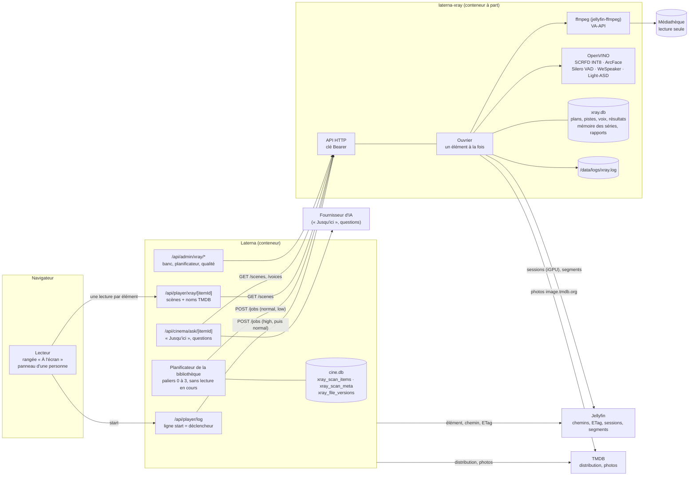
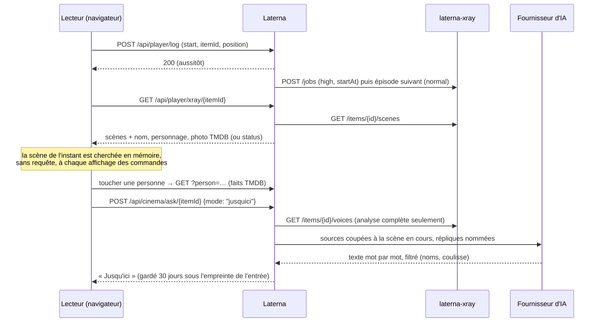
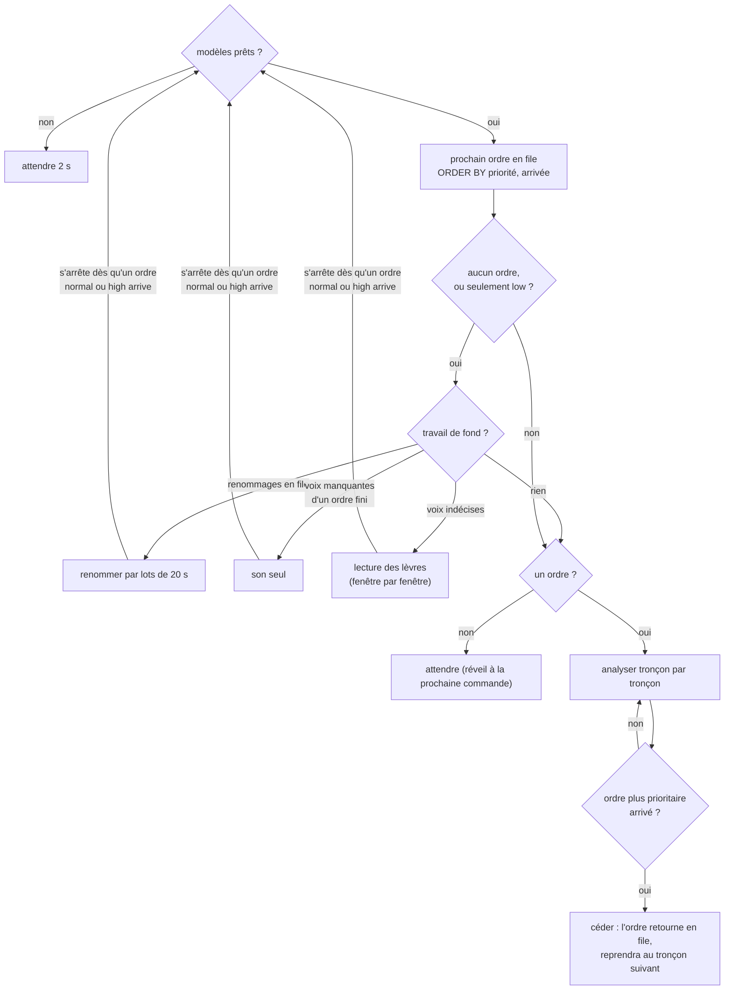

# X-Ray — architecture

Comment `laterna-xray` s'insère dans une installation de Laterna : qui commande quoi, quand, comment le
service partage la machine avec Jellyfin, ce qu'il garde, ce qu'il journalise et ce qui ne sort jamais.
Le traitement lui-même : [PIPELINE.md](PIPELINE.md). Les routes : [API.md](API.md).

---

## Sommaire

- [Vue d'ensemble](#vue-densemble)
- [Pourquoi un service à part](#pourquoi-un-service-à-part)
- [Côté Laterna : commander](#côté-laterna--commander)
- [Côté Laterna : lire et montrer](#côté-laterna--lire-et-montrer)
- [Côté service : l'ouvrier et ses priorités](#côté-service--louvrier-et-ses-priorités)
- [Partager la machine avec Jellyfin](#partager-la-machine-avec-jellyfin)
- [Stockage et modèle de données](#stockage-et-modèle-de-données)
- [Journaux et rapport de décision](#journaux-et-rapport-de-décision)
- [Sécurité et vie privée](#sécurité-et-vie-privée)

---

## Vue d'ensemble



- Laterna **commande et lit** ; il n'envoie jamais d'image ni de son, seulement un chemin, une version de
  fichier et une distribution. Le service **lit le fichier lui-même**, sur la médiathèque montée en lecture
  seule au même chemin que dans Jellyfin.
- Le service **ne parle à personne d'autre** que Laterna (qui l'appelle), TMDB (les photos de la
  distribution, `image.tmdb.org` seulement), les dépôts officiels des modèles (au premier démarrage,
  pour télécharger les poids) et, en option, Jellyfin (ses sessions et ses segments).
- **Aucun fournisseur d'IA en ligne** n'est appelé par le service : toute l'analyse est locale et gratuite.
  Les fonctions qui en appellent un (« Jusqu'ici », les questions) sont dans Laterna, qui ne leur envoie
  que du texte.

---

## Pourquoi un service à part

- **Le poids** : OpenVINO, NNCF, le pilote de calcul Intel, jellyfin-ffmpeg, Python et ses bibliothèques
  font une image de plusieurs centaines de mégaoctets que Laterna n'a pas à porter.
- **Les ressources** : l'analyse est un travail de fond, borné par ses propres `cpus`, `mem_limit`, `nice`
  et `ionice`, sans toucher la réactivité de Laterna.
- **Les licences** : les poids non commerciaux sont téléchargés par le conteneur, chez l'installateur ; ni
  le dépôt, ni l'image de Laterna, ni celle du service ne les contiennent.
- **L'option** : une installation sans le service n'a rien à installer, et Laterna fonctionne à
  l'identique (« Acteurs à l'écran » coupé par défaut).

Le code vit dans `xray/` du dépôt de Laterna, avec son propre `Dockerfile`, ses tests (`pytest`, lancés
pendant la construction) et sa propre publication d'image (`ghcr.io/lk59/laterna-xray`, étiquettes
`latest` et le commit) ; il est hors de la porte de vérification de Laterna.

---

## Côté Laterna : commander

### Le réglage

Configuration → Connexions, carte « Acteurs à l'écran » : un **public** (`XRAY_ENABLED` : `off` par
défaut, `admins`, `tous`), l'adresse (`XRAY_URL`, `http://laterna-xray:8000`) et la clé (`XRAY_API_KEY`) ;
« Tester la connexion » lit `/health`. Sans les trois, rien ne part vers le service et rien n'est lu.
`admins` ne restreint que ce qui se montre et les commandes des séances : le planificateur analyse quand
même toute la bibliothèque.

### Ce que Laterna envoie

Pour un élément (`analysisTarget`, `castWithPhotos`) :

- le **chemin** du fichier tel que Jellyfin le voit, l'**ETag** de la source (sinon `size:<octets>`), la
  durée, la série ;
- la **distribution** de cet épisode (`/tv/{id}/season/{s}/episode/{e}/credits` : rôles crédités puis
  invités) ou du film, dans l'ordre du générique, une personne une fois, quarante au plus ;
- jusqu'à **huit photos** par personne (la principale puis les mieux notées de TMDB), en adresses
  `https://image.tmdb.org/t/p/w185…` ;
- la **langue d'origine** du titre (pour la piste son de la version originale).

Sans distribution, rien n'est commandé. **L'animation est écartée** (genre « Animation » / « Anime ») et
seuls les fichiers sous les dossiers permis (`XRAY_LIBRARY_ROOTS`, par défaut `/media/movies` et
`/media/tv`) le sont — jamais les téléchargements, les seeds, les livres.

### Deux sources de commandes

**1. La séance qui commence.** La ligne `start` du journal du lecteur — la seule qu'envoient les trois
lecteurs (natif, serveur, Chromecast) — commande l'élément regardé en `high` à partir de la position
(`startAt`), puis l'épisode suivant en `normal`. Sans attente : la réponse du journal part avant. Une
commande par élément pendant six heures (une reconstruction du lecteur réécrit son `start`), trente
commandes neuves par compte et par heure au plus. Exclus : le banc, le lecteur hors ligne, un lien de
partage hors de son titre ; avec le public `admins`, seules les séances d'administrateurs commandent.

**2. Le planificateur de la bibliothèque** (`src/lib/xray/scheduler.ts`), un tour par minute :

| Palier | Contenu | Priorité | Pendant une lecture |
|---|---|---|---|
| 0 | la **liste de priorité** de l'administrateur : un film, ou une série entière saison par saison | `normal` | nourri, mais seulement si la file du service ne contient que nos propres commandes |
| 1 | ce qui **se regarde** : pour chaque compte, les films de « Reprendre » et, par série en cours, l'épisode en cours ou suivant et les quatre d'après — le premier titre de chaque compte avant le deuxième de quiconque | `low` | rien de neuf |
| 2 | les **arrivées des quatorze derniers jours** (date d'import de Radarr/Sonarr, jamais celle de Jellyfin) | `low` | rien de neuf |
| 3 | **le reste**, du plus récent au plus ancien | `low` | rien de neuf |

- **Deux commandes d'avance au plus**, et rien si la file du service en compte déjà trois : la commande
  `high` d'un spectateur ne trouve jamais une longue file devant elle.
- **Dans un palier, une série passe dans l'ordre de ses épisodes** ; une série dont tout le plan est traité
  est **renommée une fois** (`POST /series/{id}/relabel`) : ses premiers épisodes profitent de la mémoire
  de toute la série.
- **Déjà fait, rien ne part** : avant chaque commande, `/items/{id}` ; les éléments finis sont relus
  lentement (une fois par semaine au plus) pour voir un ETag changé.
- **Un fichier remplacé à durée égale** (± 1 s) — un réencodage — est rattaché sans analyse
  (`rebindIfSameDuration`), et le lecteur continue de servir ses scènes.
- **Les gestes** (Configuration → Acteurs à l'écran) : « Lancer maintenant » force un palier (nourri même
  pendant une lecture, jusqu'à ce qu'il soit vide), « Mettre en pause » / « Reprendre » par palier ou
  tous ; « Analyser en priorité » sur la fiche d'un titre (administrateur seul).
- **Robuste** : l'erreur d'un élément (TMDB, Jellyfin) le met en échec sans arrêter la file ; une erreur de
  réseau est revue dans l'heure ; une relecture de la bibliothèque qui échoue attend 15 min, 1 h puis 6 h ;
  échecs et écartés revus chaque semaine. Rien ne tourne sous `next dev`.
- **Suivi** : par palier, éléments faits / total, en file, échecs, écartés, heures de vidéo faites /
  totales, temps restant ; la vitesse (× temps réel des trente derniers éléments finis) ; et la **qualité
  des noms** par série (`/quality`), avec « Réinitialiser la mémoire ».

---

## Côté Laterna : lire et montrer



- **`GET /api/player/xray/[itemId]`** (`scenesForPlayer`) : les scènes, chaque personne jointe à la
  distribution (nom, personnage, photo TMDB `w185`). **Une absence attendue répond 200**, `scenes: []` et
  un `status` (`off`, `none`, `queued`, `running`, `failed`, `stale`, `unavailable`) — jamais 404. Le droit
  de voir l'élément est demandé à Jellyfin sous l'identité du compte ; caché, la route répond exactement
  comme pour un élément jamais analysé.
- **Le lecteur** lit cette route une fois à l'ouverture d'un élément (et de l'épisode suivant), la relit
  toutes les minutes tant que l'analyse est en cours (vingt minutes au plus, jamais page cachée), et
  cherche la scène de l'instant en mémoire.
- **La rangée « À l'écran »** paraît avec les commandes, en lecture comme en pause : toutes les personnes
  nommées de la scène, par temps de présence, en pilules (photo, acteur, personnage). Pas sur Fire TV, au
  lecteur hors ligne, pendant une diffusion ni au mini-lecteur.
- **Le panneau d'une personne** : faits TMDB (âge, lieu), courte biographie, deux ou trois affiches de
  ses autres titres de la bibliothèque (non cliquables, jamais pour un lien de partage). Indépendant de
  toute IA.
- **Les fonctions d'IA**, chacune avec son public (`ASK_ENABLED`, `ASK_PERSON_ENABLED`, `SOFAR_ENABLED`) et
  jamais pour un lien de partage : « Jusqu'ici » (une ou deux phrases sur le personnage, d'après ce que le
  compte a vu, coupées au début de la scène en cours), des questions sur les liens entre personnages de la
  scène, et les questions sur le titre. Les **scènes** servent à couper et à grouper les répliques, les
  **voix** à les attribuer (« Nom : … ») — seulement quand l'analyse des voix est complète.

Le détail de ces écrans et de leurs règles est dans le registre des décisions de Laterna
(`DECISIONS.md`, §138 à §140).

---

## Côté service : l'ouvrier et ses priorités

Un seul ouvrier, **un élément à la fois**. À chaque tour :



- **Priorités** : `high` (0) avant `normal` (1) avant `low` (2) ; à priorité égale, l'ordre d'arrivée.
- **Céder** : entre deux tronçons, un ordre cède la place à un ordre plus prioritaire (`job_yield` au
  journal) et reprend ensuite là où il en était — rien n'est perdu, les tronçons faits sont en base.
- **Le travail de fond** (renommages, son seul, lecture des lèvres) ne passe **jamais devant un ordre
  `normal` ou `high`** et rend la main entre deux lots ou deux fenêtres.
- **Reprise** : un redémarrage reprend au premier tronçon non fait ; un ordre commencé sous une version
  antérieure des résultats repart de zéro.
- **Annulation** : `DELETE`, ou un nouvel ordre sous un autre ETag, arrête l'analyse en cours
  (`job_cancelled`).
- **Deux voies** (10/11/2026, `lanes.py`, en option) : à côté de la voie A (iGPU), une voie B sur le
  processeur seul analyse un *autre* élément `normal`/`low` de 1080p au plus, seulement pendant que la voie A
  en analyse un, et s'arrête à la fin de son tronçon pendant une transcodification de Jellyfin. Jamais deux
  voies sur un élément, un `high` toujours à la voie A ; chaque voie a son moteur, son fil des voix et son
  drapeau d'annulation ; la base est partagée sous son verrou. Voir le README, « Voies d'analyse ».
- **Discrétion** : `nice 10` et `ionice` en classe basse pour le service et le ffmpeg qu'il lance ;
  `XRAY_THREADS` fils de calcul pour l'image, `XRAY_VOICE_THREADS` pour la voix, `XRAY_ASD_THREADS` pour
  la lecture des lèvres ; dans l'exemple de composition, `cpus: 6` et `mem_limit: 4g`.

---

## Partager la machine avec Jellyfin

Jellyfin garde la priorité, à trois niveaux :

1. **Côté Laterna** : le planificateur ne commande rien de neuf pendant une lecture (séance Jellyfin,
   relais de flux de Laterna, battement de lecture, puis cinq minutes), sauf palier forcé ou palier 0.
2. **Le décodage** : avec `JELLYFIN_URL` et `JELLYFIN_API_KEY`, le service relit les sessions de Jellyfin
   avant chaque ordre et toutes les 30 s ; si l'une transcode avec l'accélération matérielle, les tronçons
   suivants sont décodés sur le processeur.
3. **L'inférence sur l'iGPU** (option `XRAY_OV_DEVICE=GPU`) : tant que Jellyfin transcode sur l'iGPU,
   l'inférence repasse sur le processeur, puis revient (`device_switch` au journal). Mesuré : une
   transcodification perdait 39 % de sa vitesse avec l'inférence sur l'iGPU, 8 % avec l'inférence sur le
   processeur.

Sans `JELLYFIN_URL`, l'iGPU est toujours considéré libre.

---

## Stockage et modèle de données

Tout vit dans le volume de données du service (`XRAY_DATA_DIR`, `/data`) :

```
/data
├── xray.db              SQLite : ordres, tronçons, plans, pistes, voix, résultats, mémoire, rapports
├── models/              poids téléchargés et vérifiés (SHA-256)
│   ├── buffalo_l/       det_10g.onnx, w600k_r50.onnx ; int8/ (IR produit sur place + manifest.json)
│   ├── voice/           silero_vad.onnx, empreinte de voix
│   └── asd/             Light-ASD
├── photos/              photos de référence de TMDB
├── ov-cache/            noyaux OpenCL compilés pour l'iGPU
└── logs/                xray.log et ses archives
```

Les tables de `xray.db` :

| Table | Une ligne par | Contenu |
|---|---|---|
| `items` | élément commandé | ETag, chemin, priorité (0 `high`, 1 `normal`, 2 `low`), `startAt`, série, distribution, état, erreur, durée, modèle, rang d'arrivée, tentatives, version des résultats |
| `chunks` | tronçon de 2 min | bornes, fait ou non, décodeur utilisé |
| `shots` | plan | bornes, histogramme de couleurs |
| `tracks` | piste de visage | plan, temps de présence, qualité, nombre de visages, **empreinte** (512 nombres) |
| `results` | élément | scènes (JSON), plage analysée, avancement, complet, version |
| `photo_emb` | photo de référence × modèle | empreinte (ou rien : photo sans visage exploitable, jamais retentée) |
| `voice_regions` | zone de parole | bornes, tronçon |
| `voice_windows` | fenêtre de voix de 1,5 s | bornes, **empreinte** (demi-précision) |
| `voice_results` | élément | piste son retenue, segments (JSON), statistiques, complet, version |
| `series_memory` | série × genre × modèle × personne × épisode | empreinte moyenne, poids, note — une **contribution par épisode** |
| `relabel_queue` | élément à renommer | rang, date |
| `asd_votes` | morceau lu par la lecture des lèvres | qui parlait, sa note et celle du suivant, nombre de visages |
| `asd_runs` | élément | état (`partial` / `done`), reprise, bilan |
| `reports` | élément | rapport de décision (JSON) |
| `series_faces` | — | ancienne mémoire des visages, reprise une fois comme contribution `legacy` |

**Ce que coûte un épisode** : environ 1 Mo pour les visages et 0,7 Mo pour les voix. **Ce qui permet de
tout refaire sans relire le fichier** : `shots`, `tracks`, `voice_regions`, `voice_windows`, `asd_votes`.

Côté Laterna, trois tables dans `cine.db` : `xray_scan_items` (le plan : un élément par ligne, palier,
rang, durée, date, état, ETag, temps de calcul), `xray_scan_meta` (pauses, forçages, liste de priorité) et
`xray_file_versions` (la durée de chaque version commandée, pour le rattachement à durée égale). Les
textes de « Jusqu'ici » sont dans `sofar_texts` (trente jours).

---

## Journaux et rapport de décision

### Le journal : `/data/logs/xray.log`

`docker logs` disparaît avec le conteneur, recréé à chaque mise à jour. Chaque ligne de journal du service
(`app/logs.py`) va donc **aussi** dans le volume, un objet JSON par ligne — en plus de la sortie standard,
qui garde sa ligne lisible :

```json
{"ts":"2026-11-10T21:04:12.381+01:00","level":"info","scope":"worker","msg":"[xray] 3f2a… : tronçon 7 (840–960 s) vaapi · …",
 "itemId":"3f2a…","action":"chunk_done","chunk":7,"decoder":"vaapi","frames":481,"shots":38,"tracks":21,"thread":"worker"}
```

`ts`, `level`, `scope` (le module : `api`, `worker`, `voicejob`, `asdjob`, `inference`, `guard`, `models`,
`report`…), `msg`, `itemId` quand l'événement concerne un élément, les champs de l'événement (`action` en
premier lieu), et pour une erreur `error` et `stack`. **Rotation** à 5 Mo, cinq archives (`xray.log.1` la
plus récente … `xray.log.5`) : 30 Mo au plus. Les exceptions des routes y vont aussi. Un dossier non
inscriptible laisse le service tourner sur la seule sortie standard, et le dit.

**Jamais un secret** : `XRAY_API_KEY`, `JELLYFIN_API_KEY` et toute variable d'environnement dont le nom
contient `KEY`, `TOKEN`, `SECRET` ou `PASSW` sont remplacées par `«secret»` dans chaque ligne (fichier et
sortie standard), comme ce qui suit `Bearer `, `Token="` ou `api_key=`. Le contenu des fichiers n'est
jamais journalisé ; les chemins le sont. `tests/test_logs.py` pose de fausses clés et vérifie qu'aucune
n'apparaît.

| `action` | Quand | Champs principaux |
|---|---|---|
| `startup` | démarrage | version, `commit`, fils, `inference`, `ovDevice`, `detectorInt8`, VA-API, `noref`, voix et lèvres activées, seuils de visage, `jellyfin`/`apiKey` (posés ou non, jamais la valeur), `models` (fichiers, versions, SHA-256) |
| `models_ready` | poids vérifiés (visages, voix, lèvres) | `files` {fichier: SHA-256}, `int8` |
| `int8` | détecteur INT8 produit, repris, refusé ou non voulu | `state`, `reason`/`error`, `files` |
| `engine_loaded`, `gpu_unavailable` | réseaux chargés ; iGPU qui ne s'ouvre pas | `engine`, `detector`, `device`, `gpu`, `gpuError` |
| `gpu_guard`, `device_switch` | Jellyfin prend ou rend l'iGPU ; chaque bascule iGPU ↔ processeur | `busy`, `device`, `previous`, `reason` (`jellyfin_transcode`, `jellyfin_idle`, `start`) |
| `job_received`, `job_refused` | `POST /jobs` | `priority`, `startAt`, `skip`, `originalLanguage`, `seriesId`, `cast`, `rebindDuration`, `status`, `position` |
| `job_start`, `job_plan` | début d'un passage | chemin, etag, tentative ; distribution, références, mémoire, codec, HDR, plages sautées et leur source |
| `chunk_done`, `chunk_skipped`, `vaapi_fallback` | chaque tronçon | décodeur, images, plans, pistes, secondes |
| `voice_track`, `audio_track` | piste son retenue | `reason`, `originalLanguage`, piste (langue, codec, canaux, disposition, canal écouté, filtre) |
| `job_done`, `job_yield`, `job_cancelled`, `job_failed` | fin d'un passage | durées, calcul par étape, × temps réel ; erreur et pile |
| `voice_only_*`, `voices_done` | voix par le son seul ; voix finales | tronçons, secondes de parole, comptes |
| `asd_start`, `asd_yield`, `asd_done`, `asd_failed` | lecture des lèvres | voix lues et candidats, fenêtres, votes, calcul, plafond, décodeurs |
| `rebind`, `rebind_refused` | fichier remplacé (`rebindIfSameDuration`) | ancien et nouvel etag, durées |
| `relabel_requested`, `relabel`, `relabel_failed` | renommages | éléments, résumé |
| `memory_reset`, `voice_model_reset`, `version_reset`, `item_deleted` | oublis | contributions, modèles, versions |
| `report`, `report_failed` | rapport refait (une ligne qui le résume) | comptes, `voiceReasons`, `voiceVia`, `gpuShare`, `vaapiShare` |

Lire : `docker exec laterna-xray tail -n 50 /data/logs/xray.log | jq -c .` ; un élément :
`docker exec laterna-xray sh -c 'cat /data/logs/xray.log*' | jq -c 'select(.itemId=="…")'`.

Côté Laterna : `docker logs cine-app` porte une ligne `[xray]` par lot commandé, relecture du plan, geste
et palier forcé terminé ; `data/logs/server.log` les erreurs (`xray/order`, `xray/scan`, `xray/version`…).

### Le rapport de décision : `GET /items/{itemId}/report`

Pour chaque élément, ce qui a été fait, avec quoi, et **pourquoi chaque voix est nommée ou non** — modèles
et leurs SHA-256, périphériques réellement utilisés, piste son, seuils, plages sautées, comptes, temps de
calcul, et par voix ou groupe de visages la raison d'un nom absent. Refait et gardé à chaque fin de
passage ; `GET /quality` en donne le lien pour chaque élément. Schéma et raisons : [API.md](API.md#get-itemsitemidreport).

---

## Sécurité et vie privée

- **Les empreintes biométriques restent sur le serveur.** Empreintes de visages et de voix, photos de
  référence, votes de la lecture des lèvres : tout est dans le volume du service. Rien n'est envoyé à un
  service en ligne ; Laterna ne reçoit que des identifiants de personnes TMDB, des temps et des
  confiances — jamais une empreinte ni une image.
- **Seuls des acteurs crédités sont nommés.** Le service ne compare un visage qu'à la distribution
  fournie, et ne renvoie jamais un visage anonyme : il ne sert pas à reconnaître qui que ce soit d'autre.
- **Pas de port publié** : seul un conteneur du même réseau Docker l'atteint, et toute requête porte la
  clé partagée (comparée en temps constant ; une clé vide refuse tout).
- **Lecture seule** de la médiathèque, sous un utilisateur sans privilège ; tout chemin hors de la
  médiathèque montée est refusé (liens symboliques résolus) ; seules les photos de `image.tmdb.org` sont
  téléchargées.
- **Poids vérifiés** par SHA-256 avant usage ; le fichier de Light-ASD (un `state_dict` PyTorch) est lu
  par un *unpickler* restreint qui n'accepte qu'un dictionnaire de tenseurs — un fichier piégé est refusé
  (`tests/test_asd.py`).
- **Pas de télémétrie** : OpenVINO et NNCF sont installés sans leur paquet de télémétrie.
- **Journal sans secret** (voir plus haut).
- **Côté Laterna**, la route du lecteur demande à Jellyfin si le compte a le droit de voir l'élément ; un
  titre caché par le contrôle parental répond comme un titre jamais analysé. Un lien de partage n'a
  aucune fonction d'IA et ne voit pas les autres titres de la bibliothèque.
